# 🧠 AI Engineer — Complete Interview Preparation Guide (2026 Edition)
**Coverage:** LLM fundamentals · Prompt engineering · RAG · Agents & tool use · MCP & A2A · Evaluation · Fine-tuning · LLMOps (cost & latency) · Security (OWASP LLM Top 10) · AI system design · Coding scenarios  
**Level:** Basic → Senior · Code in Python · Mermaid diagrams throughout  
**Built from:** 2026 AI-engineer interview guides, the MCP specification (2025-11-25), the A2A protocol docs, the OWASP Top 10 for LLM Applications (2025), and RAGAS metric definitions.

> **Version note:** Model names, prices, and SDK APIs change every few months. Concepts here are stable; verify exact API names and model IDs against current docs before an interview.

---

## Table of Contents

### Part A — Foundations
1. [How LLMs Generate Text](#1-how-llms-generate-text)
2. [Tokens, Context Windows & Long-Context Limits](#2-tokens-context-windows--long-context-limits)
3. [Sampling Parameters](#3-sampling-parameters)
4. [Reasoning Models & Test-Time Compute](#4-reasoning-models--test-time-compute)

### Part B — Prompting & Structured Output
5. [Prompt Engineering Essentials](#5-prompt-engineering-essentials)
6. [Structured Output & Function Calling](#6-structured-output--function-calling)

### Part C — Retrieval-Augmented Generation (RAG)
7. [Embeddings & Similarity](#7-embeddings--similarity)
8. [Chunking & Ingestion](#8-chunking--ingestion)
9. [Retrieval: Dense, Sparse, Hybrid, Reranking](#9-retrieval-dense-sparse-hybrid-reranking)
10. [Vector Databases & ANN Indexes](#10-vector-databases--ann-indexes)
11. [Advanced RAG Patterns & Debugging](#11-advanced-rag-patterns--debugging)

### Part D — Agents, Tools, MCP & A2A
12. [Workflows vs Agents](#12-workflows-vs-agents)
13. [Tool Design & the Agent Loop](#13-tool-design--the-agent-loop)
14. [Model Context Protocol (MCP)](#14-model-context-protocol-mcp)
15. [Agent-to-Agent Protocol (A2A)](#15-agent-to-agent-protocol-a2a)
16. [Agent Memory & State](#16-agent-memory--state)

### Part E — Evaluation & Observability
17. [Evaluation Strategy: The Eval Pyramid](#17-evaluation-strategy-the-eval-pyramid)
18. [RAG Evaluation Metrics (RAGAS)](#18-rag-evaluation-metrics-ragas)
19. [LLM-as-a-Judge](#19-llm-as-a-judge)
20. [pass@k vs pass^k, Trajectory Evaluation & Production Monitoring](#20-passk-vs-passk-trajectory-evaluation--production-monitoring)

### Part F — Model Adaptation
21. [Prompting vs RAG vs Fine-Tuning](#21-prompting-vs-rag-vs-fine-tuning)
22. [Fine-Tuning Methods: LoRA, QLoRA, DPO, GRPO](#22-fine-tuning-methods-lora-qlora-dpo-grpo)
23. [Inference & Serving](#23-inference--serving)

### Part G — Production Engineering
24. [LLMOps: Cost, Latency & Reliability](#24-llmops-cost-latency--reliability)
25. [Security: OWASP Top 10 for LLM Applications (2025)](#25-security-owasp-top-10-for-llm-applications-2025)

### Part H — Design & Coding
26. [AI System Design Rubric](#26-ai-system-design-rubric)
27. [Worked System Designs](#27-worked-system-designs)
28. [Hands-on Coding Scenarios](#28-hands-on-coding-scenarios)
29. [Behavioral & Experience Questions](#29-behavioral--experience-questions)
30. [Quick Revision Checklist](#30-quick-revision-checklist)
31. [Sources to Re-check Before Interviews](#31-sources-to-re-check-before-interviews)

---

## Part A — Foundations

## 1. How LLMs Generate Text

### ❓ Explain how a decoder-only LLM generates a response.
**Answer:**
Modern chat LLMs are **decoder-only transformers**. Generation has two phases:
- **Prefill**: the whole prompt is processed in parallel; the model builds the key/value (KV) cache for every prompt token. Cost scales with prompt length. This phase determines **time-to-first-token (TTFT)**.
- **Decode**: the model produces **one token at a time**, each step attending to the cached keys and values. This phase determines **tokens per second** and total latency.

### 📊 Diagram — Prefill and decode loop

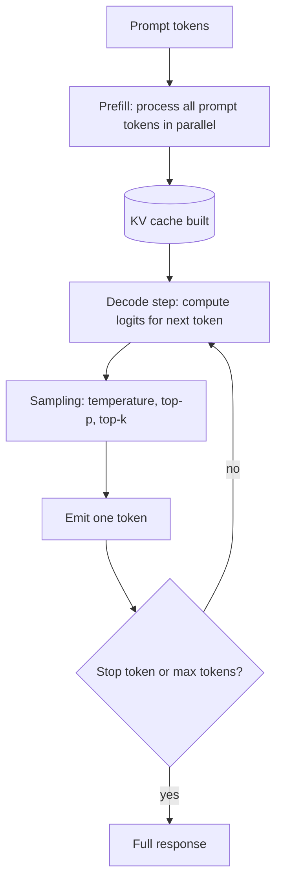

---

### ❓ What is self-attention and why does it matter?
**Answer:**
Each token builds a **query**, **key**, and **value** vector. Attention scores measure how much each token should use information from every other token: `softmax(QKᵀ / √d) V`. Because every token can look at every other token, the model captures long-range dependencies. The cost is O(n²) in sequence length for the attention matrix, which is why long contexts are expensive.

Interview-level points:
- **Multi-head attention** runs several attention patterns in parallel.
- **Positional encodings** (RoPE is common today) tell the model token order.
- **Grouped-query attention (GQA)** shares keys/values across heads to shrink the KV cache.

---

## 2. Tokens, Context Windows & Long-Context Limits

### ❓ What is a token, and why do token counts matter?
**Answer:**
A token is a subword unit produced by a tokenizer (BPE-style). Roughly, 1 token ≈ 4 English characters or ¾ of a word, but this varies by language and code. Tokens drive:
- **Cost**: providers bill input and output tokens separately.
- **Latency**: more output tokens = longer generation.
- **Limits**: the context window is a hard cap on prompt + output tokens combined.

Always count tokens with the model's own tokenizer (for example `tiktoken` for OpenAI models) rather than estimating.

---

### ❓ A model advertises a 1M-token context. Should you put everything in the prompt?
**Answer:**
Not blindly. Research and practitioner reports describe:
- **Lost in the middle**: models recall information at the start and end of long contexts better than information in the middle.
- **Context rot**: accuracy and instruction-following often degrade as input length grows, even when the model technically accepts it.
- **Cost and latency**: long prompts are expensive; prompt caching helps only for repeated prefixes.

Good practice: send only the relevant context (RAG or summarization), place critical instructions and data near the start or end, and **measure** quality at the context lengths you actually use.

---

## 3. Sampling Parameters

### ❓ What do temperature, top-p, and top-k control?
**Answer:**
| Parameter | Effect | Typical use |
|---|---|---|
| `temperature` | Scales logits before softmax; higher = more random | 0 to 0.3 for extraction and code; 0.7 to 1.0 for creative text |
| `top_p` (nucleus) | Sample only from the smallest token set whose cumulative probability ≥ p | Alternative to temperature; often tune one, not both |
| `top_k` | Sample only from the k most likely tokens | Common in open-source model APIs |
| `max_tokens` | Hard cap on output length | Cost and runaway-generation control |
| `seed` | Best-effort reproducibility | Testing; not guaranteed deterministic |

**Interview point:** Temperature 0 does **not** guarantee identical outputs across runs or model versions. Treat outputs as distributions and evaluate them statistically.

---

## 4. Reasoning Models & Test-Time Compute

### ❓ What are reasoning models and when do they help?
**Answer:**
Reasoning models (for example OpenAI's o-series and models with extended thinking such as Claude's extended-thinking mode, DeepSeek-R1, and Gemini thinking variants) spend extra tokens on an internal chain of reasoning before answering. This is **test-time compute**: more compute at inference buys accuracy on math, code, multi-step planning, and hard analysis.

Trade-offs:
- Higher **latency** and **cost** (thinking tokens are billed).
- Overkill for simple extraction, classification, or chat.
- Some providers hide the reasoning trace; others return a summary.

**Rule of thumb:** use a fast, cheap model by default; route only hard tasks to a reasoning model (see routing in section 24).

### 📊 Diagram — Model routing by difficulty

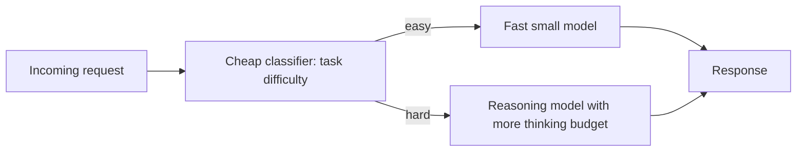

---

## Part B — Prompting & Structured Output

## 5. Prompt Engineering Essentials

### ❓ What makes a good production prompt?
**Answer:**
Structure every production prompt with clear sections:
1. **Role and goal**: what the model is and what success looks like.
2. **Context**: retrieved documents, user data, constraints. Delimit clearly (XML tags or markdown headers).
3. **Instructions**: numbered, specific, testable rules.
4. **Output format**: schema, length, language, and what to do when information is missing.
5. **Examples (few-shot)**: 2 to 5 diverse examples, especially for formats and edge cases.

```text
<role>You are a support assistant for Acme Cloud.</role>
<context>
{retrieved_passages}
</context>
<rules>
1. Answer only from <context>. If the answer is absent, say "I don't know" and offer to create a ticket.
2. Cite the source id for every claim, like [doc-12].
3. Keep the answer under 120 words.
</rules>
<question>{user_question}</question>
```

### ❓ What techniques improve reasoning in prompts?
**Answer:**
- **Chain-of-thought (CoT)**: ask for step-by-step reasoning. For reasoning models, the model already thinks internally, so explicit CoT is often unnecessary.
- **Self-consistency**: sample several answers and take the majority.
- **Decomposition**: split a big task into sub-prompts (prompt chaining).
- **Self-critique / reflection**: a second pass that checks the first answer against rules.
- **Prompt injection hardening**: explicitly tell the model that retrieved text is data, not instructions (see section 25).

**Interview point:** Prompts are code. Version them, test them with an eval set, and roll them out like any other change.

---

## 6. Structured Output & Function Calling

### ❓ How do you get reliable JSON or typed output from an LLM?
**Answer:**
Use the strongest mechanism available, in this order:
1. **Native structured outputs** (JSON schema constrained decoding offered by providers). The output is guaranteed to parse against the schema.
2. **Function / tool calling** with a JSON schema for arguments.
3. **Prompted JSON + validation** with Pydantic, retrying with the validation error on failure.

```python
from pydantic import BaseModel, Field, ValidationError
from typing import Literal

class Ticket(BaseModel):
    title: str = Field(min_length=5)
    severity: Literal["low", "medium", "high", "critical"]
    component: str

def parse_with_retry(llm_call, prompt, max_attempts=3):
    last_error = None
    for _ in range(max_attempts):
        raw = llm_call(prompt if last_error is None
                       else f"{prompt}\n\nPrevious output was invalid: {last_error}. Return valid JSON only.")
        try:
            return Ticket.model_validate_json(raw)
        except ValidationError as e:
            last_error = str(e)
    raise ValueError(f"Could not parse output after {max_attempts} attempts: {last_error}")
```

### 📊 Diagram — Structured output with validation and retry

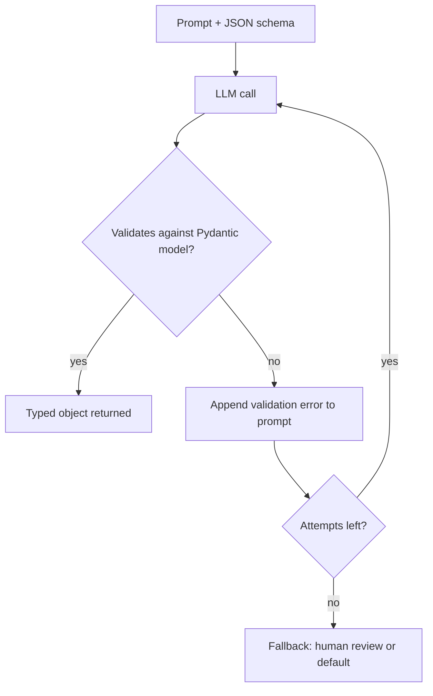

---

## Part C — Retrieval-Augmented Generation (RAG)

## 7. Embeddings & Similarity

### ❓ What are embeddings and how is similarity measured?
**Answer:**
An embedding model maps text to a dense vector so that semantically similar texts are close together. Common similarity measures:
- **Cosine similarity**: angle between vectors. Most common for text embeddings. Equivalent to dot product when vectors are L2-normalized.
- **Dot product**: fast; requires normalization or model-specific training assumptions.
- **Euclidean (L2) distance**: used by some indexes; for normalized vectors it ranks the same as cosine.

```python
import numpy as np

def top_k_cosine(query_vec, doc_vecs, k=3):
    q = query_vec / np.linalg.norm(query_vec)
    d = doc_vecs / np.linalg.norm(doc_vecs, axis=1, keepdims=True)
    scores = d @ q
    idx = np.argsort(-scores)[:k]
    return idx, scores[idx]
```

**Choosing an embedding model:** check MTEB (or domain benchmarks), dimension size (storage and speed), max input length, language coverage, cost, and whether you can self-host. Always test on **your** data.

**Critical rule:** queries and documents must use the **same** embedding model. Changing models means re-embedding the whole corpus.

---

## 8. Chunking & Ingestion

### ❓ How do you chunk documents for RAG?
**Answer:**
| Strategy | How | When |
|---|---|---|
| Fixed-size with overlap | 500 to 1000 tokens, 10 to 20% overlap | Simple baseline |
| Recursive / structural | Split on headings, paragraphs, then sentences | Most prose and markdown |
| Semantic | Split where embedding similarity between sentences drops | Mixed-topic documents |
| Document-aware | Keep tables, code blocks, and list items intact | PDFs, reports, API docs |
| Parent-child (small-to-big) | Index small chunks, return their larger parent section | When precise matching needs wider context |

**Metadata matters:** store source id, title, section path, date, version, tenant id, and access-control labels with every chunk. Filters on metadata are often the biggest precision win.

### 📊 Diagram — Ingestion pipeline

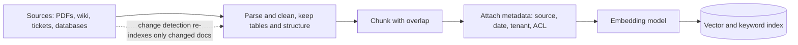

---

## 9. Retrieval: Dense, Sparse, Hybrid, Reranking

### ❓ What is the difference between dense and sparse retrieval?
**Answer:**
- **Dense (vector) retrieval**: finds semantically similar text, even with different wording. Weak on exact tokens such as product codes, error IDs, and names.
- **Sparse (lexical) retrieval**: BM25 or TF-IDF scores exact term overlap. Strong on exact identifiers, weak on paraphrase.
- **Hybrid retrieval**: run both and fuse the rankings. This is the common production default.

### ❓ How does Reciprocal Rank Fusion (RRF) combine rankings?
**Answer:**
RRF scores each document by summing `1 / (k + rank)` across the result lists it appears in, with `k` typically 60. It needs no score normalization between BM25 and cosine scores, which is why it's popular.

```python
def rrf(rankings: list[list[str]], k: int = 60) -> list[str]:
    scores: dict[str, float] = {}
    for ranked in rankings:
        for rank, doc_id in enumerate(ranked, start=1):
            scores[doc_id] = scores.get(doc_id, 0.0) + 1.0 / (k + rank)
    return sorted(scores, key=scores.get, reverse=True)

dense = ["d3", "d1", "d7"]
sparse = ["d1", "d9", "d3"]
rrf([dense, sparse])   # d1 and d3 rise to the top
```

### 📊 Diagram — Hybrid retrieval with reranking

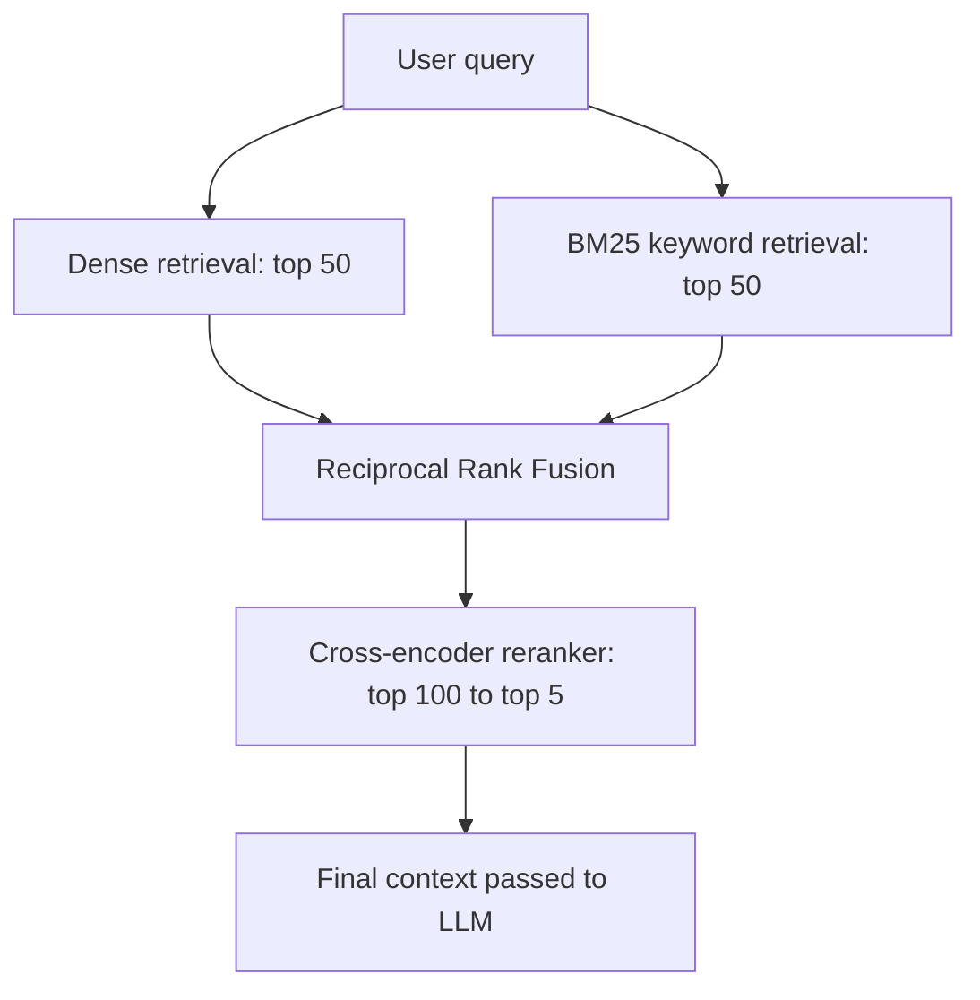

### ❓ Why use a reranker, and what does it cost?
**Answer:**
Retrieval uses bi-encoders (query and document embedded separately), which are fast but approximate. A **cross-encoder reranker** reads query and candidate together and scores relevance much more accurately, but it is slower, so you apply it only to the top 20 to 100 candidates. Measure the gain on your eval set (recall@k and answer quality) against the added latency.

---

## 10. Vector Databases & ANN Indexes

### ❓ How do approximate nearest neighbor (ANN) indexes work?
**Answer:**
Exact search compares the query to every vector (O(n)). ANN indexes trade a small amount of recall for large speedups.
- **HNSW (Hierarchical Navigable Small World)**: a multi-layer proximity graph. Most popular in 2026. Key knobs: `M` (graph connectivity, memory), `efConstruction` (build quality), `efSearch` (query-time recall vs latency).
- **IVF (inverted file)**: clusters vectors; the query searches only the nearest clusters (`nprobe`). Often combined with **PQ (product quantization)** to compress vectors.
- **Flat (brute force)**: exact; fine for small corpora or as a recall baseline.

### ❓ How do you pick a vector store?
**Answer:**
| Option | Fits when |
|---|---|
| **pgvector** (Postgres) | You already run Postgres; corpus up to tens of millions of vectors; you want transactions and joins with relational data |
| **Dedicated services** (Pinecone, Qdrant, Weaviate, Milvus, Vespa) | Very large scale, managed operations, advanced filtering or hybrid search |
| **Local libraries** (FAISS, Chroma, LanceDB) | Prototypes, offline batch jobs, edge deployments |
| **Search engines** (Elasticsearch / OpenSearch) | You need mature keyword search plus vector search in one system |

Evaluate on: recall at your latency target, filtered-search performance (tenant and ACL filters), write throughput for re-indexing, backup and multi-region needs, and cost per million vectors.

---

## 11. Advanced RAG Patterns & Debugging

### ❓ Name common advanced RAG patterns.
**Answer:**
- **Query rewriting / multi-query**: an LLM rewrites the question or generates variants to improve recall.
- **HyDE**: generate a hypothetical answer, embed it, and retrieve with that vector.
- **Parent-child retrieval**: match small chunks, return larger parents.
- **Contextual retrieval**: prepend a short LLM-written context summary to each chunk before embedding, which reduces ambiguous chunks.
- **Agentic RAG**: an agent decides whether, what, and when to retrieve, and can iterate. Covered in section 12.
- **GraphRAG**: build a knowledge graph of entities and relations; useful for multi-hop questions over large corpora.

### ❓ An answer is wrong. How do you debug a RAG system?
**Answer:**
Split the problem first: **retrieval** or **generation**? Log for every query: the rewritten query, retrieved chunks with scores, the final prompt, and the answer. Then classify.

### 📊 Diagram — RAG debugging decision tree

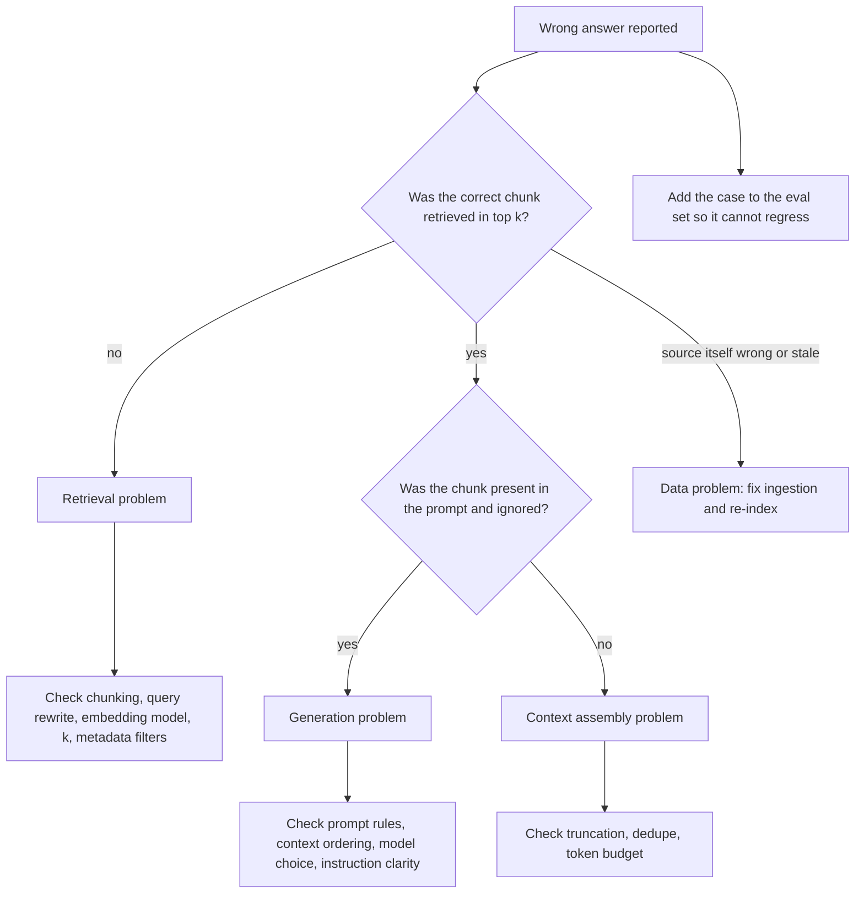

**Interview point:** the single most valuable habit in RAG debugging is inspecting retrieved chunks before touching the prompt. If the right passage is missing, no prompt will fix it.

---

## Part D — Agents, Tools, MCP & A2A

## 12. Workflows vs Agents

### ❓ What is the difference between a workflow and an agent?
**Answer:**
- **Workflow**: LLMs and tools are orchestrated through **predefined code paths**. The developer decides the steps.
- **Agent**: the LLM **dynamically decides** its next action and tool use in a loop until it reaches a goal or a limit.

Anthropic's guidance ("Building effective agents") describes common workflow patterns:
- **Prompt chaining**: sequential LLM calls, each consuming the previous output, with programmatic checks in between.
- **Routing**: classify the input and send it to a specialized prompt or model.
- **Parallelization**: run independent subtasks at the same time (sectioning) or run the same task several times for voting.
- **Orchestrator-workers**: a central LLM splits the task and delegates to worker LLMs.
- **Evaluator-optimizer**: one LLM generates, another critiques in a loop until a quality bar is met.

**Rule of thumb:** start with the simplest thing that works (often one well-prompted call with RAG). Add workflow structure, and only then autonomy, when measured results justify the extra latency and cost.

### 📊 Diagram — Common workflow patterns

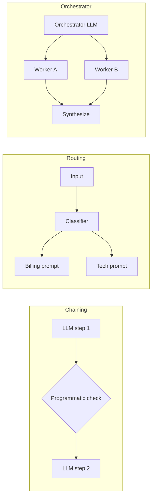

---

## 13. Tool Design & the Agent Loop

### ❓ Describe the basic agent loop and its stop conditions.
**Answer:**
The model receives the goal and tool schemas, then either calls a tool or answers. Your code executes the tool, appends the observation to the context, and repeats. A production loop **must** have explicit stop conditions, not just "until the model says it is done."

### 📊 Diagram — Agent loop with guardrails

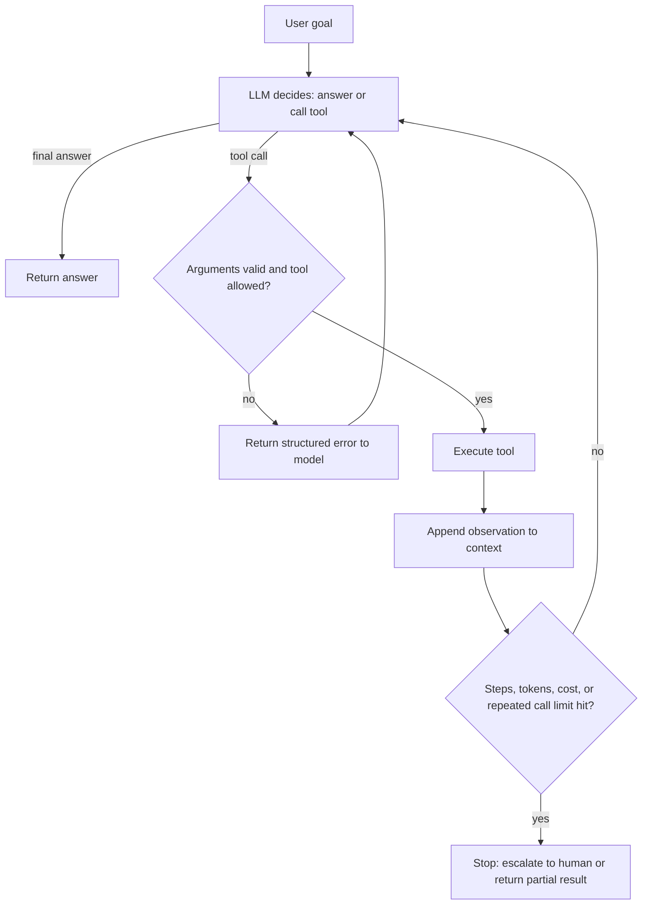

### ❓ How do you design good tools for an agent?
**Answer:**
Treat tools as an **agent-computer interface (ACI)**, and invest in it as much as in prompts:
- **Clear names and descriptions** with when-to-use and when-not-to-use guidance.
- **Few, well-scoped tools**. Overlapping tools confuse the model.
- **Typed, minimal arguments**. Prefer enums and IDs over free text when possible.
- **Token-efficient outputs**. Return concise, relevant fields; paginate large results.
- **Structured errors** the model can act on ("order not found; try order_id format ORD-123").
- **Idempotency** for side effects. Use idempotency keys so a retry never charges twice.
- **Least privilege**. Read-only by default; writes require confirmation or a human approval step.

### ❓ A tool call fails or returns bad data. What should happen?
**Answer:**
1. Validate the tool arguments and output against a schema before feeding them back.
2. Return a **structured error** to the model so it can correct the call.
3. Retry **only idempotent** operations, with exponential backoff and jitter, capped at a small number of attempts.
4. If repeated attempts fail, fall back (cached data, simpler tool) or escalate to a human.

Error compounding is the central reliability problem for agents: if each step is 95% reliable, a 10-step task succeeds only about 60% of the time (0.95¹⁰ ≈ 0.60). This is why short workflows with checks beat long autonomous loops for most products.

---

## 14. Model Context Protocol (MCP)

### ❓ What is MCP and why does it matter?
**Answer:**
The **Model Context Protocol** is an open protocol, introduced by Anthropic in late 2024, that standardizes how LLM applications connect to external **data sources and tools**. Instead of writing one custom integration per model and per tool pair, a tool implements one MCP server, and any MCP-capable client can use it.

Current spec: the **2025-11-25** revision is the latest stable release at the time of writing. The previous stable version is **2025-06-18**. Key additions since 2025-06-18 include OpenID Connect discovery, icons metadata, URL-mode elicitation, sampling with tool calling, and experimental Tasks support. Notable 2025-06-18 changes include removed JSON-RPC batching, structured tool output, and resource links.

### 📊 Diagram — MCP architecture

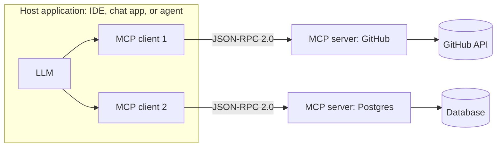

### ❓ What are the server features and client features in MCP?
**Answer:**
| Side | Feature | Purpose |
|---|---|---|
| Server | **Tools** | Functions the model can execute (`tools/list`, `tools/call`) |
| Server | **Resources** | Context data identified by URI (`resources/list`, `resources/read`) |
| Server | **Prompts** | Reusable prompt templates the user can invoke (`prompts/list`, `prompts/get`) |
| Client | **Sampling** | Server asks the client's LLM to generate, without holding API keys |
| Client | **Roots** | Server learns which filesystem or URI boundaries it may operate in |
| Client | **Elicitation** | Server asks the user for more input in a structured way |

**Transports:** stdio for local servers; Streamable HTTP for remote servers. Authorization for HTTP transports follows OAuth 2.1 style flows, with protected resource metadata.

### ❓ Show a minimal MCP server in Python.
**Answer:**
```python
# pip install mcp  (official Python SDK; FastMCP helper)
from mcp.server.fastmcp import FastMCP

mcp = FastMCP("demo-tools")

@mcp.tool()
def add(a: int, b: int) -> int:
    """Add two integers and return the sum."""
    return a + b

@mcp.resource("notes://{topic}")
def read_note(topic: str) -> str:
    """Return the note text for a topic."""
    return f"Notes about {topic}"

if __name__ == "__main__":
    mcp.run()   # stdio transport by default
```

**Interview points:**
- Tool descriptions and schemas are what the model reads. Write them as carefully as prompts.
- MCP servers run with the permissions you grant them. Treat tool outputs as **untrusted** input to the model (prompt injection risk, section 25).
- MCP standardizes the connection; it does not make a bad tool safe.

---

## 15. Agent-to-Agent Protocol (A2A)

### ❓ How is A2A different from MCP?
**Answer:**
- **MCP** connects an agent to **tools, data, and resources**. It is agent-to-tool.
- **A2A** lets independent **agents** discover each other and collaborate on tasks, even across vendors and frameworks. It is agent-to-agent.

Google announced A2A in April 2025 with more than 50 launch partners. It was later donated to the Linux Foundation, and the project's spec repository now lists version 1.0.0 as latest. Verify the current version before quoting it.

Core A2A concepts:
- **Agent Card**: a JSON capability description published by an agent (discovery).
- **Task**: a unit of work with a lifecycle, which can be long-running or human-in-the-loop.
- **Messages and artifacts**: content exchanged during a task.
- **Transport**: JSON-RPC 2.0 over HTTP(S), with streaming via Server-Sent Events and push notifications for long tasks. Security builds on standard web authentication.

### 📊 Diagram — MCP and A2A together

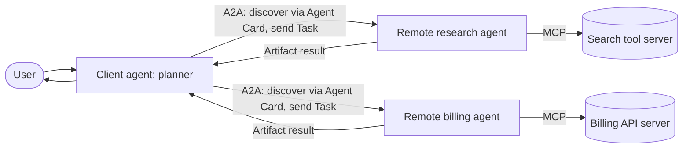

---

## 16. Agent Memory & State

### ❓ How do LLM applications handle memory?
**Answer:**
The LLM is stateless. Memory is something **your system** provides:
- **Short-term (working) memory**: the conversation messages in the current context, often trimmed or summarized to fit the window.
- **Long-term episodic memory**: summaries or key facts saved per user and reloaded in later sessions.
- **Semantic memory**: facts or documents retrieved by similarity (a RAG store over user data).
- **Procedural memory**: prompts, tool instructions, and learned workflows stored as versioned artifacts.

**Trade-offs:** full-history memory is simple but costly; summary memory is cheap but lossy; vector memory scales but can retrieve stale or conflicting facts. Store timestamps and provenance so the agent can prefer recent, trusted facts.

**Durable state:** for long-running agents, persist the workflow state after each step (checkpointing) so work survives crashes and human-approval pauses. LangGraph checkpointers and similar patterns do this.

---

## Part E — Evaluation & Observability

## 17. Evaluation Strategy: The Eval Pyramid

### ❓ How do you evaluate an LLM feature? What is the eval pyramid?
**Answer:**
Evaluation is now a core AI-engineer skill: a 2026 analysis of AI-engineer job descriptions found evals mentioned in more than half of postings. Build evals in layers:

- **Unit evals (deterministic)**: schema validity, regex and format checks, tool-argument validity, forbidden-content checks. Cheap, run on every commit.
- **Component evals**: retrieval recall@k, reranker quality, classifier accuracy against labeled data.
- **End-to-end task evals**: answer correctness against golden answers, rubric-based scoring, often with LLM-as-judge.
- **Online evals**: production metrics, user feedback, A/B tests, and sampled human review.

### 📊 Diagram — The eval pyramid

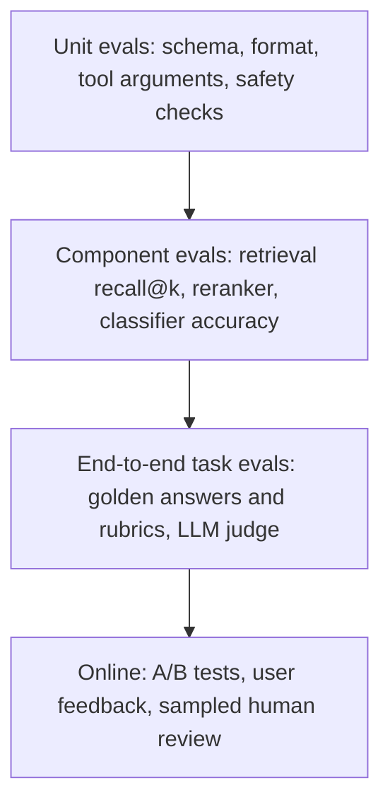

### ❓ How do you build an eval set with no data?
**Answer:**
1. Start with 20 to 50 realistic inputs written by domain experts or sampled from logs.
2. For each, define the expected answer or a pass/fail rubric.
3. Include hard cases: ambiguous questions, missing information, adversarial inputs, and multi-language inputs.
4. Run the set on every prompt, model, or retrieval change; gate deploys on it.
5. Grow the set continuously from production failures and user complaints.

**Interview point:** "I tested it manually" is the weakest possible answer. Name the dataset size, the scoring method, and the regression gate.

---

## 18. RAG Evaluation Metrics (RAGAS)

### ❓ Which metrics do you use to evaluate a RAG system?
**Answer:**
Evaluate **retrieval** and **generation** separately so you know which component to fix. RAGAS defines the widely used core metrics:

| Metric | Component | Question it answers | Needs reference answer? |
|---|---|---|---|
| **Context recall** | Retrieval | Does the retrieved context contain the information needed for the reference answer? | Yes |
| **Context precision** | Retrieval | Are the relevant chunks ranked above irrelevant ones? | Yes (or judged relevance) |
| **Faithfulness** | Generation | Are all claims in the answer supported by the retrieved context? | No |
| **Answer relevancy** | Generation | Does the answer actually address the question? | No |
| **Factual correctness** | End-to-end | Do the answer's claims match the reference answer? | Yes |

**How they're computed (RAGAS style):**
- **Faithfulness**: the LLM splits the answer into claims, checks each against the context, and reports the supported fraction.
- **Context recall**: the reference answer is split into sentences; the score is the fraction attributable to the retrieved context.
- **Context precision**: each retrieved chunk is judged relevant or not; the score rewards relevant chunks appearing early (rank-weighted precision).
- **Answer relevancy**: the answer is compared to generated questions via embedding similarity, penalizing evasive or off-topic answers.

Recent RAGAS releases (v0.4 and later) use class-based metric implementations; check the current API before writing code.

### 📊 Diagram — Mapping failures to metrics

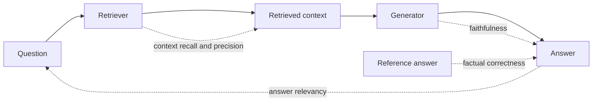

### ❓ Show a RAG evaluation loop in Python.
**Answer:**
```python
# Sketch using RAGAS-style metrics. Check the installed version's API names.
from datasets import Dataset
from ragas import evaluate
from ragas.metrics import faithfulness, answer_relevancy, context_precision, context_recall

eval_rows = {
    "question": ["How long do refunds take?"],
    "answer": [rag_chain.invoke("How long do refunds take?")],   # your pipeline
    "contexts": [[c.page_content for c in retriever.invoke("How long do refunds take?")]],
    "ground_truth": ["Refunds are processed within 5 business days."],
}
result = evaluate(
    Dataset.from_dict(eval_rows),
    metrics=[faithfulness, answer_relevancy, context_precision, context_recall],
)
print(result)   # per-metric scores; fail the build below your thresholds
```

**Interview point:** a drop in faithfulness with stable recall means the **generator** started ignoring context. A drop in recall means the **retriever** broke. Metrics are only useful if they point to a fix.

---

## 19. LLM-as-a-Judge

### ❓ When and how do you use an LLM as a judge?
**Answer:**
Use a strong model to grade outputs against a rubric when exact-match metrics cannot capture quality (tone, helpfulness, groundedness). Make it reliable:
- **Specific rubric** with score anchors (what a 1, 3, and 5 look like) instead of "rate quality 1 to 10."
- **Pairwise comparison** (A vs B) is often more reliable than absolute scores.
- **Structured output**: the judge returns a verdict plus a short justification, parsed by schema.
- **Calibrate against humans**: label 50 to 100 examples yourself and measure agreement (Cohen's kappa or simple accuracy). Iterate the rubric until agreement is acceptable.
- **Mitigate biases**: position bias (swap A and B), verbosity bias (penalize padding), self-preference (use a different model family as judge when possible).

```python
from pydantic import BaseModel, Field
from typing import Literal

class Verdict(BaseModel):
    reasoning: str = Field(description="Two sentences referencing the rubric")
    label: Literal["pass", "fail"]

JUDGE_PROMPT = """You grade an answer for groundedness.
PASS only if every factual claim appears in CONTEXT. FAIL otherwise.
CONTEXT: {context}
ANSWER: {answer}
Return the verdict as JSON."""

def judge(llm_structured, context: str, answer: str) -> Verdict:
    return llm_structured.invoke(JUDGE_PROMPT.format(context=context, answer=answer))
```

### 📊 Diagram — Judge calibration loop

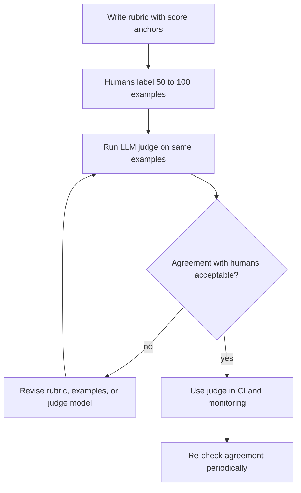

---

## 20. pass@k vs pass^k, Trajectory Evaluation & Production Monitoring

### ❓ What is the difference between pass@k and pass^k?
**Answer:**
For a stochastic agent run multiple times on the same task:
- **pass@k**: probability that **at least one** of k attempts succeeds. Useful when a human or verifier can pick the good output (code generation with tests).
- **pass^k**: probability that **all** k attempts succeed. Matters when every user request must work (customer-facing agents). A 90% single-run success rate can mean only about 73% pass^3 (0.9³ ≈ 0.73).

```python
from math import comb

def pass_at_k(n: int, c: int, k: int) -> float:
    """Unbiased estimator: n samples, c correct, estimate P(at least one of k is correct)."""
    if n - c < k:
        return 1.0
    return 1.0 - comb(n - c, k) / comb(n, k)

def pass_pow_k(p_single: float, k: int) -> float:
    return p_single ** k
```

### ❓ What is trajectory evaluation for agents?
**Answer:**
Outcome evaluation checks only the final answer. Trajectory evaluation also checks the path: Did the agent call the right tools, with valid arguments, in a reasonable number of steps? Did it avoid forbidden actions? Trajectory checks catch "right answer by luck" and expensive, looping behavior that outcome metrics miss.

### ❓ What do you monitor in production?
**Answer:**
- **Quality**: sampled judge scores, thumbs up/down, escalation and deflection rates, hallucination flags.
- **Operations**: latency (p50, p95), TTFT, error and timeout rates, tool-call failure rates, retries.
- **Cost**: tokens per request, cost per successful task, cache hit rate.
- **Safety**: guardrail trips, prompt-injection detections, PII leaks.
- **Drift**: changes in input distribution, retrieval score distributions, and judge scores after a model-version change (silent regressions).

Tracing tools (LangSmith, Langfuse, Arize Phoenix, OpenTelemetry-based pipelines) record each prompt, retrieval, tool call, and token count so you can debug a single bad trace.

---

## Part F — Model Adaptation

## 21. Prompting vs RAG vs Fine-Tuning

### ❓ When do you use prompting, RAG, or fine-tuning?
**Answer:**
| Need | Best first choice | Why |
|---|---|---|
| Behavior, tone, or output format | Prompting, then fine-tuning if needed | Cheap to change; fine-tuning fixes consistent format at scale |
| Fresh or private knowledge | RAG | Knowledge stays updatable and citable; no retraining |
| Domain jargon and style at high volume | Fine-tuning (often LoRA) | Shorter prompts, lower latency and cost per call |
| Strict structured output | Native structured output, then fine-tuning | Reliability without retries |
| Lower cost by using a smaller model | Distillation: fine-tune a small model on a strong model's outputs | Keeps quality for a narrow task |

**Key interview line:** "RAG for knowledge, fine-tuning for behavior. Start with prompting and an eval set; add RAG for facts; fine-tune only when the eval shows a consistent gap that prompting cannot close."

### 📊 Diagram — Decision flow

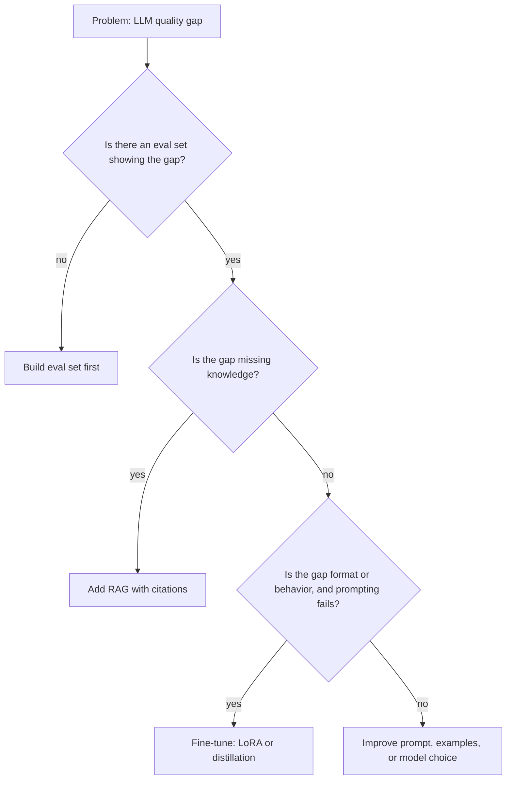

---

## 22. Fine-Tuning Methods: LoRA, QLoRA, DPO, GRPO

### ❓ What is LoRA and why is it popular?
**Answer:**
**LoRA (Low-Rank Adaptation)** freezes the base model weights and trains small low-rank matrices injected into attention (and sometimes MLP) layers. For a weight matrix W, the update is `W + BA`, where B and A have a small rank r. Benefits: far fewer trainable parameters, small adapter files, and easy swapping of adapters per task.

**QLoRA** quantizes the frozen base model to 4-bit and trains LoRA adapters on top, making fine-tuning large models feasible on a single GPU.

### ❓ What are preference-based methods: RLHF, DPO, and GRPO?
**Answer:**
- **RLHF**: train a reward model from human preferences, then optimize the policy with reinforcement learning (for example PPO). Powerful but complex and unstable.
- **DPO (Direct Preference Optimization)**: optimizes directly on preference pairs (chosen vs rejected) with a classification-style loss, with no separate reward model or RL loop. Simpler and widely used.
- **GRPO (Group Relative Policy Optimization)**: samples a group of responses per prompt and uses their relative rewards as the baseline, avoiding a learned value model. Popularized by DeepSeek's reasoning training; often used with verifiable rewards (unit tests, math answer checks).

### 📊 Diagram — Fine-tuning pipeline

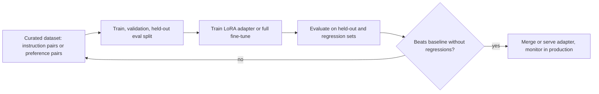

**Interview points:**
- Data quality beats data quantity. A few hundred clean, diverse examples often outperform thousands of noisy ones.
- Always keep a **held-out eval set** and a regression set; fine-tuning can damage general abilities (catastrophic forgetting).
- Fine-tuning changes model behavior, not reliable knowledge. For facts, use RAG.

---

## 23. Inference & Serving

### ❓ How do you serve LLMs efficiently?
**Answer:**
- **Batching**: continuous (in-flight) batching adds new requests to a running batch, raising GPU utilization.
- **PagedAttention** (vLLM): manages the KV cache in fixed-size blocks, cutting memory fragmentation and enabling more concurrent requests.
- **Quantization**: store weights in INT8 or INT4 (for example GPTQ or AWQ) to fit larger models and increase throughput, with a measurable quality cost to evaluate.
- **Speculative decoding**: a small draft model proposes several tokens that the large model verifies in one pass, cutting latency without changing the output distribution.
- **Prefix / prompt caching**: reuse the KV cache for shared system prompts and few-shot examples.
- **Streaming**: send tokens as they are generated to reduce perceived latency.

**Metrics to know:** TTFT (time to first token), TPOT or inter-token latency, throughput in tokens per second, and cost per million tokens.

---

## Part G — Production Engineering

## 24. LLMOps: Cost, Latency & Reliability

### ❓ How do you reduce LLM cost and latency without hurting quality?
**Answer:**
- **Route by difficulty**: small model for easy cases, large or reasoning model for hard ones (section 4).
- **Prompt caching**: keep the static prefix (system prompt, tool definitions, few-shot examples) first and identical so providers can cache it. Major providers offer prompt caching with discounted cached-input pricing; check current terms.
- **Exact and semantic caching**: cache full responses for identical requests; semantic caches reuse answers for near-duplicate queries, but carry a correctness risk, so set high similarity thresholds and monitor.
- **Shorter context**: rerank and trim retrieved context; summarize history.
- **Limit output**: `max_tokens`, concise format instructions.
- **Batch offline work**: use batch APIs for non-interactive jobs where available.
- **Stream** interactive responses.

### ❓ How do you make LLM calls reliable?
**Answer:**
- **Timeouts** on every call, with explicit budgets.
- **Retries** with exponential backoff and jitter for rate limits and transient errors only.
- **Fallback models** from a different provider when the primary is down (test that fallback passes the same eval set).
- **Circuit breakers** to stop hammering a failing provider.
- **Schema validation** on every output; treat parse failures as errors with a defined path.
- **Idempotency** for any tool with side effects.

```python
import random
import time

def call_with_backoff(fn, max_attempts: int = 4, base: float = 0.5, cap: float = 20.0):
    for attempt in range(max_attempts):
        try:
            return fn()
        except (TimeoutError, ConnectionError):   # retry transient errors only
            if attempt == max_attempts - 1:
                raise
            delay = min(cap, base * (2 ** attempt)) * random.uniform(0.5, 1.0)  # jitter
            time.sleep(delay)
```

### 📊 Diagram — Reliable LLM request path

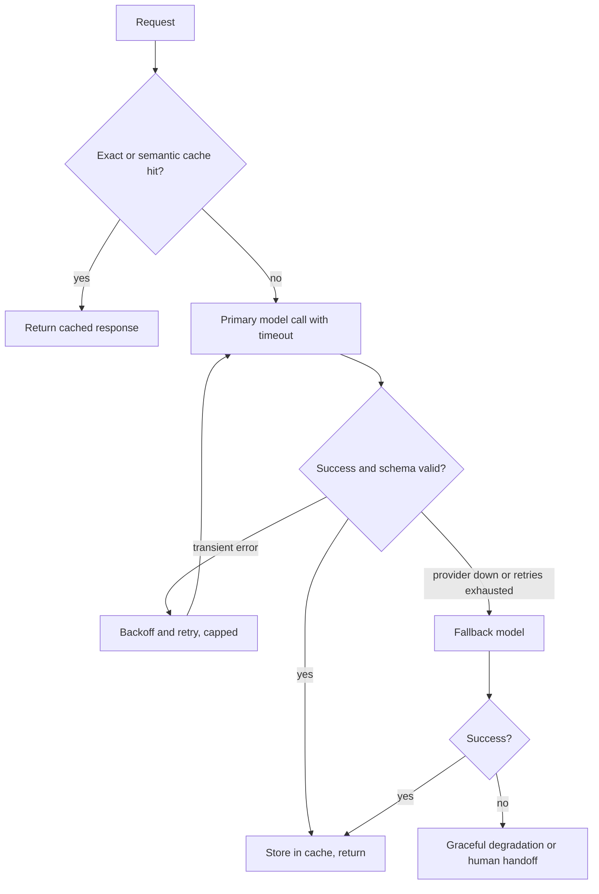

---

## 25. Security: OWASP Top 10 for LLM Applications (2025)

### ❓ What are the OWASP Top 10 risks for LLM applications in 2025?
**Answer:**
| ID | Risk | One-line mitigation |
|---|---|---|
| LLM01 | **Prompt Injection** (direct and indirect) | Treat all retrieved and tool text as data; least-privilege tools; output checks; human approval for sensitive actions |
| LLM02 | **Sensitive Information Disclosure** | Minimize data in prompts; redact PII; tenant-scoped retrieval |
| LLM03 | **Supply Chain** | Vet models, datasets, plugins, and MCP servers; pin versions |
| LLM04 | **Data and Model Poisoning** | Validate training and RAG ingestion sources; monitor for anomalies |
| LLM05 | **Improper Output Handling** | Treat LLM output as untrusted; escape before rendering, validate before executing |
| LLM06 | **Excessive Agency** | Minimize tool permissions and autonomy; require confirmation for writes |
| LLM07 | **System Prompt Leakage** | Do not rely on secrets in prompts; enforce security outside the model |
| LLM08 | **Vector and Embedding Weaknesses** | Enforce access control at retrieval time; validate ingested content |
| LLM09 | **Misinformation** | Grounding with citations, evals for faithfulness, human review for high stakes |
| LLM10 | **Unbounded Consumption** | Rate limits, token and cost budgets, timeouts, step limits |

### ❓ What is prompt injection and how do you defend against it?
**Answer:**
Prompt injection happens when untrusted input changes the model's behavior, overriding your instructions. It is **direct** (the user types it) or **indirect** (a web page, email, document, or tool output contains hidden instructions the model reads). OWASP ranks it first because LLMs process instructions and data in one token stream, so input filters alone cannot close it.

Defense in depth:
- **Separate data from instructions**: label retrieved content clearly and tell the model never to follow instructions inside it.
- **Least privilege**: each tool gets only the permissions it needs.
- **Limit exfiltration paths**: do not render arbitrary links or images from model output without checks.
- **Human approval** for irreversible or sensitive actions.
- **Classifiers and guardrails** as one layer, not the only layer.
- **Monitoring and red-teaming** with known attack suites.

Simon Willison's "lethal trifecta" names the dangerous combination: an agent with (1) access to private data, (2) exposure to untrusted content, and (3) a way to communicate externally. Remove at least one leg for any high-risk agent.

### 📊 Diagram — Defense layers for an agent

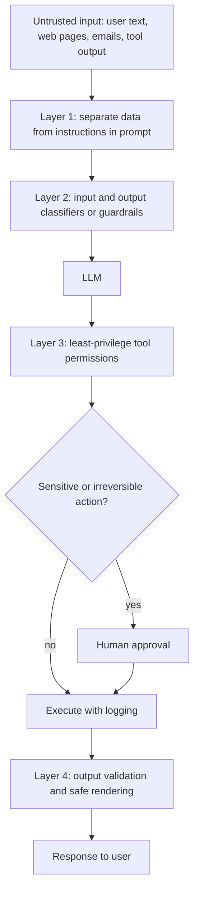

---

## Part H — Design, Coding & Revision

## 26. AI System Design Rubric

### ❓ How do you answer a "design an LLM system" question?
**Answer:**
Use one rubric every time. Interviewers grade structure first:

1. **Frame the problem**: users, volume, latency target, failure cost, data sensitivity, languages.
2. **Data and evaluation**: what data exists, how you will build the eval set, and the success metric.
3. **Retrieval or model choice**: RAG vs fine-tune vs prompt only; embedding model; index; reranker; or model routing.
4. **Serving and latency budget**: break down the target (for example 2 s total: 200 ms retrieval, 1.5 s generation, 100 ms overhead). Streaming, caching, and batching.
5. **Guardrails and security**: prompt injection defense, PII, access control on retrieval, output validation.
6. **Monitoring and cost**: traces, quality sampling, cost per task, drift alerts.
7. **Scaling and failure modes**: rate limits, fallbacks, re-indexing pipeline, multi-tenancy.

### 📊 Diagram — Rubric as a flow

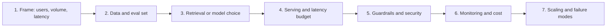

---

## 27. Worked System Designs

### ❓ Design a customer-support chatbot over company documentation.
**Answer:**
- **Frame**: 50k queries/day, p95 under 3 s, answers must cite sources, customers only see their own product docs.
- **Eval**: 300 labeled questions from ticket history; metrics: context recall, faithfulness, escalation rate.
- **Retrieval**: hybrid search (BM25 + dense) with tenant and product metadata filters; RRF fusion; cross-encoder rerank of top 50 to top 5.
- **Generation**: grounded prompt with citations; refuse and offer ticket creation when context is insufficient.
- **Latency budget**: retrieval under 300 ms, rerank under 200 ms, generation streamed; target first token under 1 s.
- **Guardrails**: PII redaction on input and output; tenant-scoped retrieval (never trust the model to choose the tenant).
- **Ops**: nightly incremental re-indexing on document change events; traces; sampled judge scores; cost dashboard.

### 📊 Diagram — Support chatbot architecture

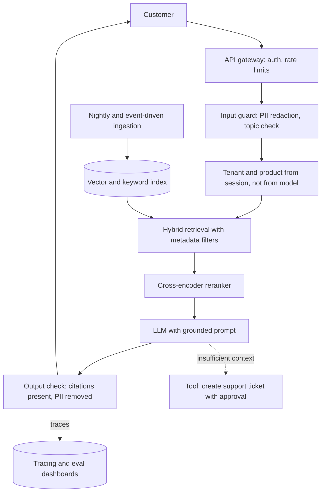

---

### ❓ Design an agent that reviews pull requests.
**Answer:**
- **Frame**: reviews every PR within 5 minutes; must not merge or push; comments only.
- **Architecture**: a workflow with an orchestrator and three workers: style and lint checker (deterministic tools first), security reviewer (LLM with SAST results), and test-coverage reviewer. Workers run in parallel; a synthesis step deduplicates comments.
- **Tools via MCP**: a read-only GitHub MCP server for diffs and files; a comment-posting tool restricted to a review draft that a human publishes.
- **Stop conditions**: max 15 tool calls per worker, token budget per PR, timeout 4 minutes.
- **Eval**: 100 historical PRs with known issues; measure precision of comments (humans accept or reject), recall of seeded bugs, and cost per review.
- **Security**: PR text and code comments are untrusted (indirect prompt injection); workers receive no secrets and cannot call write tools.

### 📊 Diagram — PR review agent

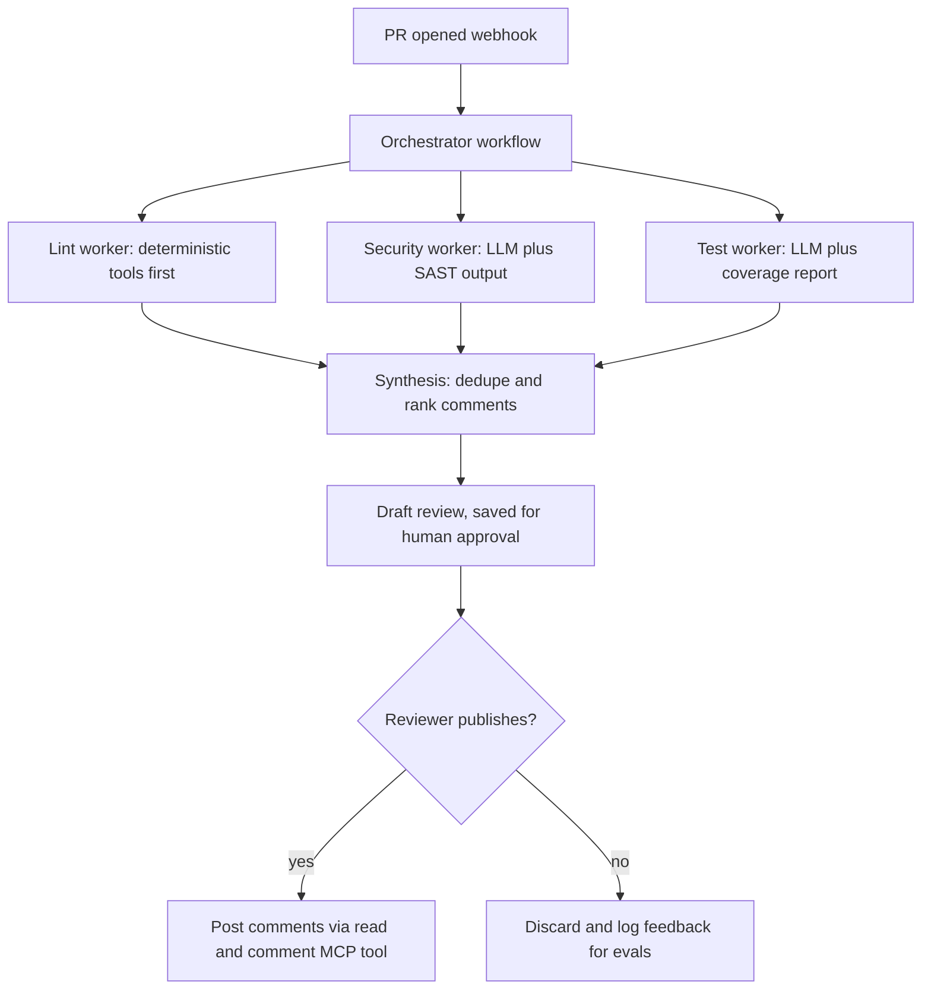

---

## 28. Hands-on Coding Scenarios

### ❓ Scenario 1: Build a small in-memory vector search with metadata filtering.
**Answer:**
```python
from dataclasses import dataclass
import numpy as np

@dataclass
class Doc:
    doc_id: str
    text: str
    vector: np.ndarray
    tenant: str

class VectorIndex:
    def __init__(self):
        self.docs: list[Doc] = []

    def add(self, doc: Doc) -> None:
        doc.vector = doc.vector / np.linalg.norm(doc.vector)   # normalize once at write time
        self.docs.append(doc)

    def search(self, query_vec: np.ndarray, tenant: str, k: int = 3) -> list[tuple[str, float]]:
        q = query_vec / np.linalg.norm(query_vec)
        candidates = [d for d in self.docs if d.tenant == tenant]   # filter before ranking
        scored = [(d.doc_id, float(d.vector @ q)) for d in candidates]
        return sorted(scored, key=lambda x: x[1], reverse=True)[:k]
```
**Discussion points:** normalization at write time makes search a dot product; the tenant filter must run **before** ranking to prevent leaks; a real index (HNSW) replaces the linear scan at scale.

---

### ❓ Scenario 2: Implement a retrieval recall@k metric.
**Answer:**
```python
def recall_at_k(retrieved_ids: list[str], relevant_ids: set[str], k: int) -> float:
    if not relevant_ids:
        return 0.0
    hits = len(set(retrieved_ids[:k]) & relevant_ids)
    return hits / len(relevant_ids)

def mean_reciprocal_rank(runs: list[tuple[list[str], set[str]]]) -> float:
    total = 0.0
    for retrieved, relevant in runs:
        for rank, doc_id in enumerate(retrieved, start=1):
            if doc_id in relevant:
                total += 1.0 / rank
                break
    return total / len(runs)
```

---

### ❓ Scenario 3: Write a guarded agent loop with a step budget and idempotent tool calls.
**Answer:**
```python
import json

MAX_STEPS = 8
seen_calls: set[str] = set()

def run_agent(llm_with_tools, tools: dict, messages: list, execute_tool):
    for step in range(MAX_STEPS):
        ai = llm_with_tools.invoke(messages)
        messages.append(ai)
        if not ai.tool_calls:
            return ai.content                       # final answer
        for call in ai.tool_calls:
            key = json.dumps({"name": call["name"], "args": call["args"]}, sort_keys=True)
            if key in seen_calls:                   # repeated-call detector
                result = {"error": "Duplicate call skipped; use the previous result."}
            elif call["name"] not in tools:         # allow-list check
                result = {"error": f"Unknown tool {call['name']}"}
            else:
                seen_calls.add(key)
                result = execute_tool(call["name"], call["args"])
            messages.append({"role": "tool", "tool_call_id": call["id"], "content": json.dumps(result)})
    return "Stopped: step budget exhausted. Escalating to a human."
```
**Discussion points:** the step budget and duplicate detector prevent runaway cost; the allow-list blocks hallucinated tool names; errors go back as data so the model can recover.

---

### ❓ Scenario 4: Compare two prompt versions on an eval set with a regression gate.
**Answer:**
```python
def evaluate_prompt(run_fn, dataset, scorer) -> float:
    scores = [scorer(item, run_fn(item["question"])) for item in dataset]
    return sum(scores) / len(scores)

def gate(baseline_score: float, candidate_score: float, min_gain: float = 0.0) -> bool:
    """Ship only if the candidate is not worse than baseline plus the required gain."""
    return candidate_score >= baseline_score + min_gain
```
**Discussion points:** use the same dataset and scorer for both versions; report confidence intervals for small sets; include a regression slice of previously failing cases.

---

## 29. Behavioral & Experience Questions

### ❓ "Walk me through an AI feature you shipped. What was the biggest production failure?"
**Answer structure:**
- **Problem and users**: one sentence on the business goal and volume.
- **Architecture**: retrieval or model choice and why; the eval method you used.
- **Metrics**: before and after numbers (quality, latency, cost). Use real figures.
- **Failure**: a specific incident, how you detected it (traces, user reports), root cause (retrieval, prompt, data), the fix, and the eval case you added.
- **Lesson**: what you changed in your process (eval gates, monitoring, guardrails).

Interviewers score specificity heavily. "I tested it manually" or "it worked well" earns little credit; numbers, incidents, and tradeoffs earn most of it.

### ❓ "How do you keep up with a field that changes every month?"
**Answer:** Name a concrete, repeatable routine: reading primary sources (provider changelogs, the MCP and A2A specs, model release notes), maintaining a personal eval set that you rerun on each new model, and building small prototypes to test claims. Interviewers want a method, not a list of blogs.

---

## 30. Quick Revision Checklist

| Area | Key points to remember |
|---|---|
| **Generation** | Prefill (TTFT) then decode (tokens/s); KV cache; attention is O(n²) |
| **Context** | Lost-in-the-middle; context rot; measure at the lengths you use |
| **Sampling** | Temperature 0 is not fully deterministic; tune temperature or top-p, not both |
| **Reasoning models** | Test-time compute; higher latency and cost; route only hard tasks |
| **Structured output** | Native schema > tool calling > prompted JSON + Pydantic retry |
| **Embeddings** | Cosine on normalized vectors; same model for query and docs; re-embed on model change |
| **Chunking** | Recursive or structural; overlap 10 to 20%; metadata and ACLs on every chunk |
| **Hybrid retrieval** | BM25 + dense fused with RRF (`1/(k+rank)`, k=60); rerank top 20 to 100 |
| **ANN indexes** | HNSW (M, efSearch); IVF + PQ; flat as baseline |
| **RAG debugging** | Retrieval or generation? Inspect chunks before the prompt |
| **Workflow vs agent** | Start with workflows; add autonomy only when measured value justifies cost |
| **Agent loop** | Stop conditions, allow-lists, duplicate detection, structured errors |
| **Error compounding** | 0.95 per step over 10 steps ≈ 60% success |
| **MCP (2025-11-25)** | Servers expose tools, resources, prompts; clients offer sampling, roots, elicitation; JSON-RPC 2.0 |
| **A2A** | Agent Cards for discovery; Tasks with lifecycle; complements MCP (agent-to-agent vs agent-to-tool) |
| **RAGAS metrics** | Faithfulness, answer relevancy, context precision, context recall, factual correctness |
| **Judges** | Rubric with anchors; calibrate against humans; swap A/B; structured verdicts |
| **pass@k vs pass^k** | At-least-one vs all-succeed; pass^k drops fast for customer-facing agents |
| **Trajectory eval** | Check tool choices and step counts, not only the final answer |
| **Prompt vs RAG vs FT** | Behavior → prompt or FT; knowledge → RAG; facts are not learned reliably by FT |
| **LoRA / QLoRA** | Low-rank adapters; 4-bit base for QLoRA |
| **DPO / GRPO** | DPO: preference pairs, no RL loop; GRPO: group-relative reward, good with verifiable rewards |
| **Serving** | Continuous batching, PagedAttention, quantization, speculative decoding, prefix caching |
| **Cost and latency** | Route by difficulty; stable prompt prefix; caching; trim context; cap output |
| **Reliability** | Timeouts, backoff with jitter on transient errors, fallback models, schema validation |
| **OWASP LLM 2025** | Prompt injection is #1; excessive agency; unbounded consumption; vector weaknesses |
| **Lethal trifecta** | Private data + untrusted content + external communication; break one leg |
| **System design** | Frame → data and eval → retrieval/model → latency budget → guardrails → monitoring → scaling |

---

## 31. Sources to Re-check Before Interviews

This guide was built from the following sources. Re-check versions and API names before the interview.

- **Model Context Protocol specification (latest stable 2025-11-25)**: https://modelcontextprotocol.io/specification/2025-11-25/index
- **A2A protocol documentation**: https://a2a-protocol.org/latest/ and the Google Developers announcement (April 2025): https://developers.googleblog.com/en/a2a-a-new-era-of-agent-interoperability/
- **OWASP Top 10 for LLM Applications 2025**: https://genai.owasp.org/llm-top-10/
- **RAGAS metric definitions** (faithfulness, answer relevancy, context precision, context recall, factual correctness): the RAGAS documentation site, since the library moved to class-based metrics in v0.4+.
- **2026 AI-engineer interview landscape** (role clusters and frequency of evals and agents in job postings): Dexity analysis, July 2026: https://dexity.com/intel/ai-engineer-interview-questions-2026
- **Agent design patterns (workflow vs agent)**: Anthropic, "Building effective agents": https://www.anthropic.com/engineering/building-effective-agents

