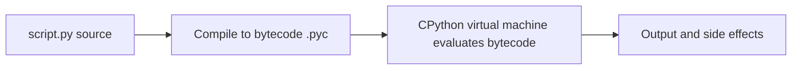
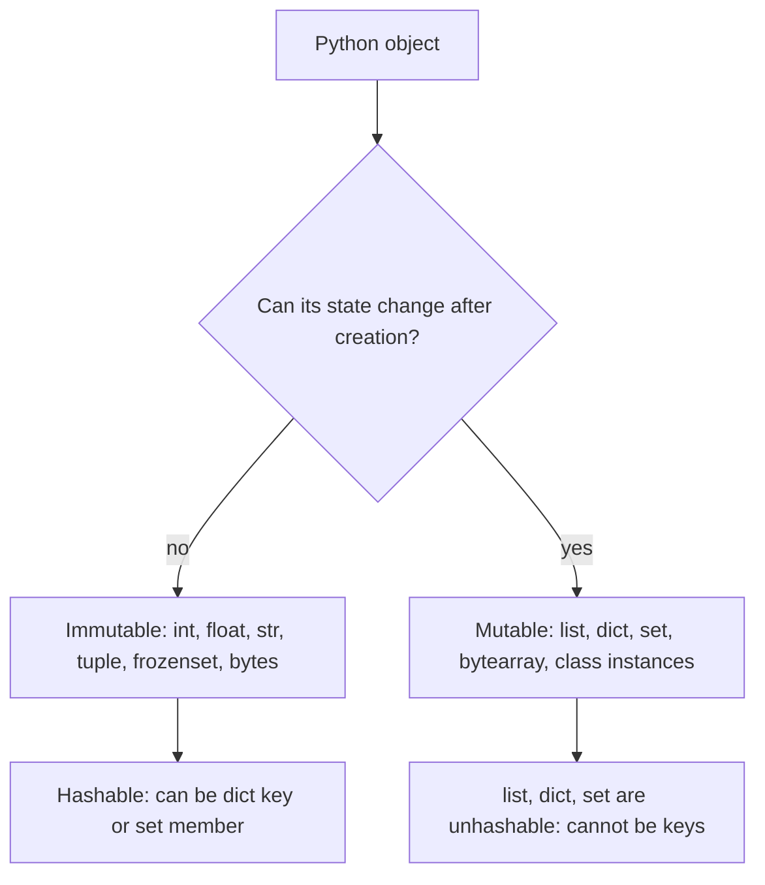
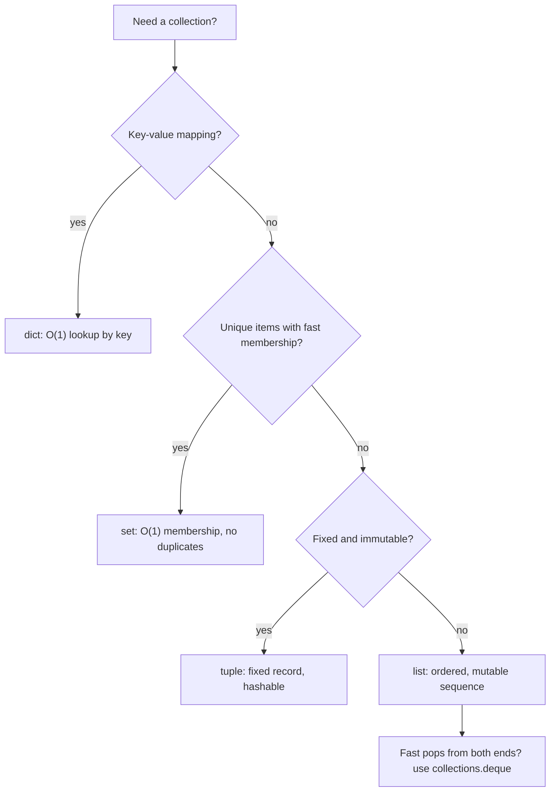
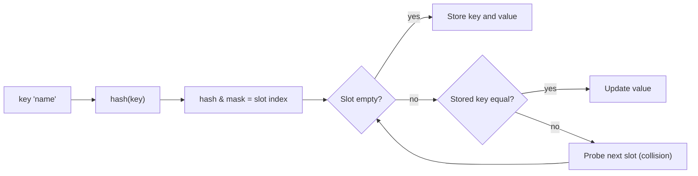
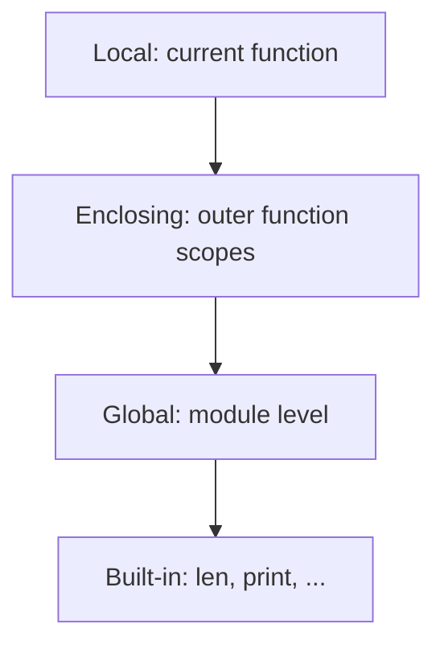
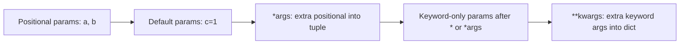
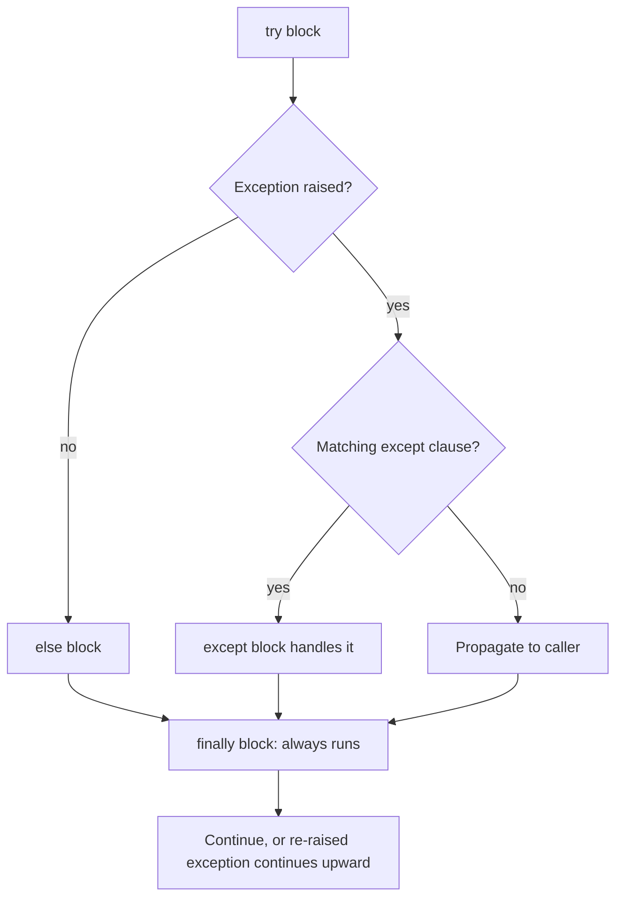
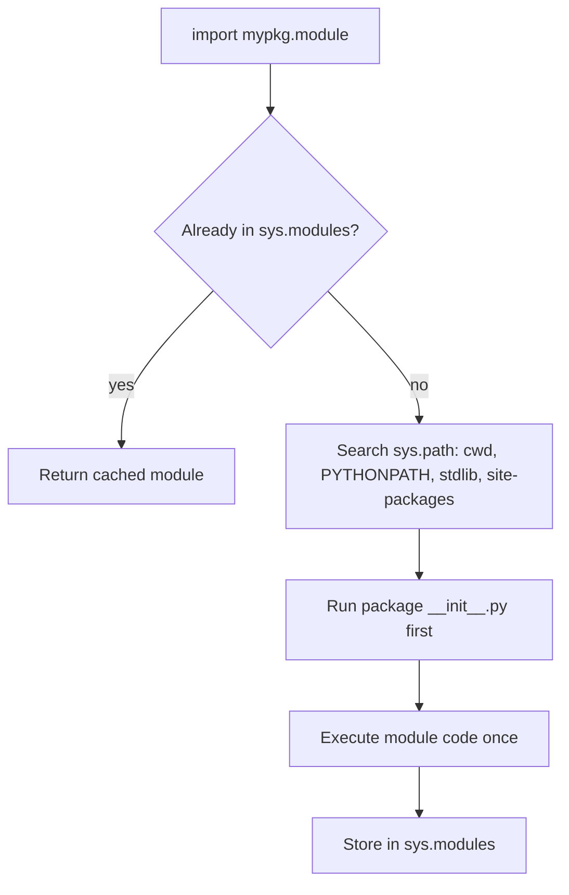

# 🐍 Python — Basics Interview Preparation Guide
**Coverage:** Python Syntax · Data Types · Collections · Functions · Built-ins · Comprehensions · Exception Handling  
**Use this file to:** Revise before any Python backend/data engineering interview

---

## Table of Contents
1. [Python Fundamentals](#1-python-fundamentals)
2. [Mutable vs Immutable](#2-mutable-vs-immutable)
3. [Built-in Data Types](#3-built-in-data-types)
4. [Lists](#4-lists)
5. [Tuples](#5-tuples)
6. [Sets](#6-sets)
7. [Dictionaries](#7-dictionaries)
8. [Strings](#8-strings)
9. [Functions](#9-functions)
10. [*args and **kwargs](#10-args-and-kwargs)
11. [Lambda, map, filter, zip](#11-lambda-map-filter-zip)
12. [Comprehensions](#12-comprehensions)
13. [Exception Handling](#13-exception-handling)
14. [Type Hints](#14-type-hints)
15. [Useful Built-in Functions](#15-useful-built-in-functions)
16. [Modules & Packages](#16-modules--packages)
17. [Advanced Data Structures, Files & Modern Syntax](#17-advanced-data-structures-files--modern-syntax)
18. [Quick Revision Checklist](#18-quick-revision-checklist)

---

## 1. Python Fundamentals

### 📊 Diagram — How Python runs your code



### ❓ What is Python? What makes it different from Java/C++?
> **Answer:**
> Python is a high-level, interpreted, dynamically typed, garbage-collected language with a strong emphasis on readability and developer productivity.
>
> Key differences:
> - **Interpreted**: No compilation step — code runs via the CPython interpreter line by line.
> - **Dynamically typed**: Variable types are resolved at runtime, not compile time. `x = 5; x = "hello"` is valid.
> - **GIL**: CPython has a Global Interpreter Lock — true parallel thread execution of Python bytecode is restricted (see Async file).
> - **Everything is an object**: Even functions and classes are first-class objects.
> - **Duck typing**: "If it walks like a duck and quacks like a duck, it's a duck." — the type doesn't matter, only the interface.

---

### ❓ What is the difference between `==` and `is`?
> **Answer:**
> - `==` checks **value equality** — do the two objects have the same value?
> - `is` checks **identity equality** — do the two variables point to the same object in memory?
>
> ```python
> a = [1, 2, 3]
> b = [1, 2, 3]
> a == b   # True  (same values)
> a is b   # False (different objects)
>
> c = a
> c is a   # True  (same object)
> ```
>
> **Gotcha:** CPython interns small integers (-5 to 256) and short strings, so `a = 5; b = 5; a is b` is `True` — but don't rely on this.

---

### ❓ How is Python memory managed?
> **Answer:**
> Python uses **reference counting** as the primary memory management mechanism. Every object has a counter of how many references point to it. When it hits 0, the memory is freed.
>
> **Cyclic GC**: Reference counting alone can't handle circular references (A → B → A). Python has a cyclic garbage collector (the `gc` module) that periodically detects and breaks cycles.
>
> **Private heap**: Python maintains its own private heap for object allocation, managed by `pymalloc`.

---

### ❓ What is PEP 8?
> **Answer:**
> PEP 8 is Python's official style guide. Key conventions:
> - 4 spaces for indentation (no tabs)
> - `snake_case` for variables and functions
> - `PascalCase` for class names
> - `UPPER_CASE` for constants
> - Max line length: 79 chars (79 for code, 72 for docstrings)
> - Two blank lines before/after top-level function/class definitions

---

## 2. Mutable vs Immutable

### 📊 Diagram — Mutability and hashability



### ❓ What is the difference between mutable and immutable objects?
> **Answer:**
> | Category | Types |
> |---|---|
> | **Immutable** | `int`, `float`, `bool`, `str`, `tuple`, `frozenset`, `bytes` |
> | **Mutable** | `list`, `dict`, `set`, `bytearray`, user-defined class instances |
>
> **Immutable** = the object's state cannot change after creation. Any "modification" creates a new object.
>
> ```python
> s = "hello"
> id_before = id(s)
> s += " world"
> id(s) == id_before  # False — new object created
> ```
>
> **Why it matters:**
> - Only immutable types can be used as **dictionary keys** or **set elements** (they must be hashable).
> - Immutable objects are **thread-safe** by default.
> - Mutable default arguments are a classic Python pitfall.

---

### ❓ Classic pitfall: mutable default argument
> **Answer:**
> ```python
> # BUG: the list is created ONCE at function definition time
> def append_to(element, to=[]):
>     to.append(element)
>     return to
>
> append_to(1)  # [1]
> append_to(2)  # [1, 2]  ← bug! shared across calls
>
> # FIX: use None as default
> def append_to(element, to=None):
>     if to is None:
>         to = []
>     to.append(element)
>     return to
> ```

---

## 3. Built-in Data Types

### 📊 Diagram — Choosing a collection



### ❓ What are the core built-in types in Python?
> **Answer:**
> | Type | Example | Mutable? | Ordered? | Duplicates? |
> |---|---|---|---|---|
> | `int` | `42` | No | — | — |
> | `float` | `3.14` | No | — | — |
> | `bool` | `True` | No | — | — |
> | `str` | `"hello"` | No | Yes | Yes |
> | `list` | `[1,2,3]` | Yes | Yes | Yes |
> | `tuple` | `(1,2,3)` | No | Yes | Yes |
> | `set` | `{1,2,3}` | Yes | No | No |
> | `frozenset` | `frozenset({1,2})` | No | No | No |
> | `dict` | `{"k":1}` | Yes | Yes (3.7+) | Keys: No |
> | `bytes` | `b"abc"` | No | Yes | Yes |
> | `bytearray` | `bytearray(b"abc")` | Yes | Yes | Yes |
> | `NoneType` | `None` | No | — | — |

---

## 4. Lists

### ❓ Key list operations and time complexities
> **Answer:**
> ```python
> lst = [3, 1, 4, 1, 5]
>
> lst.append(9)        # O(1) amortized
> lst.insert(2, 99)    # O(n) — shifts elements
> lst.pop()            # O(1) — remove last
> lst.pop(0)           # O(n) — remove first (shifts all)
> lst.remove(99)       # O(n) — finds first occurrence
> lst.index(4)         # O(n)
> lst.sort()           # O(n log n) — Timsort, in-place
> sorted(lst)          # O(n log n) — returns new list
> lst.reverse()        # O(n) — in-place
> len(lst)             # O(1)
> 4 in lst             # O(n)
> ```

---

### ❓ What is list slicing?
> **Answer:**
> `lst[start:stop:step]` — returns a **new list** (shallow copy).
> ```python
> lst = [0, 1, 2, 3, 4, 5]
> lst[1:4]    # [1, 2, 3]
> lst[::-1]   # [5, 4, 3, 2, 1, 0]  — reverse
> lst[::2]    # [0, 2, 4]  — every other
> lst[:]      # shallow copy of entire list
> ```

---

### ❓ Shallow copy vs deep copy
> **Answer:**
> ```python
> import copy
>
> original = [[1, 2], [3, 4]]
> shallow = original.copy()       # or original[:]
> deep    = copy.deepcopy(original)
>
> original[0].append(99)
> # shallow[0] → [1, 2, 99]  ← affected (inner list shared)
> # deep[0]    → [1, 2]      ← unaffected
> ```
> **Shallow copy**: copies the outer container, inner objects are still shared references.
> **Deep copy**: recursively copies all nested objects.

---

## 5. Tuples

### ❓ When should you use a tuple vs a list?
> **Answer:**
> - Use **tuple** when the data is **fixed/immutable** (e.g., coordinates, RGB values, DB row).
> - Use **list** when you need to **add/remove/modify** elements.
>
> Tuples are:
> - Faster to iterate (slightly) due to their fixed nature
> - Hashable (if all elements are hashable) → can be dict keys / set elements
> - Can be used for **tuple unpacking** / **multiple return values**
>
> ```python
> def min_max(lst):
>     return min(lst), max(lst)   # returns a tuple
>
> lo, hi = min_max([3, 1, 4, 1, 5])
> ```

---

### ❓ Named tuples
> **Answer:**
> ```python
> from collections import namedtuple
>
> Point = namedtuple('Point', ['x', 'y'])
> p = Point(3, 4)
> p.x  # 3
> p.y  # 4
> # Immutable, readable, memory-efficient vs a full class
> ```

---

## 6. Sets

### ❓ Key set operations
> **Answer:**
> ```python
> a = {1, 2, 3, 4}
> b = {3, 4, 5, 6}
>
> a | b   # union:        {1,2,3,4,5,6}
> a & b   # intersection: {3,4}
> a - b   # difference:   {1,2}
> a ^ b   # symmetric diff: {1,2,5,6}
>
> 3 in a  # O(1) — hash-based lookup
> a.add(7)
> a.discard(99)  # no error if absent
> a.remove(99)   # KeyError if absent
> ```
>
> **Use cases:**
> - Deduplication: `list(set(my_list))`
> - Fast membership tests (O(1) avg)
> - Set algebra for data comparisons

---

## 7. Dictionaries

### 📊 Diagram — Dict lookup with hashing and collisions



### ❓ How does a Python dict work internally?
> **Answer:**
> Python dicts are implemented as **hash tables**.
> - Keys are hashed using `hash()` → mapped to a bucket.
> - Collision resolution: **open addressing** with pseudo-random probing.
> - Average case: O(1) get/set/delete. Worst case (many collisions): O(n).
> - Since Python 3.7, dicts maintain **insertion order** (guaranteed by spec in 3.7+, implementation in 3.6+).

---

### ❓ Common dict patterns
> **Answer:**
> ```python
> d = {"a": 1, "b": 2}
>
> d.get("c", 0)         # safe get with default
> d.setdefault("c", 0)  # insert default if key missing
> d.update({"d": 4})    # merge
> {**d, "e": 5}         # merge via unpacking (Python 3.5+)
> d | {"f": 6}          # merge operator (Python 3.9+)
>
> # Iteration
> for k, v in d.items(): ...
> for k in d.keys(): ...
> for v in d.values(): ...
>
> # Dict comprehension
> squared = {x: x**2 for x in range(5)}
>
> # defaultdict — auto-initializes missing keys
> from collections import defaultdict
> freq = defaultdict(int)
> for ch in "hello":
>     freq[ch] += 1
>
> # Counter
> from collections import Counter
> c = Counter("aabbcc")
> c.most_common(2)  # [('a', 2), ('b', 2)]
>
> # OrderedDict (only needed pre-3.7 for ordered guarantee)
> from collections import OrderedDict
> ```

---

## 8. Strings

### ❓ Key string facts and methods
> **Answer:**
> Strings are **immutable** sequences of Unicode characters.
>
> ```python
> s = "Hello, World!"
>
> s.upper()           # "HELLO, WORLD!"
> s.lower()           # "hello, world!"
> s.strip()           # removes leading/trailing whitespace
> s.split(",")        # ['Hello', ' World!']
> ",".join(["a","b"]) # "a,b"
> s.replace("World", "Python")
> s.startswith("Hello")
> s.endswith("!")
> s.find("World")     # index or -1
> s.count("l")        # 3
>
> # f-strings (3.6+) — preferred
> name = "Alice"
> f"Hello, {name}!"
> f"{3.14159:.2f}"    # "3.14"
>
> # String formatting alternatives
> "Hello, {}!".format(name)
> "Hello, %s!" % name  # old style
> ```

---

### ❓ Why is string concatenation in a loop inefficient?
> **Answer:**
> Since strings are immutable, `s += "x"` creates a **new string** object on every iteration → O(n²) total work.
>
> **Fix:** Use `"".join(list_of_parts)`:
> ```python
> # Bad O(n^2)
> result = ""
> for word in words:
>     result += word
>
> # Good O(n)
> result = "".join(words)
> ```

---

## 9. Functions

### ❓ How are functions first-class objects in Python?
> **Answer:**
> Functions can be:
> - Assigned to variables
> - Passed as arguments
> - Returned from other functions
> - Stored in data structures
>
> ```python
> def greet(name):
>     return f"Hello, {name}"
>
> fn = greet          # assign
> fn("Alice")         # "Hello, Alice"
>
> def apply(func, value):
>     return func(value)
>
> apply(greet, "Bob") # pass as argument
> ```

---

### ❓ What is a closure?
> **Answer:**
> A closure is a function that **remembers variables from its enclosing scope** even after that scope has finished executing.
>
> ```python
> def make_multiplier(n):
>     def multiplier(x):
>         return x * n   # 'n' is captured from the enclosing scope
>     return multiplier
>
> double = make_multiplier(2)
> double(5)   # 10
> double(7)   # 14
> ```
>
> The inner function `multiplier` closes over `n` — this is a closure.
> Use `__closure__` to inspect: `double.__closure__[0].cell_contents` → 2

---

### ❓ What is the LEGB rule?
> **Answer:**
> Python resolves variable names in this order:
> - **L**ocal — inside the current function
> - **E**nclosing — outer function's scope (for nested functions)
> - **G**lobal — module-level scope
> - **B**uilt-in — Python's built-in namespace (`len`, `print`, etc.)
>
> ```python
> x = "global"
>
> def outer():
>     x = "enclosing"
>     def inner():
>         x = "local"
>         print(x)   # "local"
>     inner()
>     print(x)       # "enclosing"
>
> outer()
> print(x)           # "global"
> ```
>
> Use `global x` to modify global from inside function.
> Use `nonlocal x` to modify enclosing scope from nested function.

### 📊 Diagram — LEGB name resolution



---

## 10. *args and **kwargs

### 📊 Diagram — Parameter order in a function signature



### ❓ Explain *args and **kwargs with examples
> **Answer:**
> ```python
> # *args — collects positional arguments into a tuple
> def sum_all(*args):
>     return sum(args)
>
> sum_all(1, 2, 3, 4)  # 10
>
> # **kwargs — collects keyword arguments into a dict
> def print_info(**kwargs):
>     for k, v in kwargs.items():
>         print(f"{k}: {v}")
>
> print_info(name="Alice", age=30)
>
> # Combined — order matters: normal, *args, keyword-only, **kwargs
> def combined(a, b, *args, keyword_only=True, **kwargs):
>     pass
>
> # Unpacking at call site
> lst = [1, 2, 3]
> dct = {"name": "Alice", "age": 30}
> sum_all(*lst)           # unpacks list as positional args
> print_info(**dct)       # unpacks dict as keyword args
> ```

---

## 11. Lambda, map, filter, zip

### ❓ When to use lambda vs def?
> **Answer:**
> `lambda` creates an **anonymous function** for simple, one-expression use cases.
>
> ```python
> # Good use: sort key
> people = [{"name": "Bob", "age": 30}, {"name": "Alice", "age": 25}]
> sorted(people, key=lambda p: p["age"])
>
> # Avoid for complex logic — use def instead
> ```
>
> **map, filter, zip:**
> ```python
> nums = [1, 2, 3, 4, 5]
>
> # map: apply function to each element → lazy iterator
> list(map(lambda x: x**2, nums))  # [1, 4, 9, 16, 25]
>
> # filter: keep elements matching predicate → lazy iterator
> list(filter(lambda x: x % 2 == 0, nums))  # [2, 4]
>
> # zip: pair up elements from multiple iterables
> names = ["Alice", "Bob"]
> ages  = [25, 30]
> list(zip(names, ages))  # [("Alice", 25), ("Bob", 30)]
>
> # Modern preference: list comprehensions are often more readable
> [x**2 for x in nums]
> [x for x in nums if x % 2 == 0]
> ```

---

## 12. Comprehensions

### ❓ List, dict, set, and generator comprehensions
> **Answer:**
> ```python
> # List comprehension
> squares = [x**2 for x in range(10)]
> evens   = [x for x in range(20) if x % 2 == 0]
>
> # Nested list comprehension — flatten a matrix
> matrix = [[1,2,3],[4,5,6],[7,8,9]]
> flat   = [val for row in matrix for val in row]
>
> # Dict comprehension
> word_len = {word: len(word) for word in ["hello", "world"]}
>
> # Set comprehension
> unique_squares = {x**2 for x in [-2, -1, 0, 1, 2]}
>
> # Generator expression (lazy — no brackets)
> gen = (x**2 for x in range(10))
> sum(gen)  # computed on demand — memory efficient
> next(gen)  # but consumed once
> ```
>
> **Generator vs list comprehension:**
> - List `[...]` evaluates eagerly → stores all values in memory
> - Generator `(...)` is lazy → yields one value at a time → memory efficient for large sequences

---

## 13. Exception Handling

### 📊 Diagram — try / except / else / finally flow



### ❓ How does exception handling work in Python?
> **Answer:**
> ```python
> try:
>     result = 10 / 0
> except ZeroDivisionError as e:
>     print(f"Error: {e}")
> except (TypeError, ValueError) as e:
>     print(f"Type or Value error: {e}")
> except Exception as e:
>     print(f"Unexpected: {e}")
>     raise  # re-raise the same exception
> else:
>     print("No exception occurred")  # runs only if no exception
> finally:
>     print("Always runs — cleanup here")  # even if exception or return
> ```
>
> **Custom exceptions:**
> ```python
> class InsufficientFundsError(Exception):
>     def __init__(self, amount, balance):
>         self.amount = amount
>         self.balance = balance
>         super().__init__(f"Cannot withdraw {amount}, balance is {balance}")
>
> raise InsufficientFundsError(500, 100)
> ```
>
> **Exception hierarchy (partial):**
> `BaseException → Exception → ValueError, TypeError, KeyError, IndexError, OSError, RuntimeError...`

---

## 14. Type Hints

### ❓ How does type hinting work in Python?
> **Answer:**
> Type hints are **not enforced at runtime** by default — they're for tooling (mypy, IDEs, editors).
>
> ```python
> from typing import Optional, List, Dict, Tuple, Union, Any, Callable
>
> def greet(name: str) -> str:
>     return f"Hello, {name}"
>
> def process(items: List[int]) -> Dict[str, int]:
>     return {"sum": sum(items), "count": len(items)}
>
> def maybe_name(flag: bool) -> Optional[str]:
>     return "Alice" if flag else None
>
> # Python 3.10+ union shorthand
> def legacy(x: int | str) -> None: ...
>
> # Python 3.9+: can use built-in types directly
> def modern(items: list[int]) -> dict[str, int]: ...
> ```

---

## 15. Useful Built-in Functions

### ❓ Must-know built-ins
> **Answer:**
> ```python
> # Iteration utilities
> enumerate(["a","b","c"])        # → (0,'a'), (1,'b'), (2,'c')
> zip([1,2], ["a","b"])           # → (1,'a'), (2,'b')
> reversed([1,2,3])               # → iterator in reverse
> sorted([3,1,2], reverse=True)   # → [3,2,1], new list
> sorted(people, key=lambda p: p["age"])
>
> # Math
> abs(-5)         # 5
> round(3.567, 2) # 3.57
> pow(2, 10)      # 1024
> divmod(17, 5)   # (3, 2)  → quotient, remainder
> sum([1,2,3])    # 6
> min([3,1,4])    # 1
> max([3,1,4])    # 4
>
> # Type / inspection
> type(42)           # <class 'int'>
> isinstance(42, int)  # True
> issubclass(bool, int)  # True
> id(obj)            # memory address
> dir(obj)           # list attributes/methods
> vars(obj)          # __dict__ of object
> callable(obj)      # True if callable
> hasattr(obj, "x")
> getattr(obj, "x", default)
> setattr(obj, "x", value)
>
> # Functional
> all([True, True, False])  # False
> any([False, False, True]) # True
> map(fn, iterable)
> filter(pred, iterable)
>
> # String/repr
> repr(obj)   # unambiguous string
> str(obj)    # readable string
> ```

---

## 16. Modules & Packages

### 📊 Diagram — What happens on `import`



### ❓ How does Python's import system work?
> **Answer:**
> - A **module** is any `.py` file.
> - A **package** is a directory with `__init__.py`.
> - `import mymodule` → Python searches `sys.path` (current dir, PYTHONPATH, standard lib, site-packages).
>
> ```python
> import os                      # full module
> from os import path            # specific name
> from os import path as p       # alias
> import os.path                 # submodule
>
> # Relative imports (inside a package)
> from . import sibling_module
> from .. import parent_module
> ```
>
> **`__init__.py`** runs when the package is imported — use it to expose public API:
> ```python
> # mypackage/__init__.py
> from .core import MyClass
> ```
>
> **`if __name__ == "__main__":`** — code under this block only runs when the file is executed directly, not when imported.

---

## 17. Advanced Data Structures, Files & Modern Syntax

### ❓ When should you use `collections.deque` instead of a list?
> **Answer:**
> `deque` is a double-ended queue: `append`/`appendleft` and `pop`/`popleft` are O(1). `list.pop(0)` and `list.insert(0, x)` are O(n) because every element shifts.
>
> ```python
> from collections import deque
>
> q = deque([1, 2, 3], maxlen=3)   # bounded: old items drop automatically
> q.appendleft(0)                   # deque([0, 1, 2], maxlen=3)
> q.popleft()                       # 0
> ```
> Use it for BFS queues, sliding windows, and recent-N buffers.

---

### ❓ How does `heapq` work and when do you use it?
> **Answer:**
> `heapq` implements a **min-heap** on a plain list: the smallest item is always at index 0. Push and pop are O(log n); `heapify` builds a heap in O(n).
>
> ### 📊 Diagram — Min-heap as a tree (list layout: 1, 3, 2, 7, 5, 4, 6)
>
> ```mermaid
> flowchart TD
>     R["1 root: smallest"] --> A["3"]
>     R --> B["2"]
>     A --> C["7"]
>     A --> D["5"]
>     B --> E["4"]
>     B --> F["6"]
> ```
>
> ```python
> import heapq
>
> nums = [5, 1, 8, 3]
> heapq.heapify(nums)              # O(n), in place
> heapq.heappush(nums, 0)          # O(log n)
> heapq.heappop(nums)              # 0 (smallest)
> heapq.nlargest(2, [5, 1, 8, 3]) # [8, 5]  — top-k
>
> # Max-heap trick: push negatives
> max_heap = []
> for x in [5, 1, 8]:
>     heapq.heappush(max_heap, -x)
> -heapq.heappop(max_heap)         # 8
> ```
> Typical uses: top-K problems, priority queues, merging sorted streams (`heapq.merge`).

---

### ❓ What are `bisect` and `itertools` used for?
> **Answer:**
> - `bisect` — binary search on a **sorted** list in O(log n); `insort` inserts while keeping order.
> - `itertools` — memory-efficient iterator tools.
>
> ```python
> import bisect, itertools
>
> scores = [10, 20, 30]
> bisect.bisect_left(scores, 25)     # 2 — insertion index
> bisect.insort(scores, 25)          # [10, 20, 25, 30]
>
> list(itertools.chain([1, 2], [3])) # [1, 2, 3]
> list(itertools.islice(itertools.count(), 3))  # [0, 1, 2]
> list(itertools.product('ab', repeat=2))       # aa, ab, ba, bb
> list(itertools.combinations([1, 2, 3], 2))    # (1,2), (1,3), (2,3)
> list(itertools.accumulate([1, 2, 3]))         # [1, 3, 6] — running sum
>
> # groupby only groups CONSECUTIVE items — sort first
> words = ['apple', 'fig', 'kiwi', 'plum']
> for length, group in itertools.groupby(sorted(words, key=len), key=len):
>     print(length, list(group))
> ```

---

### ❓ What is the late-binding closure gotcha?
> **Answer:**
> Closures capture the **variable**, not its value at creation time. By the time the lambdas run, the loop variable has its final value.
>
> ```python
> funcs = [lambda: i for i in range(3)]
> [f() for f in funcs]                       # [2, 2, 2]  — bug
>
> funcs = [lambda i=i: i for i in range(3)]   # bind value via default argument
> [f() for f in funcs]                       # [0, 1, 2]  — fixed
> ```

---

### ❓ How do you read and write files safely?
> **Answer:**
> Always use a context manager so the file is closed even if an exception occurs.
>
> ```python
> from pathlib import Path
> import json
>
> with open('data.txt', 'r', encoding='utf-8') as f:   # 'r', 'w', 'a', 'rb', 'wb'
>     for line in f:                                      # lazy, memory-efficient
>         print(line.rstrip('\n'))
>
> Path('out.txt').write_text('hello', encoding='utf-8')  # pathlib shortcut
>
> with open('config.json', encoding='utf-8') as f:
>     config = json.load(f)
> ```

---

### ❓ What are the walrus operator and structural pattern matching?
> **Answer:**
> - **Walrus `:=`** (3.8+) assigns inside an expression.
> - **`match`** (3.10+) is structural pattern matching — like `switch`, but it can destructure.
>
> ```python
> data = [1, 2, 3, 4]
> if (n := len(data)) > 3:          # assign and test in one line
>     print(f'{n} items')
>
> def handle(command: dict):
>     match command:
>         case {'action': 'move', 'x': x, 'y': y}:
>             return f'move to {x},{y}'
>         case {'action': 'stop'}:
>             return 'stopping'
>         case _:
>             return 'unknown'
> ```

---

## 18. Quick Revision Checklist

| Topic | Key Points to Remember |
|---|---|
| **Mutability** | str/tuple/int immutable; list/dict/set mutable |
| **`is` vs `==`** | identity vs equality |
| **LEGB** | Local → Enclosing → Global → Built-in |
| **Mutable default arg** | Always use `None` as default, init inside body |
| **List slicing** | `[start:stop:step]`, returns new list |
| **dict** | O(1) avg, insertion-ordered (3.7+) |
| **set** | O(1) membership test, unordered, no duplicates |
| **Generator** | lazy evaluation, memory-efficient, consumed once |
| **`*args`/`**kwargs`** | tuple / dict inside the function |
| **Closure** | inner function captures outer scope variables |
| **Exception order** | specific first, broad last; `finally` always runs |
| **`join()` for concat** | always use `"".join(lst)` instead of `+=` in loop |
| **Type hints** | not enforced at runtime; use `from typing import ...` |
| **deque** | O(1) append/pop at both ends; use for queues and bounded buffers |
| **heapq** | min-heap; O(log n) push/pop; `nlargest` for top-K; negate for max-heap |
| **bisect** | binary search in sorted list; `insort` keeps order |
| **itertools.groupby** | groups consecutive items only; sort first |
| **Late binding** | lambdas in loops capture the variable; bind with default arg |
| **File I/O** | `with open(...)`; `pathlib` for quick read/write |
| **Walrus / match** | `:=` (3.8+); `match` pattern matching (3.10+) |
