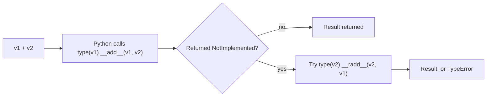
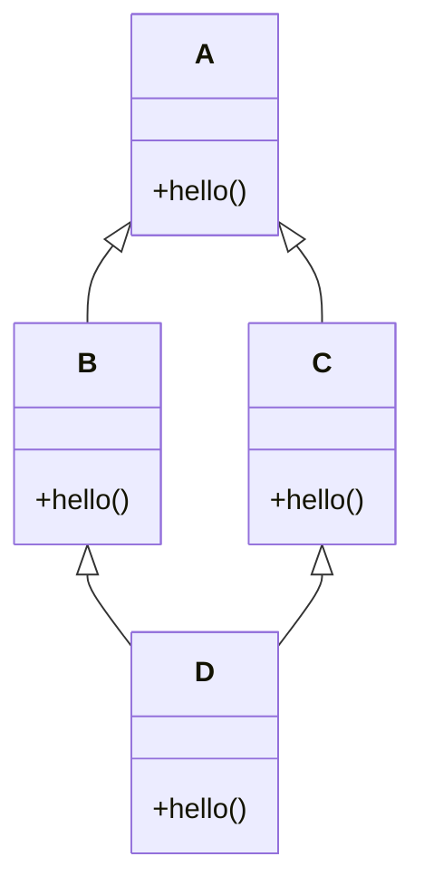
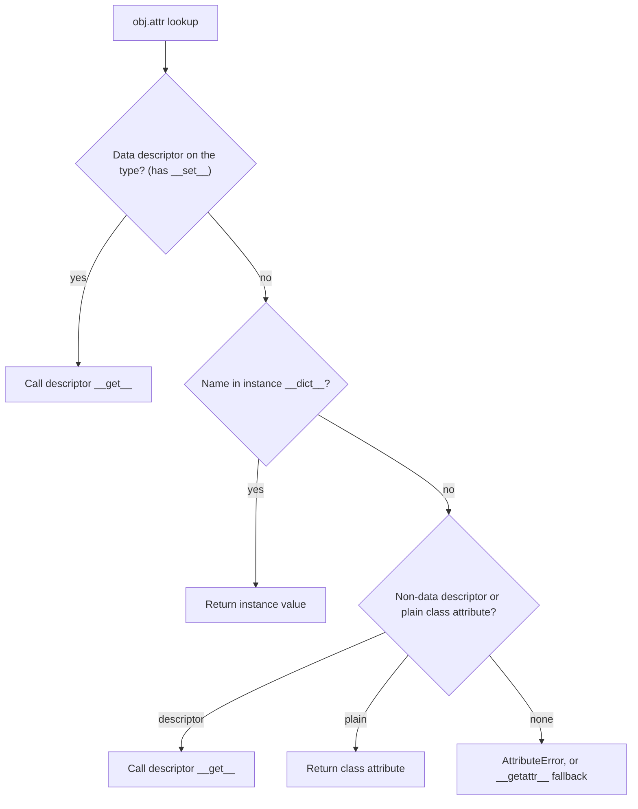
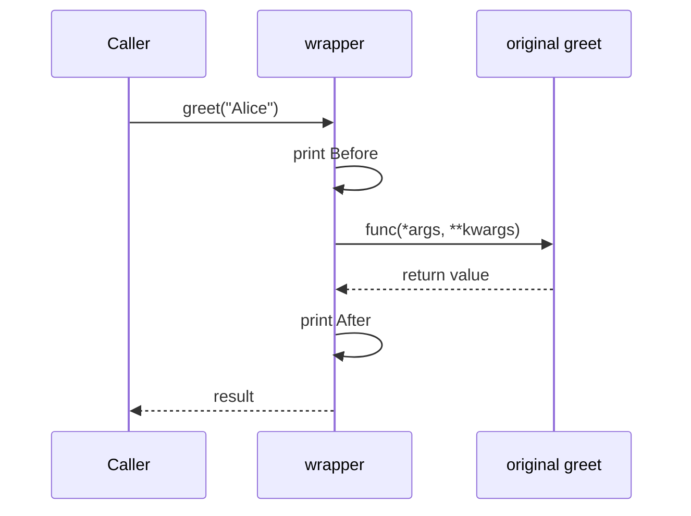
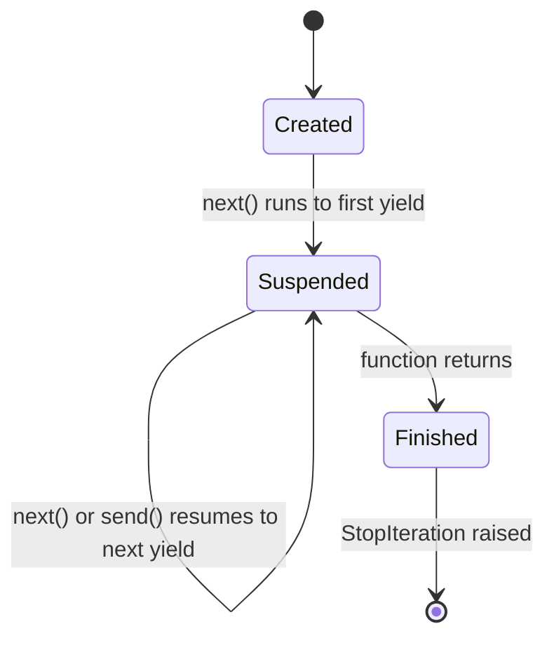
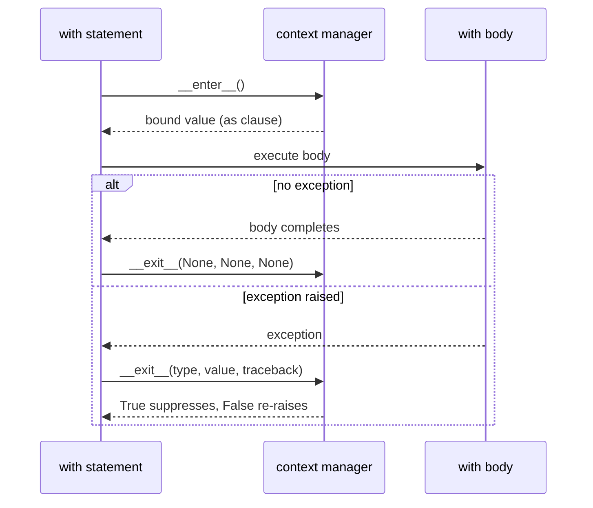
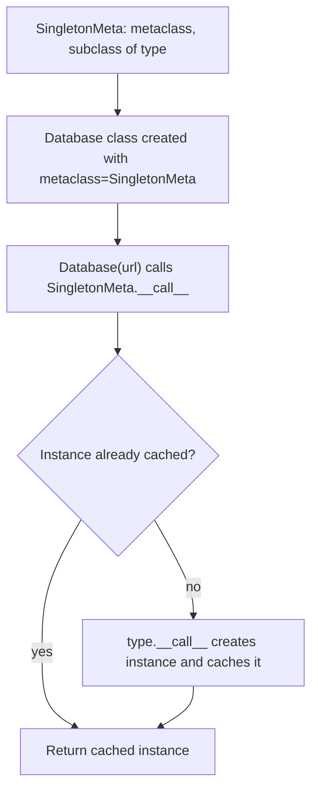
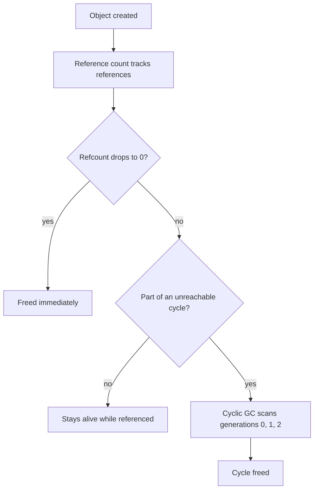
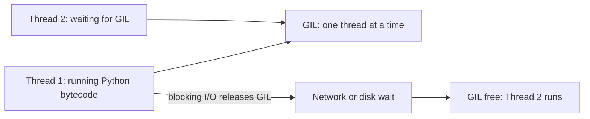

# 🐍 Python — Core & Advanced Interview Preparation Guide
**Coverage:** OOP · Decorators · Generators & Iterators · Context Managers · GIL · Memory · Metaclasses · MRO  
**Use this file to:** Revise deep Python internals before senior-level interviews

---

## Table of Contents
1. [OOP in Python](#1-oop-in-python)
2. [Dunder / Magic Methods](#2-dunder--magic-methods)
3. [Inheritance & MRO](#3-inheritance--mro)
4. [Abstract Classes & Interfaces](#4-abstract-classes--interfaces)
5. [Properties & Descriptors](#5-properties--descriptors)
6. [Decorators](#6-decorators)
7. [Generators & Iterators](#7-generators--iterators)
8. [Context Managers](#8-context-managers)
9. [Metaclasses](#9-metaclasses)
10. [Memory Management & GC](#10-memory-management--gc)
11. [The GIL](#11-the-gil)
12. [Slots](#12-slots)
13. [Dataclasses](#13-dataclasses)
14. [Functools, Object Model & Scoping Questions](#14-functools-object-model--scoping-questions)
15. [Quick Revision Checklist](#15-quick-revision-checklist)

---

## 1. OOP in Python

### ❓ What are the four pillars of OOP and how does Python implement them?
> **Answer:**
>
> **Encapsulation** — bundling data and methods; control access via name mangling.
> ```python
> class BankAccount:
>     def __init__(self, balance):
>         self._balance = balance      # "protected" by convention
>         self.__secret = "hidden"     # name-mangled to _BankAccount__secret
>
>     def deposit(self, amount):
>         if amount > 0:
>             self._balance += amount
> ```
>
> **Abstraction** — expose what's necessary, hide implementation (via ABCs).
>
> **Inheritance** — child class inherits from parent; `super()` calls parent.
>
> **Polymorphism** — same method name, different behavior.
> ```python
> class Shape:
>     def area(self): raise NotImplementedError
>
> class Circle(Shape):
>     def __init__(self, r): self.r = r
>     def area(self): return 3.14 * self.r ** 2
>
> class Rectangle(Shape):
>     def __init__(self, w, h): self.w, self.h = w, h
>     def area(self): return self.w * self.h
>
> shapes = [Circle(5), Rectangle(3, 4)]
> for s in shapes:
>     print(s.area())   # polymorphic dispatch
> ```

---

### ❓ What is `__init__` vs `__new__`?
> **Answer:**
> - `__new__` — **creates** the instance (allocates memory). Called before `__init__`. Returns the new object.
> - `__init__` — **initializes** the already-created instance. Returns `None`.
>
> ```python
> class Singleton:
>     _instance = None
>
>     def __new__(cls, *args, **kwargs):
>         if cls._instance is None:
>             cls._instance = super().__new__(cls)
>         return cls._instance
>
>     def __init__(self, value):
>         self.value = value
>
> a = Singleton(1)
> b = Singleton(2)
> a is b  # True — same instance
> ```

---

### ❓ Class methods vs static methods vs instance methods
> **Answer:**
> ```python
> class Dog:
>     species = "Canis lupus familiaris"
>
>     def __init__(self, name):
>         self.name = name
>
>     def bark(self):                        # instance method — receives self
>         return f"{self.name} says Woof!"
>
>     @classmethod
>     def get_species(cls):                  # class method — receives cls
>         return cls.species
>
>     @staticmethod
>     def is_domestic():                     # static method — no self or cls
>         return True
>
> Dog.get_species()    # works without instance
> Dog.is_domestic()    # works without instance
> Dog("Rex").bark()    # needs instance
> ```

---

## 2. Dunder / Magic Methods

### 📊 Diagram — How `v1 + v2` dispatches to dunder methods



### ❓ Most important dunder methods to know
> **Answer:**
> ```python
> class Vector:
>     def __init__(self, x, y):
>         self.x, self.y = x, y
>
>     def __repr__(self):          # unambiguous; used by repr(), debugger
>         return f"Vector({self.x}, {self.y})"
>
>     def __str__(self):           # readable; used by print(), str()
>         return f"({self.x}, {self.y})"
>
>     def __add__(self, other):    # v1 + v2
>         return Vector(self.x + other.x, self.y + other.y)
>
>     def __eq__(self, other):     # v1 == v2
>         return self.x == other.x and self.y == other.y
>
>     def __hash__(self):          # needed if __eq__ is defined (to use in sets/dicts)
>         return hash((self.x, self.y))
>
>     def __len__(self):           # len(v)
>         return 2
>
>     def __getitem__(self, idx):  # v[0]
>         return (self.x, self.y)[idx]
>
>     def __contains__(self, val): # val in v
>         return val in (self.x, self.y)
>
>     def __bool__(self):          # bool(v); if not defined, falls back to __len__
>         return self.x != 0 or self.y != 0
>
>     def __call__(self, scale):   # v(2) — callable object
>         return Vector(self.x * scale, self.y * scale)
>
>     def __enter__(self):         # with v as ...:
>         return self
>
>     def __exit__(self, exc_type, exc_val, exc_tb):
>         return False
> ```
>
> | Dunder | Triggered by |
> |---|---|
> | `__repr__` | `repr(x)`, REPL |
> | `__str__` | `str(x)`, `print(x)` |
> | `__len__` | `len(x)` |
> | `__getitem__` | `x[key]` |
> | `__setitem__` | `x[key] = val` |
> | `__delitem__` | `del x[key]` |
> | `__iter__` | `iter(x)`, for loops |
> | `__next__` | `next(x)` |
> | `__contains__` | `val in x` |
> | `__call__` | `x(args)` |
> | `__enter__/__exit__` | `with x:` |
> | `__add__/__radd__` | `x + y` |
> | `__lt__`,`__le__`,etc. | `<`, `<=`, etc. |
> | `__hash__` | `hash(x)`, dict key, set member |

---

## 3. Inheritance & MRO

### 📊 Diagram — The diamond problem



MRO of `D` (C3 linearization): `D → B → C → A → object`. Each class appears once; `super()` moves one step along this list.

### ❓ How does Python's MRO (Method Resolution Order) work?
> **Answer:**
> Python uses the **C3 linearization algorithm** to compute MRO in multiple inheritance scenarios.
>
> ```python
> class A:
>     def hello(self): print("A")
>
> class B(A):
>     def hello(self): print("B")
>
> class C(A):
>     def hello(self): print("C")
>
> class D(B, C):   # Multiple inheritance
>     pass
>
> D.__mro__
> # (<class 'D'>, <class 'B'>, <class 'C'>, <class 'A'>, <class 'object'>)
>
> D().hello()   # "B" — follows MRO left to right
> ```
>
> Rule: **child before parent, left-to-right among siblings, each class appears only once**.
>
> **`super()`** follows MRO — it doesn't always call the direct parent:
> ```python
> class B(A):
>     def hello(self):
>         super().hello()   # calls next in MRO (could be C, not necessarily A)
>         print("B")
> ```

---

### ❓ What is the diamond problem and how does Python solve it?
> **Answer:**
> The diamond problem: D inherits from B and C, both of which inherit from A. Which `A.method()` does D use?
>
> Python solves it via **MRO (C3 linearization)** — A's method appears only **once** at the end of the MRO chain. Combined with cooperative `super()` calls, each class in the hierarchy gets called exactly once.

---

## 4. Abstract Classes & Interfaces

### ❓ How do you define abstract classes in Python?
> **Answer:**
> Python uses the `abc` module (Abstract Base Classes).
>
> ```python
> from abc import ABC, abstractmethod
>
> class Animal(ABC):
>     @abstractmethod
>     def speak(self) -> str:
>         """Must be implemented by subclasses."""
>
>     @abstractmethod
>     def move(self) -> None: ...
>
>     def breathe(self):       # concrete method — inherited as-is
>         print("Breathing...")
>
> class Dog(Animal):
>     def speak(self) -> str:
>         return "Woof"
>     def move(self) -> None:
>         print("Running")
>
> # Animal()  → TypeError: Can't instantiate abstract class
> Dog()       # OK
> ```
>
> Python doesn't have interfaces like Java, but ABCs + abstract methods serve the same purpose. You can also use **Protocol** (3.8+) for structural subtyping (duck typing with type checking):
> ```python
> from typing import Protocol
>
> class Drawable(Protocol):
>     def draw(self) -> None: ...
>
> class Circle:
>     def draw(self) -> None: print("Drawing circle")
>
> def render(obj: Drawable) -> None:
>     obj.draw()
>
> render(Circle())  # works — structural match, no inheritance needed
> ```

---

## 5. Properties & Descriptors

### ❓ What is `@property` and why use it?
> **Answer:**
> `@property` lets you define getter/setter/deleter logic that looks like attribute access.
>
> ```python
> class Temperature:
>     def __init__(self, celsius=0):
>         self._celsius = celsius
>
>     @property
>     def celsius(self):
>         return self._celsius
>
>     @celsius.setter
>     def celsius(self, value):
>         if value < -273.15:
>             raise ValueError("Temperature below absolute zero!")
>         self._celsius = value
>
>     @property
>     def fahrenheit(self):
>         return self._celsius * 9/5 + 32
>
> t = Temperature(100)
> t.celsius       # 100  (getter)
> t.celsius = 25  # (setter with validation)
> t.fahrenheit    # 77.0 (computed property, no setter)
> ```

---

### ❓ What are descriptors and how does `property` use them?
> **Answer:**
> A **descriptor** is an object stored as a class attribute that defines `__get__`, `__set__`, and/or `__delete__`. `property`, `classmethod`, `staticmethod`, and Django model fields are all descriptors.
>
> ```python
> class Positive:
>     def __set_name__(self, owner, name):
>         self.private = f"_{name}"
>
>     def __get__(self, obj, objtype=None):
>         if obj is None:
>             return self
>         return getattr(obj, self.private)
>
>     def __set__(self, obj, value):
>         if value <= 0:
>             raise ValueError(f"{self.private[1:]} must be positive")
>         setattr(obj, self.private, value)
>
> class Product:
>     price = Positive()
>
>     def __init__(self, price):
>         self.price = price          # goes through Positive.__set__
>
> Product(10).price   # 10
> Product(-1)         # ValueError: price must be positive
> ```

### 📊 Diagram — Attribute lookup order (`obj.attr`)



---

## 6. Decorators

### 📊 Diagram — What happens when a decorated function is called



### ❓ What is a decorator and how does it work?
> **Answer:**
> A decorator is a **higher-order function** that wraps another function to extend or modify its behavior — without changing the original function's source code.
>
> ```python
> def my_decorator(func):
>     def wrapper(*args, **kwargs):
>         print("Before")
>         result = func(*args, **kwargs)
>         print("After")
>         return result
>     return wrapper
>
> @my_decorator          # syntactic sugar for: greet = my_decorator(greet)
> def greet(name):
>     print(f"Hello, {name}")
>
> greet("Alice")
> # Before
> # Hello, Alice
> # After
> ```

---

### ❓ How do you write a decorator that preserves the original function's metadata?
> **Answer:**
> Use `functools.wraps` — otherwise `func.__name__`, `func.__doc__` get replaced by the wrapper's.
>
> ```python
> import functools
>
> def log(func):
>     @functools.wraps(func)   # preserves __name__, __doc__, __module__
>     def wrapper(*args, **kwargs):
>         print(f"Calling {func.__name__}")
>         return func(*args, **kwargs)
>     return wrapper
> ```

---

### ❓ Decorator with arguments (parameterized decorator)
> **Answer:**
> You need one more nesting level:
> ```python
> import functools
>
> def retry(times=3):
>     def decorator(func):
>         @functools.wraps(func)
>         def wrapper(*args, **kwargs):
>             for attempt in range(times):
>                 try:
>                     return func(*args, **kwargs)
>                 except Exception as e:
>                     if attempt == times - 1:
>                         raise
>                     print(f"Retry {attempt + 1}/{times}: {e}")
>         return wrapper
>     return decorator
>
> @retry(times=3)
> def unstable_api_call():
>     ...
> ```

---

### ❓ Class-based decorator
> **Answer:**
> ```python
> import functools
>
> class CountCalls:
>     def __init__(self, func):
>         functools.update_wrapper(self, func)
>         self.func = func
>         self.count = 0
>
>     def __call__(self, *args, **kwargs):
>         self.count += 1
>         print(f"Call #{self.count}")
>         return self.func(*args, **kwargs)
>
> @CountCalls
> def say_hello():
>     print("Hello!")
>
> say_hello()  # Call #1  Hello!
> say_hello()  # Call #2  Hello!
> say_hello.count  # 2
> ```

---

## 7. Generators & Iterators

### 📊 Diagram — Generator lifecycle



### ❓ What is an iterator vs an iterable?
> **Answer:**
> - **Iterable**: any object you can loop over — has `__iter__()` method that returns an iterator. Examples: `list`, `str`, `dict`, `range`.
> - **Iterator**: an object with `__iter__()` and `__next__()`. Maintains state, yields one value at a time.
>
> ```python
> lst = [1, 2, 3]      # iterable
> it  = iter(lst)       # iterator
> next(it)              # 1
> next(it)              # 2
> next(it)              # 3
> next(it)              # StopIteration
> ```

---

### ❓ What is a generator and how does `yield` work?
> **Answer:**
> A generator is a function that uses `yield` to produce values lazily — **suspending execution** at each `yield` and resuming on the next `next()` call.
>
> ```python
> def count_up(n):
>     i = 0
>     while i < n:
>         yield i      # pauses here, returns i, resumes on next()
>         i += 1
>
> gen = count_up(3)
> next(gen)  # 0
> next(gen)  # 1
> next(gen)  # 2
> next(gen)  # StopIteration
>
> # Use in for loop (automatically handles StopIteration)
> for val in count_up(5):
>     print(val)
> ```
>
> **Why generators?**
> - **Memory efficient**: only one value in memory at a time — essential for large files, streams, infinite sequences.
> - **Lazy evaluation**: compute values only when needed.
>
> ```python
> # Reading a huge file line by line — memory efficient
> def read_lines(filepath):
>     with open(filepath) as f:
>         for line in f:
>             yield line.strip()
> ```

---

### ❓ `yield from` and delegating to sub-generators
> **Answer:**
> ```python
> def inner():
>     yield 1
>     yield 2
>
> def outer():
>     yield 0
>     yield from inner()   # delegates to inner generator
>     yield 3
>
> list(outer())  # [0, 1, 2, 3]
> ```

---

### ❓ Generator `send()` — two-way communication
> **Answer:**
> ```python
> def accumulator():
>     total = 0
>     while True:
>         value = yield total   # yields total, receives sent value
>         if value is None:
>             break
>         total += value
>
> gen = accumulator()
> next(gen)       # prime the generator → 0
> gen.send(10)    # → 10
> gen.send(20)    # → 30
> gen.send(5)     # → 35
> ```

---

## 8. Context Managers

### 📊 Diagram — The `with` statement protocol



### ❓ How do context managers work?
> **Answer:**
> Context managers implement the **context manager protocol**: `__enter__` and `__exit__`.
>
> ```python
> class ManagedResource:
>     def __enter__(self):
>         print("Acquiring resource")
>         return self          # value bound to 'as' clause
>
>     def __exit__(self, exc_type, exc_val, exc_tb):
>         print("Releasing resource")
>         return False         # False = don't suppress exceptions; True = suppress
>
> with ManagedResource() as res:
>     print("Using resource")
>     # even if exception here, __exit__ is called
> ```
>
> **Using `contextlib.contextmanager`** — generator-based approach:
> ```python
> from contextlib import contextmanager
>
> @contextmanager
> def managed_resource():
>     print("Acquiring")
>     try:
>         yield "the resource"   # becomes the 'as' value
>     finally:
>         print("Releasing")     # always runs
>
> with managed_resource() as res:
>     print(f"Using {res}")
> ```

---

## 9. Metaclasses

### 📊 Diagram — How a metaclass controls instance creation



### ❓ What is a metaclass?
> **Answer:**
> In Python, **everything is an object**, including classes. A metaclass is the **class of a class** — it controls how classes are created.
>
> - `type` is the default metaclass of all classes.
> - `type(obj)` → class of obj. `type(MyClass)` → `<class 'type'>`.
>
> ```python
> # type can create classes dynamically
> Dog = type('Dog', (object,), {'speak': lambda self: 'Woof'})
> Dog().speak()  # "Woof"
>
> # Custom metaclass
> class SingletonMeta(type):
>     _instances = {}
>
>     def __call__(cls, *args, **kwargs):
>         if cls not in cls._instances:
>             cls._instances[cls] = super().__call__(*args, **kwargs)
>         return cls._instances[cls]
>
> class Database(metaclass=SingletonMeta):
>     def __init__(self, url):
>         self.url = url
>
> db1 = Database("postgres://...")
> db2 = Database("mysql://...")
> db1 is db2  # True — same instance
> ```
>
> **Use metaclasses for:** ORM internals (Django Model), API framework routing, singleton enforcement, automatic method registration.
> **In practice:** prefer decorators or `__init_subclass__` for most use cases — metaclasses add complexity.

---

## 10. Memory Management & GC

### 📊 Diagram — Reference counting plus cyclic GC



### ❓ How does Python's garbage collection work?
> **Answer:**
> Python uses **two mechanisms**:
>
> 1. **Reference Counting** (primary): every object has a `ob_refcnt`. When it drops to 0, the object is immediately freed.
>    ```python
>    import sys
>    x = [1, 2, 3]
>    sys.getrefcount(x)   # at least 2 (x + argument to getrefcount)
>    ```
>
> 2. **Cyclic GC** (`gc` module): handles reference cycles that reference counting misses.
>    ```python
>    import gc
>    gc.collect()              # force a full collection
>    gc.get_threshold()        # (700, 10, 10) — generation thresholds
>    gc.disable()              # disable (only safe if you know no cycles exist)
>    ```
>
> **Generations**: Objects are in generation 0, 1, or 2. Young objects (gen 0) are collected frequently. Long-lived objects are promoted to gen 2.

---

### ❓ What causes memory leaks in Python?
> **Answer:**
> - **Circular references** with `__del__` methods (prior to Python 3.4)
> - **Global / module-level caches** growing unboundedly
> - **Forgotten callbacks / event listeners** holding references
> - **Thread-local storage** accumulation
> - **Large DataFrames/tensors** not explicitly deleted
>
> **Fix strategies:**
> - Use `weakref.ref` for caches so objects can be GC'd if no strong refs remain.
> - Use `functools.lru_cache` with `maxsize` to bound cache growth.
> - Profile with `tracemalloc` or `objgraph`.

---

## 11. The GIL

### 📊 Diagram — Threads competing for the GIL



CPU-bound threads never release the GIL between bytecodes (except on the periodic switch interval), so they serialize. I/O-bound threads spend most time in the wait state and overlap well.

### ❓ What is the GIL and why does it exist?
> **Answer:**
> The **Global Interpreter Lock (GIL)** is a mutex in CPython that ensures **only one thread executes Python bytecode at a time**, even on multi-core CPUs.
>
> **Why it exists:** CPython's memory management (reference counting) is not thread-safe. The GIL prevents concurrent modifications to reference counts, avoiding race conditions without per-object locks.
>
> **Impact:**
> - **CPU-bound code**: threads don't give speedup — use `multiprocessing` or sub-interpreters instead.
> - **I/O-bound code**: threads work fine because GIL is released during I/O waits (network, disk, sleep).
>
> ```python
> # I/O-bound — threads are effective
> import threading, requests
>
> def fetch(url):
>     return requests.get(url)   # GIL released during network wait
>
> threads = [threading.Thread(target=fetch, args=(url,)) for url in urls]
>
> # CPU-bound — use multiprocessing
> from multiprocessing import Pool
>
> def compute(n):
>     return sum(range(n))
>
> with Pool(4) as p:
>     results = p.map(compute, [10**7]*4)
> ```
>
> **Python 3.13+**: Experimental "no-GIL" build (`--disable-gil`) is in progress (PEP 703).

---

## 12. Slots

### ❓ What are `__slots__` and when should you use them?
> **Answer:**
> By default, Python stores instance attributes in a `__dict__` per instance (a dict), which uses memory.
>
> `__slots__` replaces the per-instance dict with a fixed set of attributes stored in a more compact C array:
> ```python
> class Point:
>     __slots__ = ('x', 'y')    # no __dict__ per instance
>
>     def __init__(self, x, y):
>         self.x = x
>         self.y = y
>
> p = Point(1, 2)
> p.z = 3    # AttributeError — can't add new attributes
> ```
>
> **Benefits:** ~40–50% memory reduction when creating millions of instances (e.g., in data-intensive apps).
> **Drawbacks:** Can't add arbitrary attributes; complicates multiple inheritance.

---

## 13. Dataclasses

### ❓ What are dataclasses and when should you use them?
> **Answer:**
> `@dataclass` (Python 3.7+) auto-generates `__init__`, `__repr__`, `__eq__`, and optionally `__lt__`, `__hash__`, `__slots__`.
>
> ```python
> from dataclasses import dataclass, field
>
> @dataclass(order=True, frozen=True)   # frozen=True makes it immutable + hashable
> class Point:
>     x: float
>     y: float
>     label: str = "default"
>     tags: list = field(default_factory=list)   # mutable default → use field()
>
> p1 = Point(1.0, 2.0)
> p2 = Point(1.0, 2.0)
> p1 == p2   # True (auto __eq__)
> p1 < p2    # comparison works (order=True)
>
> # Post-init processing
> @dataclass
> class Circle:
>     radius: float
>     area: float = field(init=False)
>
>     def __post_init__(self):
>         self.area = 3.14 * self.radius ** 2
> ```
>
> **Dataclass vs NamedTuple:**
> | Feature | dataclass | NamedTuple |
> |---|---|---|
> | Mutable | Yes (by default) | No |
> | Hashable | Only if `frozen=True` | Yes |
> | Inheritance | Full OOP | Limited |
> | Memory | `__dict__` per instance | tuple-efficient |

---

## 14. Functools, Object Model & Scoping Questions

### ❓ Is Python pass-by-value or pass-by-reference?
> **Answer:**
> Python uses **pass-by-object-reference** (also called call-by-sharing). The function receives a reference to the same object. Mutating that object is visible to the caller; rebinding the parameter name is not.
>
> ```python
> def mutate(lst):
>     lst.append(4)          # mutates the caller's object
>
> def rebind(lst):
>     lst = [9, 9]           # only rebinds the local name
>
> a = [1, 2, 3]
> mutate(a); print(a)       # [1, 2, 3, 4]
> rebind(a); print(a)       # [1, 2, 3, 4]
> ```

---

### ❓ How does `functools.lru_cache` work?
> **Answer:**
> It memoizes results keyed by the call arguments, so repeated calls with the same arguments return instantly.
>
> ### 📊 Diagram — Cache hit vs miss
>
> ```mermaid
> sequenceDiagram
>     participant C as Caller
>     participant L as lru_cache wrapper
>     participant F as fib function
>     C->>L: fib(5)
>     alt key in cache
>         L-->>C: cached result (hit)
>     else key missing
>         L->>F: call real function
>         F-->>L: result
>         L->>L: store result (miss)
>         L-->>C: result
>     end
> ```
>
> ```python
> from functools import lru_cache, cache
>
> @lru_cache(maxsize=128)          # bounded LRU eviction
> def fib(n):
>     return n if n < 2 else fib(n - 1) + fib(n - 2)
>
> fib(50)
> fib.cache_info()                 # CacheInfo(hits=..., misses=..., maxsize=128, currsize=...)
> fib.cache_clear()
>
> @cache                           # Python 3.9+: unbounded, same idea
> def square(n):
>     return n * n
> ```
> **Caveats:** arguments must be hashable; the cache lives for the process; caching methods keys on `self` and can keep objects alive (memory leak); it does not know when underlying data changes.

---

### ❓ How do `__getattr__` and `__getattribute__` differ?
> **Answer:**
> - `__getattribute__` runs for **every** attribute access. Overriding it is rare and risky.
> - `__getattr__` runs only **when normal lookup fails** — ideal as a fallback (dynamic attributes, proxies).
>
> ```python
> class Config:
>     def __init__(self):
>         self._data = {'debug': True}
>
>     def __getattr__(self, name):      # called only if normal lookup fails
>         try:
>             return self._data[name]
>         except KeyError:
>             raise AttributeError(name)
>
> Config().debug    # True
> Config().missing  # AttributeError
> ```

---

### ❓ What is `__init_subclass__`?
> **Answer:**
> A hook called on the **parent class** whenever a subclass is defined. It's the lightweight alternative to a metaclass for plugin registration and validation.
>
> ```python
> class Plugin:
>     registry = []
>
>     def __init_subclass__(cls, **kwargs):
>         super().__init_subclass__(**kwargs)
>         Plugin.registry.append(cls.__name__)
>
> class CSVPlugin(Plugin): pass
> class JSONPlugin(Plugin): pass
>
> Plugin.registry    # ['CSVPlugin', 'JSONPlugin']
> ```

---

### ❓ What are `functools.partial` and `contextvars`?
> **Answer:**
> - `partial` freezes some arguments of a function, producing a new callable.
> - `contextvars.ContextVar` stores context-local values (per thread and per asyncio task), safer than globals for things like request IDs.
>
> ```python
> from functools import partial
> import contextvars
>
> def power(base, exp):
>     return base ** exp
>
> square = partial(power, exp=2)
> square(5)                                   # 25
>
> request_id = contextvars.ContextVar('request_id', default=None)
> request_id.set('abc-123')
> request_id.get()                            # 'abc-123' — isolated per task/thread
> ```

---

## 15. Quick Revision Checklist

| Topic | Key Points |
|---|---|
| **`__new__` vs `__init__`** | new creates, init initializes; use new for Singleton/immutable |
| **MRO** | C3 linearization; `ClassName.__mro__`; `super()` follows MRO |
| **`@property`** | getter/setter without breaking interface; validate in setter |
| **Decorator** | wrapper function + `@functools.wraps`; extra layer for args |
| **Generator** | `yield` suspends; lazy; `send()` for two-way; `yield from` delegates |
| **Iterator protocol** | `__iter__` + `__next__` + `StopIteration` |
| **Context manager** | `__enter__` / `__exit__`; `@contextmanager` with try/finally |
| **Metaclass** | class of a class; `type` is default; use for ORMs, singletons |
| **GIL** | one thread runs at a time; I/O-bound → threads OK; CPU-bound → multiprocessing |
| **Reference counting** | primary GC mechanism; cyclic GC handles circular refs |
| **`__slots__`** | replaces `__dict__` per instance; saves memory for many objects |
| **`@dataclass`** | auto `__init__`/`__repr__`/`__eq__`; use `field()` for mutables |
| **Descriptors** | `__get__`/`__set__`; `property` is a data descriptor; lookup order: data descriptor → instance dict → class attr |
| **Pass by object reference** | mutate = visible to caller; rebind = local only |
| **lru_cache / cache** | memoization keyed by hashable args; `cache_info()`, `cache_clear()`; beware `self` in methods |
| **`__getattr__`** | fallback only when normal lookup fails |
| **`__init_subclass__`** | hook on parent when subclass is created; lighter than metaclass |
| **partial / contextvars** | freeze args; context-local variables safe for async |
