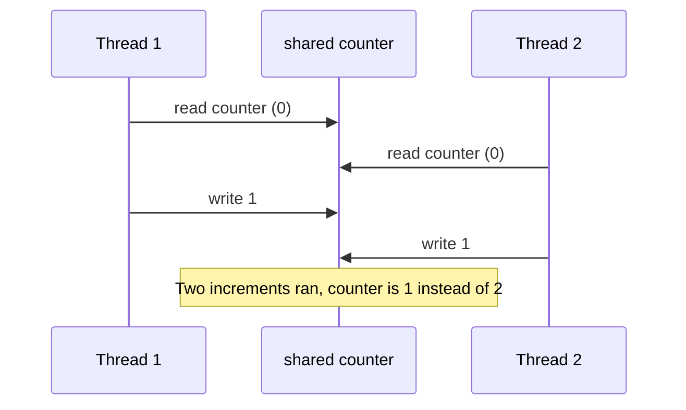
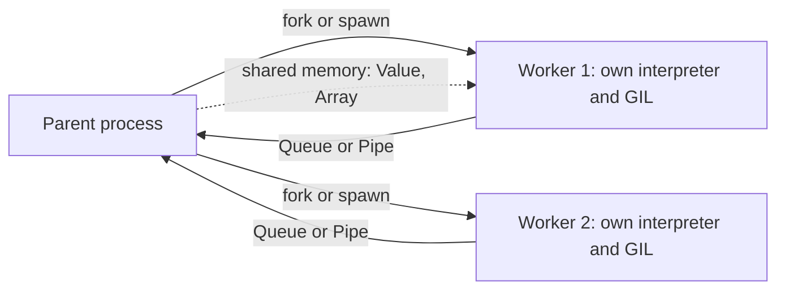
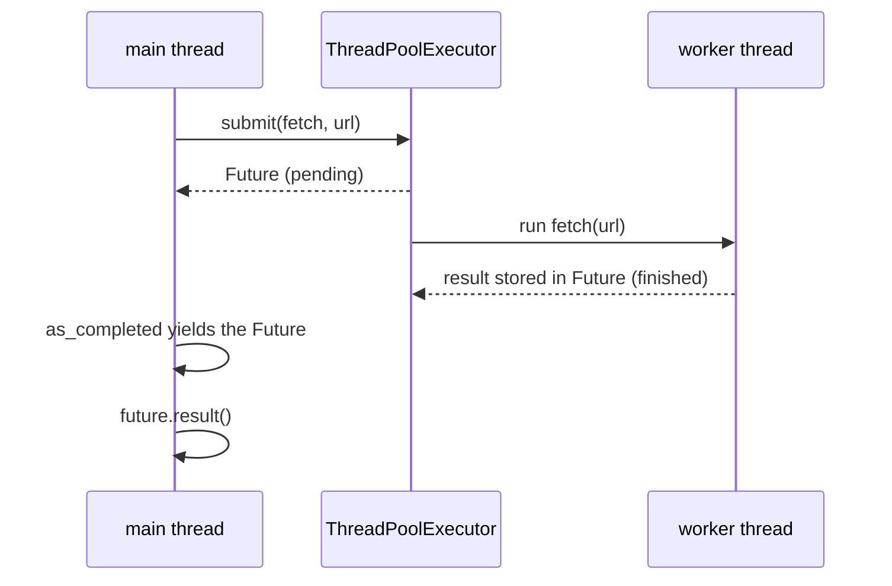
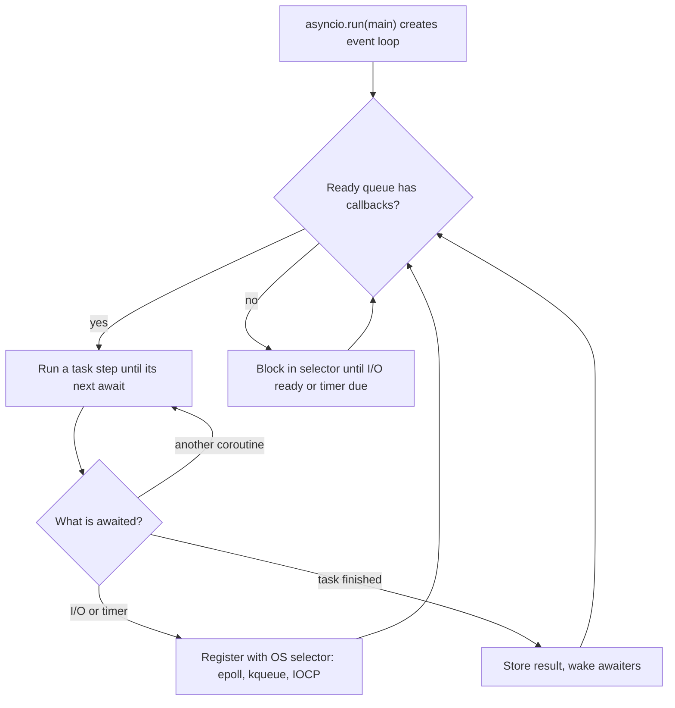
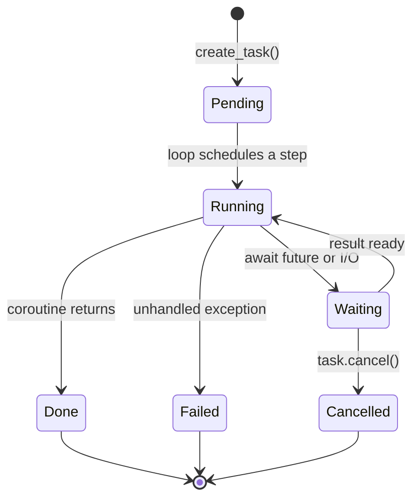
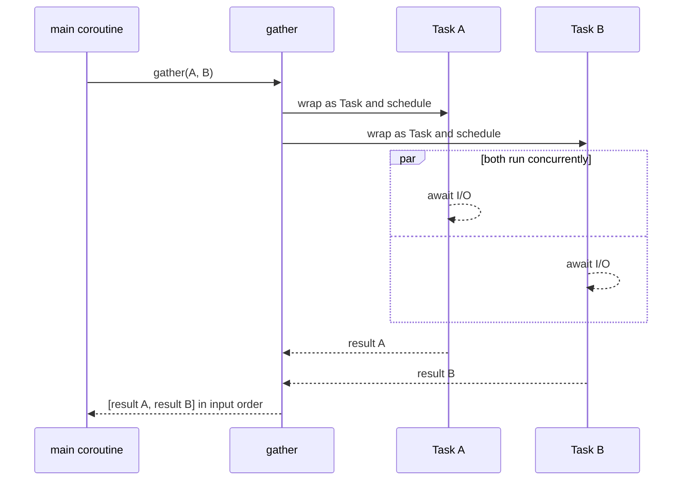
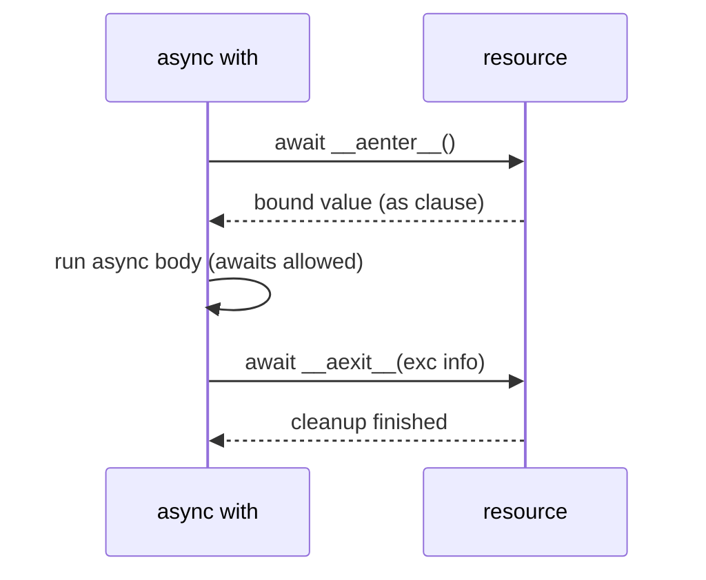
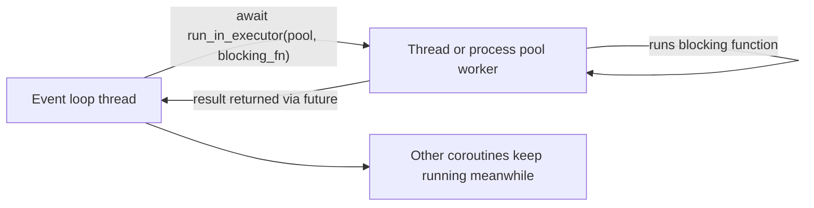
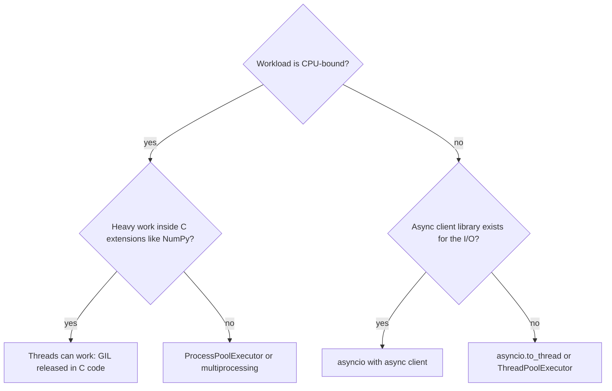

# 🐍 Python — Async & Concurrency Interview Preparation Guide
**Coverage:** asyncio · async/await · Coroutines · Tasks · Concurrency vs Parallelism · Threading · Multiprocessing · concurrent.futures  
**Use this file to:** Revise Python concurrency before backend/data engineering interviews

---

## Table of Contents
1. [Concurrency vs Parallelism vs Asynchrony](#1-concurrency-vs-parallelism-vs-asynchrony)
2. [The GIL — Impact on Concurrency](#2-the-gil--impact-on-concurrency)
3. [Threading](#3-threading)
4. [Thread Safety — Locks, Semaphores, Events](#4-thread-safety--locks-semaphores-events)
5. [Multiprocessing](#5-multiprocessing)
6. [concurrent.futures](#6-concurrentfutures)
7. [asyncio — Core Concepts](#7-asyncio--core-concepts)
8. [async/await Syntax](#8-asyncawait-syntax)
9. [Tasks & Futures](#9-tasks--futures)
10. [asyncio Patterns](#10-asyncio-patterns)
11. [Async Context Managers & Iterators](#11-async-context-managers--iterators)
12. [Mixing Sync & Async Code](#12-mixing-sync--async-code)
13. [When to Use What](#13-when-to-use-what)
14. [Quick Revision Checklist](#14-quick-revision-checklist)

---

## 1. Concurrency vs Parallelism vs Asynchrony

### 📊 Diagram — Sequential vs concurrent I/O waits

```mermaid
gantt
    title Three 1-second I/O waits
    dateFormat X
    axisFormat %S
    section Sequential
    Task A (seq) :s1, 0, 1
    Task B (seq) :s2, 1, 2
    Task C (seq) :s3, 2, 3
    section Concurrent
    Task A (conc) :c1, 0, 1
    Task B (conc) :c2, 0, 1
    Task C (conc) :c3, 0, 1
```



### ❓ What is the difference between concurrency and parallelism?
> **Answer:**
> - **Concurrency**: multiple tasks are **in progress at the same time** — they may not literally execute simultaneously. Tasks interleave (one pauses while another runs). Single-core can be concurrent.
> - **Parallelism**: multiple tasks **execute simultaneously** on different CPU cores. Requires multi-core hardware.
> - **Asynchrony**: a task can be started and its completion handled later, without blocking the caller (non-blocking I/O).
>
> ```
> Concurrency:  Task1 ▓▓░░░░▓▓░░▓▓   (interleaved on 1 core)
>               Task2 ░░▓▓▓▓░░▓▓░░
>
> Parallelism:  Task1 ▓▓▓▓▓▓▓▓▓▓▓▓   (simultaneous on 2 cores)
>               Task2 ▓▓▓▓▓▓▓▓▓▓▓▓
> ```
>
> In Python:
> - **asyncio / threading** → concurrency (handles many tasks, not CPU-bound speedup)
> - **multiprocessing** → true parallelism (bypasses GIL, multiple processes)

---

## 2. The GIL — Impact on Concurrency

### ❓ What is the GIL and how does it affect threading in Python?
> **Answer:**
> The **Global Interpreter Lock (GIL)** is a mutex in CPython that allows only **one thread to hold control of the Python interpreter at any time**.
>
> **Effect on threading:**
> - **I/O-bound tasks** (network, disk, sleep): threads work well. The GIL is **released** during I/O operations, so other threads can run while one is waiting.
> - **CPU-bound tasks** (number crunching, image processing): threads don't provide speedup — only one thread runs Python bytecode at a time.
>
> **GIL release points:** C extension calls, `time.sleep()`, socket/file I/O, `ctypes` calls.
>
> **Alternatives to bypass GIL:**
> - `multiprocessing` — separate processes, each with its own GIL
> - `concurrent.futures.ProcessPoolExecutor`
> - NumPy/SciPy operations (release GIL internally)
> - Cython with `nogil` blocks
> - Python 3.13+ experimental no-GIL build (PEP 703)

---

## 3. Threading

### ❓ Basic threading in Python
> **Answer:**
> ```python
> import threading
> import time
>
> def download(url, results, idx):
>     print(f"Starting {url}")
>     time.sleep(1)   # simulate I/O wait — GIL released here
>     results[idx] = f"Data from {url}"
>
> urls = ["http://api1.com", "http://api2.com", "http://api3.com"]
> results = [None] * len(urls)
>
> threads = [
>     threading.Thread(target=download, args=(url, results, i))
>     for i, url in enumerate(urls)
> ]
>
> for t in threads:
>     t.start()
>
> for t in threads:
>     t.join()   # wait for all to complete
>
> print(results)
> ```
>
> **Key Thread API:**
> ```python
> t = threading.Thread(target=fn, args=(arg1,), kwargs={"k": v}, daemon=True)
> t.start()
> t.join(timeout=5.0)
> t.is_alive()
> threading.current_thread()
> threading.enumerate()  # all active threads
> ```
>
> **Daemon threads**: run in the background, killed when main thread exits. Use for background tasks that should not prevent program shutdown.

---

## 4. Thread Safety — Locks, Semaphores, Events

### 📊 Diagram — Race condition without a lock



### ❓ What synchronization primitives does Python's threading module provide?
> **Answer:**
>
> **Lock (Mutex):**
> ```python
> import threading
>
> counter = 0
> lock = threading.Lock()
>
> def increment():
>     global counter
>     with lock:           # acquires lock, releases on exit
>         counter += 1
>
> threads = [threading.Thread(target=increment) for _ in range(1000)]
> for t in threads: t.start()
> for t in threads: t.join()
> print(counter)  # reliably 1000
> ```
>
> **RLock (Reentrant Lock):** Same thread can acquire it multiple times without deadlocking. Use when a function that holds the lock calls another function that also needs the lock.
>
> **Semaphore:** Limits number of concurrent accesses to a resource.
> ```python
> sem = threading.Semaphore(3)   # max 3 threads at a time
>
> def access_limited_resource():
>     with sem:
>         time.sleep(1)
> ```
>
> **Event:** Signal between threads.
> ```python
> event = threading.Event()
>
> def worker():
>     event.wait()   # blocks until event is set
>     print("Event received!")
>
> threading.Thread(target=worker).start()
> time.sleep(1)
> event.set()    # unblocks worker
> ```
>
> **Condition:** Advanced wait/notify with a lock.
> ```python
> cond = threading.Condition()
>
> # Producer
> with cond:
>     items.append(item)
>     cond.notify()    # wake one waiting thread
>
> # Consumer
> with cond:
>     while not items:
>         cond.wait()  # releases lock, waits for notify
>     item = items.pop()
> ```
>
> **Queue:** Thread-safe producer-consumer queue.
> ```python
> from queue import Queue
>
> q = Queue(maxsize=10)
> q.put(item)          # blocks if full
> q.get()              # blocks if empty
> q.task_done()
> q.join()             # blocks until all items processed
> ```

---

### ❓ Is Python thread-safe? Does the GIL make `counter += 1` atomic?
> **Answer:**
> No. The GIL serializes individual bytecode instructions, but `counter += 1` compiles to several instructions (load, add, store). The interpreter can switch threads between them, which causes lost updates (see the diagram in section 4). Protect compound operations with a `threading.Lock`, or use thread-safe structures such as `queue.Queue`.
>
> ```python
> import threading
>
> counter = 0
> lock = threading.Lock()
>
> def safe_increment():
>     global counter
>     for _ in range(100_000):
>         with lock:
>             counter += 1
> ```
> Relying on CPython's atomicity of single operations like `list.append` is an implementation detail; do not build correctness on it.

---

## 5. Multiprocessing

### 📊 Diagram — Process model and IPC



### ❓ How does multiprocessing differ from threading?
> **Answer:**
> `multiprocessing` spawns **separate OS processes** — each has its own Python interpreter and GIL. This achieves **true parallelism** on multi-core CPUs.
>
> ```python
> from multiprocessing import Process, Pool, Queue, Value, Array
> import os
>
> def cpu_task(n):
>     print(f"PID: {os.getpid()}")
>     return sum(range(n))
>
> # Manual processes
> p = Process(target=cpu_task, args=(10**7,))
> p.start()
> p.join()
>
> # Pool — parallel map over workers
> with Pool(processes=4) as pool:
>     results = pool.map(cpu_task, [10**7, 10**7, 10**7, 10**7])
>
> # Pool.starmap for multiple args
> with Pool(4) as pool:
>     results = pool.starmap(pow, [(2, 10), (3, 5), (4, 3)])
> ```
>
> **Shared memory:**
> ```python
> from multiprocessing import Value, Array
>
> counter = Value('i', 0)     # 'i' = int
> arr     = Array('d', [1.0, 2.0, 3.0])  # 'd' = double
>
> def increment(counter):
>     with counter.get_lock():
>         counter.value += 1
> ```
>
> **Inter-process communication:**
> ```python
> from multiprocessing import Queue, Pipe
>
> # Queue (safe for multiple producers/consumers)
> q = Queue()
> q.put("message")
> q.get()
>
> # Pipe (two endpoints, faster, 1-to-1)
> parent_conn, child_conn = Pipe()
> ```

---

## 6. concurrent.futures

### 📊 Diagram — submit() and Future lifecycle



### ❓ What is `concurrent.futures` and when should you use it?
> **Answer:**
> `concurrent.futures` provides a high-level interface for asynchronous execution with **ThreadPoolExecutor** (I/O-bound) and **ProcessPoolExecutor** (CPU-bound).
>
> ```python
> from concurrent.futures import ThreadPoolExecutor, ProcessPoolExecutor, as_completed
>
> # ThreadPoolExecutor — I/O-bound (HTTP requests, DB queries)
> def fetch(url):
>     import requests
>     return requests.get(url).status_code
>
> with ThreadPoolExecutor(max_workers=10) as executor:
>     # submit returns a Future
>     futures = [executor.submit(fetch, url) for url in urls]
>
>     for future in as_completed(futures):   # yields as each completes
>         try:
>             result = future.result()
>         except Exception as e:
>             print(f"Error: {e}")
>
> # map — simpler, maintains order
> with ThreadPoolExecutor(max_workers=10) as executor:
>     results = list(executor.map(fetch, urls))
>
> # ProcessPoolExecutor — CPU-bound
> def compute(n):
>     return n ** 2
>
> with ProcessPoolExecutor(max_workers=4) as executor:
>     results = list(executor.map(compute, range(100)))
> ```
>
> **Future API:**
> ```python
> f = executor.submit(fn, arg)
> f.result(timeout=5)    # blocks until done or timeout
> f.done()               # True if completed
> f.cancel()             # cancel if not started yet
> f.exception()          # the exception if raised, else None
> ```

---

## 7. asyncio — Core Concepts

### 📊 Diagram — The event loop cycle



### ❓ What is asyncio and how does the event loop work?
> **Answer:**
> `asyncio` is Python's standard library for writing **concurrent I/O-bound code** using a **single-threaded event loop**.
>
> **Event loop**: runs in a single thread, manages a queue of callbacks/coroutines. When a coroutine awaits an I/O operation, control is returned to the event loop, which can then run another coroutine.
>
> ```
> Event Loop
>    │
>    ├── coroutine A awaits I/O ──┐
>    │                            │ (I/O pending in OS)
>    ├── runs coroutine B         │
>    │                            │
>    ├── runs coroutine C         │
>    │                            │
>    └── I/O ready ───────────────┘ → resume coroutine A
> ```
>
> **Key principle:** asyncio is **cooperative multitasking** — tasks voluntarily yield control at `await` points. There's no preemption. A CPU-bound task without `await` will **block the entire event loop**.

---

## 8. async/await Syntax

### ❓ How does async/await work?
> **Answer:**
> ```python
> import asyncio
>
> # async def defines a coroutine function
> async def fetch_data(url: str) -> str:
>     print(f"Fetching {url}")
>     await asyncio.sleep(1)   # yields control to event loop for 1s
>     return f"Data from {url}"
>
> async def main():
>     result = await fetch_data("http://api.example.com")
>     print(result)
>
> # Run the event loop
> asyncio.run(main())   # Python 3.7+ — creates and runs a new event loop
> ```
>
> **Rules:**
> - `await` can only be used inside `async def` functions.
> - `async def` returns a **coroutine object** when called — it doesn't run until awaited or scheduled.
> - `asyncio.sleep(n)` is async-friendly (yields to loop); `time.sleep(n)` is **blocking** (freezes the loop).
>
> ```python
> # Common mistake: calling coroutine without await
> async def wrong():
>     result = fetch_data("url")   # RuntimeWarning: coroutine never awaited
>
> async def correct():
>     result = await fetch_data("url")
> ```

---

## 9. Tasks & Futures

### 📊 Diagram — Task lifecycle



### ❓ What is an asyncio Task vs a coroutine vs a Future?
> **Answer:**
> - **Coroutine**: the result of calling `async def fn()` — a generator-like object that hasn't started yet.
> - **Task**: wraps a coroutine and **schedules it immediately** on the event loop. The loop can switch between tasks.
> - **Future**: a low-level awaitable that represents a result not yet available (like a promise). `Task` is a subclass of `Future`.
>
> ```python
> import asyncio
>
> async def work(name, delay):
>     await asyncio.sleep(delay)
>     return f"{name} done"
>
> async def main():
>     # Create Tasks — both start running concurrently
>     task1 = asyncio.create_task(work("A", 2))
>     task2 = asyncio.create_task(work("B", 1))
>
>     result1 = await task1   # waits for task1
>     result2 = await task2   # task2 likely already done
>     print(result1, result2)
>
> asyncio.run(main())
> # Total time: ~2s (concurrent), not 3s (sequential)
> ```

---

## 10. asyncio Patterns

### 📊 Diagram — What gather does



### ❓ `asyncio.gather`, `asyncio.wait`, `asyncio.wait_for`
> **Answer:**
>
> **`asyncio.gather`** — run multiple coroutines concurrently, collect all results:
> ```python
> async def main():
>     results = await asyncio.gather(
>         work("A", 2),
>         work("B", 1),
>         work("C", 3),
>         return_exceptions=True   # don't propagate exceptions, return them as results
>     )
>     # results in same order as input: [result_A, result_B, result_C]
> ```
>
> **`asyncio.wait`** — more control: get done/pending sets, handle first-completed:
> ```python
> async def main():
>     tasks = {asyncio.create_task(work(n, d)) for n, d in [("A",2),("B",1)]}
>
>     done, pending = await asyncio.wait(
>         tasks,
>         return_when=asyncio.FIRST_COMPLETED   # or ALL_COMPLETED, FIRST_EXCEPTION
>     )
>
>     for task in done:
>         print(task.result())
>     for task in pending:
>         task.cancel()
> ```
>
> **`asyncio.wait_for`** — timeout wrapper:
> ```python
> try:
>     result = await asyncio.wait_for(work("A", 10), timeout=3.0)
> except asyncio.TimeoutError:
>     print("Timed out!")
> ```
>
> **`asyncio.as_completed`** — process results as each finishes:
> ```python
> for coro in asyncio.as_completed([work("A",3), work("B",1), work("C",2)]):
>     result = await coro
>     print(result)   # prints in order: B, C, A
> ```

---

### ❓ asyncio.Queue — async producer-consumer
> **Answer:**
> ```python
> import asyncio
>
> async def producer(queue: asyncio.Queue):
>     for i in range(5):
>         await asyncio.sleep(0.5)
>         await queue.put(i)
>         print(f"Produced {i}")
>     await queue.put(None)   # sentinel to stop consumer
>
> async def consumer(queue: asyncio.Queue):
>     while True:
>         item = await queue.get()
>         if item is None:
>             break
>         print(f"Consumed {item}")
>         queue.task_done()
>
> async def main():
>     queue = asyncio.Queue(maxsize=2)
>     await asyncio.gather(producer(queue), consumer(queue))
>
> asyncio.run(main())
> ```

---

### ❓ How does cancellation work in asyncio?
> **Answer:**
> `task.cancel()` requests cancellation by raising `asyncio.CancelledError` at the task's next `await`. A coroutine may catch it to clean up, but it **must re-raise** so the cancellation propagates. `asyncio.shield(aw)` protects an inner awaitable from being cancelled by an outer task.
>
> ```python
> import asyncio
>
> async def worker():
>     try:
>         await asyncio.sleep(10)
>     except asyncio.CancelledError:
>         print('cleaning up')
>         raise                     # always re-raise
>
> async def main():
>     task = asyncio.create_task(worker())
>     await asyncio.sleep(1)
>     task.cancel()
>     try:
>         await task
>     except asyncio.CancelledError:
>         print('worker cancelled')
> ```
>
> ### 📊 Diagram — Cancellation propagation
>
> ```mermaid
> flowchart TD
>     C["task.cancel() called"] --> AW["Task is awaiting something"]
>     AW --> RAISE["CancelledError raised at the await point"]
>     RAISE --> CLEAN{"Coroutine catches it?"}
>     CLEAN -- "yes, cleans up and re-raises" --> DONE["Task ends as cancelled"]
>     CLEAN -- "swallows it" --> BAD["Task keeps running: bug"]
> ```

---

### ❓ What are `asyncio.timeout` and `asyncio.TaskGroup`? (Python 3.11+)
> **Answer:**
> - `asyncio.timeout(seconds)` cancels the enclosed block when the deadline passes and raises `TimeoutError`.
> - `asyncio.TaskGroup` is **structured concurrency**: the `async with` block waits for all child tasks. If one fails, the others are cancelled and the errors are raised together as an `ExceptionGroup`.
>
> ```python
> import asyncio
>
> async def work(name, delay):
>     await asyncio.sleep(delay)
>     return name
>
> async def main():
>     try:
>         async with asyncio.timeout(3):
>             await asyncio.sleep(10)
>     except TimeoutError:
>         print('timed out')
>
>     async with asyncio.TaskGroup() as tg:
>         a = tg.create_task(work('A', 1))
>         b = tg.create_task(work('B', 2))
>     print(a.result(), b.result())     # both finished here
> ```

---

### ❓ How do you limit concurrency with `asyncio.Semaphore`?
> **Answer:**
> A semaphore caps how many coroutines run a section at once. It is the standard way to respect rate limits and avoid exhausting connections.
>
> ```python
> import asyncio
> import httpx
>
> sem = asyncio.Semaphore(5)              # at most 5 requests in flight
>
> async def fetch(client: httpx.AsyncClient, url: str):
>     async with sem:
>         resp = await client.get(url)
>         return resp.status_code
>
> async def main(urls):
>     async with httpx.AsyncClient() as client:
>         return await asyncio.gather(*(fetch(client, u) for u in urls))
> ```

---

## 11. Async Context Managers & Iterators

### 📊 Diagram — `async with` protocol



### ❓ How do async context managers and async iterators work?
> **Answer:**
>
> **Async context manager** — uses `__aenter__` and `__aexit__`:
> ```python
> class AsyncDB:
>     async def __aenter__(self):
>         await asyncio.sleep(0.1)   # simulate async connection
>         print("Connected")
>         return self
>
>     async def __aexit__(self, *args):
>         await asyncio.sleep(0.1)
>         print("Disconnected")
>
> async def main():
>     async with AsyncDB() as db:
>         print("Using DB")
>
> # contextlib version
> from contextlib import asynccontextmanager
>
> @asynccontextmanager
> async def db_connection():
>     print("Connecting")
>     try:
>         yield "connection"
>     finally:
>         print("Disconnecting")
> ```
>
> **Async iterator** — uses `__aiter__` and `__anext__`:
> ```python
> class AsyncCounter:
>     def __init__(self, stop):
>         self.current = 0
>         self.stop = stop
>
>     def __aiter__(self):
>         return self
>
>     async def __anext__(self):
>         if self.current >= self.stop:
>             raise StopAsyncIteration
>         await asyncio.sleep(0.1)
>         self.current += 1
>         return self.current
>
> async def main():
>     async for val in AsyncCounter(5):
>         print(val)
> ```

---

## 12. Mixing Sync & Async Code

### 📊 Diagram — Offloading blocking code with `run_in_executor`



### ❓ How do you run blocking (sync) code inside an async function?
> **Answer:**
> Running a blocking call directly inside `async def` **blocks the entire event loop**. Instead, offload it to a thread pool:
>
> ```python
> import asyncio
> import time
>
> def blocking_io():
>     time.sleep(2)         # blocks the OS thread, not the event loop
>     return "done"
>
> async def main():
>     loop = asyncio.get_running_loop()
>
>     # run_in_executor offloads to thread pool (default: ThreadPoolExecutor)
>     result = await loop.run_in_executor(None, blocking_io)
>
>     # Or with a custom executor
>     from concurrent.futures import ProcessPoolExecutor
>     with ProcessPoolExecutor() as pool:
>         result = await loop.run_in_executor(pool, cpu_heavy_fn)
>
> # asyncio.to_thread (Python 3.9+) — cleaner syntax
> async def main():
>     result = await asyncio.to_thread(blocking_io)
> ```
>
> **Running async code from sync context:**
> ```python
> # From sync code, run a coroutine
> asyncio.run(main())                  # Python 3.7+ — new event loop
> loop = asyncio.get_event_loop()
> loop.run_until_complete(main())      # older style
> ```

---

### ❓ Common asyncio mistakes
> **Answer:**
>
> 1. **Blocking the event loop** with `time.sleep()`, `requests.get()` — use `asyncio.sleep()`, `httpx`, `aiohttp`.
>
> 2. **Forgetting to await** — calling a coroutine without `await` silently does nothing (RuntimeWarning).
>
> 3. **Using `asyncio.run()` inside an existing event loop** — use `await` or `asyncio.create_task()` instead.
>
> 4. **CPU-bound code in async** — heavy computation blocks the loop; move to `run_in_executor` with ProcessPoolExecutor.
>
> 5. **Race conditions** — use `asyncio.Lock()`:
>    ```python
>    lock = asyncio.Lock()
>
>    async def safe_update():
>        async with lock:
>            await asyncio.sleep(0)   # yield but lock is held
>            # safe to modify shared state here
>    ```

---

## 13. When to Use What

### 📊 Diagram — Choosing a concurrency model



### ❓ Decision guide: asyncio vs threading vs multiprocessing
> **Answer:**
>
> | Scenario | Best Choice | Reason |
> |---|---|---|
> | Many HTTP/DB calls | `asyncio` + async library | Low overhead, handles thousands of connections |
> | CPU-bound work (image processing, ML) | `multiprocessing` | Bypasses GIL, true parallelism |
> | Calling blocking libraries (no async version) | `ThreadPoolExecutor` | Releases GIL on I/O; simple to use |
> | CPU-bound in existing async app | `run_in_executor(ProcessPool)` | Offloads CPU without blocking loop |
> | File I/O (heavy) | `asyncio` + `aiofiles` | Non-blocking I/O |
> | Simple background task | `threading.Thread` | Minimal complexity |
> | Subprocess | `asyncio.create_subprocess_exec` | Non-blocking subprocess |
>
> **Rule of thumb:**
> - **I/O-bound + many concurrent connections** → `asyncio`
> - **I/O-bound + simple concurrent tasks** → `ThreadPoolExecutor`
> - **CPU-bound** → `ProcessPoolExecutor` or `multiprocessing`

---

## 14. Quick Revision Checklist

| Topic | Key Points |
|---|---|
| **GIL** | One thread runs Python bytecode at a time; released on I/O; doesn't affect multiprocessing |
| **Threading** | Good for I/O-bound; `Lock/RLock/Semaphore/Event/Condition`; use `Queue` for producer-consumer |
| **Multiprocessing** | Separate processes; bypasses GIL; `Pool.map`/`starmap`; `Value/Array` for shared memory |
| **concurrent.futures** | High-level API; `ThreadPoolExecutor` (I/O) / `ProcessPoolExecutor` (CPU); `Future.result()` |
| **Coroutine** | `async def` returns a coroutine object; must be `await`ed to run |
| **Task** | Wraps a coroutine; scheduled immediately; `asyncio.create_task()` |
| **gather** | Run multiple coroutines concurrently; waits for all; returns results in order |
| **wait** | More control; get `done`/`pending` sets; `FIRST_COMPLETED` strategy |
| **wait_for** | Timeout wrapper around a coroutine |
| **as_completed** | Process results as each finishes (not in order) |
| **Blocking in async** | Use `asyncio.to_thread()` or `run_in_executor()`; never `time.sleep()` or `requests` directly |
| **asyncio.Lock** | Prevents race conditions within async code |
| **async with / async for** | `__aenter__/__aexit__` and `__aiter__/__anext__` |
| **Thread safety** | GIL does not make `+=` atomic; use `Lock`; prefer `queue.Queue` |
| **Cancellation** | `task.cancel()` raises `CancelledError`; catch, clean up, re-raise |
| **timeout / TaskGroup** | `asyncio.timeout` (3.11+); `TaskGroup` cancels siblings on failure |
| **Semaphore (async)** | cap concurrent coroutines, e.g. rate limiting |
