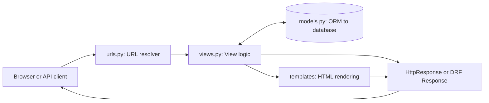
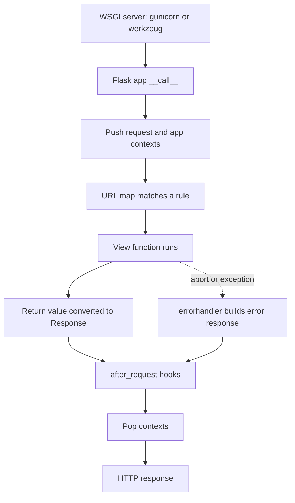
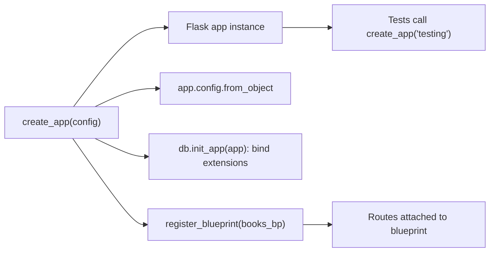
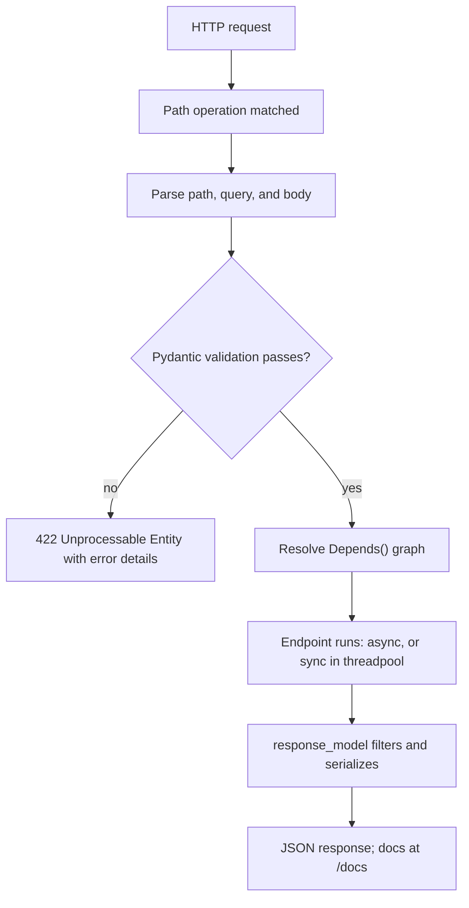
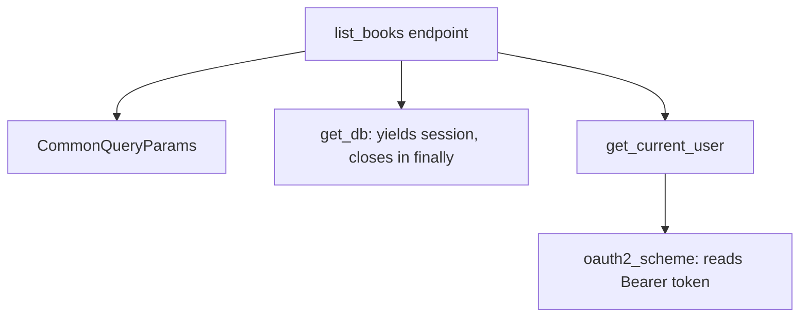
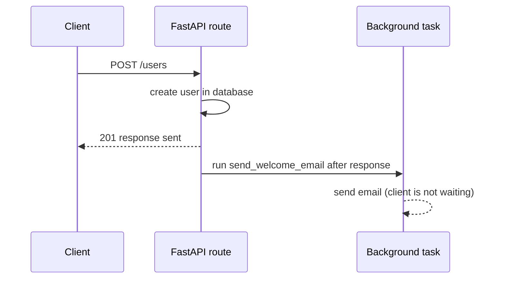
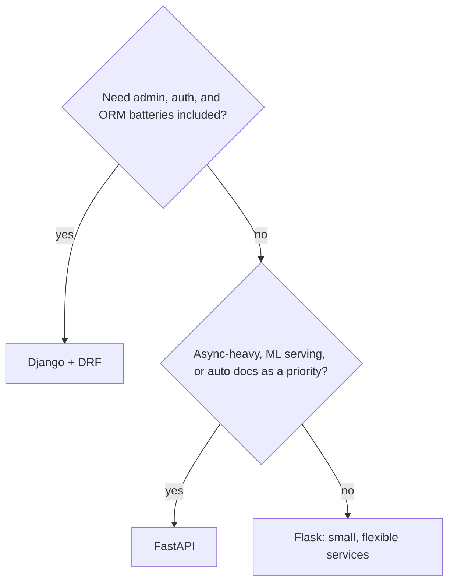

# 🐍 Python Web Frameworks — Interview Preparation Guide
**Coverage:** Django REST Framework · Flask · FastAPI  
**Use this file to:** Revise Python web framework questions before backend interviews  
> **Note:** Complete Django REST Framework coverage (basics to advanced, with diagrams) lives in `04_Django_REST_Framework_Interview_Prep.md`. Section 1 to 9 below is a summary of the DRF essentials.

---

## Table of Contents

### Django REST Framework (DRF)
1. [Django Fundamentals](#1-django-fundamentals)
2. [Django ORM](#2-django-orm)
3. [DRF — Serializers](#3-drf--serializers)
4. [DRF — Views & ViewSets](#4-drf--views--viewsets)
5. [DRF — Routers & URLs](#5-drf--routers--urls)
6. [DRF — Authentication & Permissions](#6-drf--authentication--permissions)
7. [DRF — Throttling & Pagination](#7-drf--throttling--pagination)
8. [DRF — Filtering & Searching](#8-drf--filtering--searching)
9. [DRF — Signals & Middleware](#9-drf--signals--middleware)

### Flask
10. [Flask Fundamentals](#10-flask-fundamentals)
11. [Flask Blueprints & Application Factory](#11-flask-blueprints--application-factory)
12. [Flask-SQLAlchemy & Flask-Migrate](#12-flask-sqlalchemy--flask-migrate)

### FastAPI
13. [FastAPI Fundamentals](#13-fastapi-fundamentals)
14. [FastAPI — Pydantic & Validation](#14-fastapi--pydantic--validation)
15. [FastAPI — Dependency Injection](#15-fastapi--dependency-injection)
16. [FastAPI — Async & Background Tasks](#16-fastapi--async--background-tasks)

17. [Framework Comparison](#17-framework-comparison)
18. [Quick Revision Checklist](#18-quick-revision-checklist)

---

## 1. Django Fundamentals

### 📊 Diagram — Django MTV request flow



### ❓ What is Django's MTV architecture?
> **Answer:**
> Django uses **MTV (Model-Template-View)** — analogous to MVC:
> - **Model**: defines data structure via ORM (`models.py`)
> - **Template**: HTML rendering layer (`templates/`)
> - **View**: business logic layer — receives request, returns response (`views.py`)
>
> Request flow:
> `Browser → URLs (urls.py) → View (views.py) → Model (models.py) → Template → Response`

---

### ❓ What is Django's settings and how do you split them for different environments?
> **Answer:**
> `settings.py` holds all configuration. Best practice — split into:
> ```
> settings/
>   __init__.py
>   base.py       # shared config
>   dev.py        # DEBUG=True, sqlite
>   prod.py       # DEBUG=False, postgres, Redis cache
>   test.py       # test DB settings
> ```
> Run with: `DJANGO_SETTINGS_MODULE=settings.prod python manage.py runserver`
> Use `python-decouple` or `django-environ` for secrets from `.env` files.

---

### ❓ What is `manage.py` and key commands?
> **Answer:**
> ```bash
> python manage.py runserver         # start dev server
> python manage.py makemigrations    # generate migration files from model changes
> python manage.py migrate           # apply migrations to DB
> python manage.py shell             # Django shell with all models loaded
> python manage.py createsuperuser   # admin user
> python manage.py collectstatic     # gather static files
> python manage.py test              # run tests
> python manage.py dbshell           # raw DB shell
> ```

---

## 2. Django ORM

### ❓ How does the Django ORM work?
> **Answer:**
> ```python
> from django.db import models
>
> class Author(models.Model):
>     name = models.CharField(max_length=100)
>     email = models.EmailField(unique=True)
>
>     class Meta:
>         ordering = ['name']
>         indexes = [models.Index(fields=['name'])]
>
> class Book(models.Model):
>     title  = models.CharField(max_length=200)
>     author = models.ForeignKey(Author, on_delete=models.CASCADE, related_name='books')
>     price  = models.DecimalField(max_digits=6, decimal_places=2)
>     tags   = models.ManyToManyField('Tag', blank=True)
>     published_at = models.DateTimeField(auto_now_add=True)
>
> # QuerySet — lazy; DB hit happens when evaluated
> books = Book.objects.filter(price__lt=20).select_related('author').order_by('-published_at')[:10]
>
> # Lookups
> Book.objects.filter(title__icontains="python")
> Book.objects.filter(author__name__startswith="A")
> Book.objects.filter(price__range=(10, 50))
> Book.objects.exclude(author__name="Bob")
>
> # Aggregation
> from django.db.models import Avg, Count, Sum, Max
> Book.objects.aggregate(avg_price=Avg('price'))
> Author.objects.annotate(book_count=Count('books'))
>
> # Create / Update / Delete
> book = Book.objects.create(title="DRF Guide", author=author, price=29.99)
> Book.objects.filter(price__lt=5).update(price=5)
> Book.objects.filter(published_at__year=2020).delete()
>
> # get_or_create, update_or_create
> obj, created = Book.objects.get_or_create(title="DRF Guide", defaults={"price": 29.99})
> ```

---

### ❓ What is the N+1 problem and how do you fix it?
> **Answer:**
> N+1: for each item in a queryset, a separate DB query is issued for related data.
> ```python
> # BAD: N+1
> books = Book.objects.all()
> for book in books:
>     print(book.author.name)   # 1 query per book → N+1 queries total
>
> # FIX: select_related (SQL JOIN — for ForeignKey/OneToOne)
> books = Book.objects.select_related('author').all()
>
> # FIX: prefetch_related (separate query, Python join — for ManyToMany/reverse FK)
> books = Book.objects.prefetch_related('tags').all()
>
> # Combined
> books = Book.objects.select_related('author').prefetch_related('tags')
> ```

---

### ❓ Django migrations — how do they work?
> **Answer:**
> - `makemigrations` inspects model changes and creates migration files in `migrations/`.
> - `migrate` applies pending migrations to the DB (runs `ALTER TABLE`, `CREATE TABLE`, etc.).
> - Django tracks applied migrations in the `django_migrations` table.
> - **Squash migrations**: merge many migrations into one for performance: `squashmigrations`.
> - Always commit migration files to version control.
> - For production: run migrations **before** deploying new code (backward-compatible migrations).

---

## 3. DRF — Serializers

### ❓ What is a DRF Serializer?
> **Answer:**
> Serializers convert complex data types (model instances, querysets) to Python primitives (for JSON/XML) and vice versa (deserialize + validate).
>
> ```python
> from rest_framework import serializers
> from .models import Book, Author
>
> class AuthorSerializer(serializers.ModelSerializer):
>     class Meta:
>         model  = Author
>         fields = ['id', 'name', 'email']
>
> class BookSerializer(serializers.ModelSerializer):
>     author = AuthorSerializer(read_only=True)         # nested read
>     author_id = serializers.PrimaryKeyRelatedField(   # write by ID
>         queryset=Author.objects.all(), source='author', write_only=True
>     )
>     word_count = serializers.SerializerMethodField()  # computed field
>
>     class Meta:
>         model  = Book
>         fields = ['id', 'title', 'author', 'author_id', 'price', 'word_count']
>
>     def get_word_count(self, obj):
>         return len(obj.title.split())
>
>     def validate_price(self, value):
>         if value < 0:
>             raise serializers.ValidationError("Price must be non-negative.")
>         return value
>
>     def validate(self, data):
>         # Cross-field validation
>         return data
>
>     def create(self, validated_data):
>         return Book.objects.create(**validated_data)
>
>     def update(self, instance, validated_data):
>         for attr, value in validated_data.items():
>             setattr(instance, attr, value)
>         instance.save()
>         return instance
> ```

---

### ❓ Serializer vs ModelSerializer
> **Answer:**
> | | `Serializer` | `ModelSerializer` |
> |---|---|---|
> | Field definition | Explicit, manual | Auto-generated from model |
> | `create`/`update` | Must implement manually | Provided by default |
> | Flexibility | Higher | Less boilerplate |
>
> Use `Serializer` for non-model data or complex transformations; `ModelSerializer` for typical CRUD.

---

## 4. DRF — Views & ViewSets

### ❓ What are the different view types in DRF?
> **Answer:**
>
> **1. `APIView`** — most explicit, full control:
> ```python
> from rest_framework.views import APIView
> from rest_framework.response import Response
> from rest_framework import status
>
> class BookListView(APIView):
>     def get(self, request):
>         books = Book.objects.all()
>         serializer = BookSerializer(books, many=True)
>         return Response(serializer.data)
>
>     def post(self, request):
>         serializer = BookSerializer(data=request.data)
>         if serializer.is_valid():
>             serializer.save()
>             return Response(serializer.data, status=status.HTTP_201_CREATED)
>         return Response(serializer.errors, status=status.HTTP_400_BAD_REQUEST)
> ```
>
> **2. Generic views** — reduce boilerplate:
> ```python
> from rest_framework import generics
>
> class BookListCreateView(generics.ListCreateAPIView):
>     queryset = Book.objects.select_related('author').all()
>     serializer_class = BookSerializer
>
> class BookDetailView(generics.RetrieveUpdateDestroyAPIView):
>     queryset = Book.objects.all()
>     serializer_class = BookSerializer
> ```
>
> **3. `ViewSet`** — groups related actions:
> ```python
> from rest_framework import viewsets
>
> class BookViewSet(viewsets.ModelViewSet):
>     queryset = Book.objects.select_related('author').all()
>     serializer_class = BookSerializer
>
>     def get_queryset(self):
>         qs = super().get_queryset()
>         author_id = self.request.query_params.get('author_id')
>         if author_id:
>             qs = qs.filter(author_id=author_id)
>         return qs
>
>     @action(detail=True, methods=['post'])
>     def publish(self, request, pk=None):
>         book = self.get_object()
>         book.published = True
>         book.save()
>         return Response({'status': 'published'})
> ```

---

## 5. DRF — Routers & URLs

### ❓ How do DRF routers work?
> **Answer:**
> ```python
> # urls.py
> from rest_framework.routers import DefaultRouter
> from .views import BookViewSet
>
> router = DefaultRouter()
> router.register(r'books', BookViewSet, basename='book')
>
> urlpatterns = [
>     path('api/', include(router.urls)),
> ]
>
> # Auto-generates:
> # GET  /api/books/           → list
> # POST /api/books/           → create
> # GET  /api/books/{pk}/      → retrieve
> # PUT  /api/books/{pk}/      → update
> # PATCH /api/books/{pk}/     → partial_update
> # DELETE /api/books/{pk}/    → destroy
> # POST /api/books/{pk}/publish/ → custom @action
> ```

---

## 6. DRF — Authentication & Permissions

### ❓ How does DRF handle authentication?
> **Answer:**
> DRF separates **authentication** (who are you?) from **permissions** (what can you do?).
>
> **Built-in authentication classes:**
> ```python
> REST_FRAMEWORK = {
>     'DEFAULT_AUTHENTICATION_CLASSES': [
>         'rest_framework.authentication.SessionAuthentication',
>         'rest_framework.authentication.BasicAuthentication',
>         'rest_framework_simplejwt.authentication.JWTAuthentication',  # JWT
>     ],
>     'DEFAULT_PERMISSION_CLASSES': [
>         'rest_framework.permissions.IsAuthenticated',
>     ],
> }
> ```
>
> **JWT (djangorestframework-simplejwt):**
> ```python
> # urls.py
> from rest_framework_simplejwt.views import TokenObtainPairView, TokenRefreshView
>
> urlpatterns = [
>     path('api/token/', TokenObtainPairView.as_view()),
>     path('api/token/refresh/', TokenRefreshView.as_view()),
> ]
> ```
>
> **Custom permission:**
> ```python
> from rest_framework.permissions import BasePermission
>
> class IsOwnerOrReadOnly(BasePermission):
>     def has_object_permission(self, request, view, obj):
>         if request.method in ('GET', 'HEAD', 'OPTIONS'):
>             return True
>         return obj.owner == request.user
>
> class BookViewSet(viewsets.ModelViewSet):
>     permission_classes = [IsAuthenticated, IsOwnerOrReadOnly]
> ```
>
> **Built-in permissions:** `AllowAny`, `IsAuthenticated`, `IsAdminUser`, `IsAuthenticatedOrReadOnly`, `DjangoModelPermissions`, `DjangoObjectPermissions`

---

## 7. DRF — Throttling & Pagination

### ❓ How do you add rate limiting in DRF?
> **Answer:**
> ```python
> REST_FRAMEWORK = {
>     'DEFAULT_THROTTLE_CLASSES': [
>         'rest_framework.throttling.AnonRateThrottle',
>         'rest_framework.throttling.UserRateThrottle',
>     ],
>     'DEFAULT_THROTTLE_RATES': {
>         'anon': '100/day',
>         'user': '1000/day',
>     }
> }
>
> # Custom throttle
> class BurstRateThrottle(UserRateThrottle):
>     scope = 'burst'
>
> # settings
> 'DEFAULT_THROTTLE_RATES': {'burst': '60/min', 'sustained': '1000/day'}
> ```

---

### ❓ How does DRF pagination work?
> **Answer:**
> ```python
> REST_FRAMEWORK = {
>     'DEFAULT_PAGINATION_CLASS': 'rest_framework.pagination.PageNumberPagination',
>     'PAGE_SIZE': 20
> }
>
> # Cursor pagination — for large datasets, no random access
> from rest_framework.pagination import CursorPagination
>
> class BookCursorPagination(CursorPagination):
>     page_size = 20
>     ordering  = '-published_at'
>
> # LimitOffset — ?limit=20&offset=40
> from rest_framework.pagination import LimitOffsetPagination
>
> # Response with pagination:
> # {
> #   "count": 100,
> #   "next": "http://api/books/?page=3",
> #   "previous": "http://api/books/?page=1",
> #   "results": [...]
> # }
> ```

---

## 8. DRF — Filtering & Searching

### ❓ How do you implement filtering in DRF?
> **Answer:**
> ```python
> # pip install django-filter
>
> import django_filters
> from rest_framework import filters
>
> class BookFilter(django_filters.FilterSet):
>     min_price = django_filters.NumberFilter(field_name='price', lookup_expr='gte')
>     max_price = django_filters.NumberFilter(field_name='price', lookup_expr='lte')
>     author_name = django_filters.CharFilter(field_name='author__name', lookup_expr='icontains')
>
>     class Meta:
>         model = Book
>         fields = ['author', 'min_price', 'max_price']
>
> class BookViewSet(viewsets.ModelViewSet):
>     filter_backends = [
>         django_filters.rest_framework.DjangoFilterBackend,
>         filters.SearchFilter,
>         filters.OrderingFilter,
>     ]
>     filterset_class  = BookFilter
>     search_fields    = ['title', 'author__name']  # ?search=python
>     ordering_fields  = ['price', 'published_at']  # ?ordering=-price
>     ordering         = ['-published_at']           # default
> ```

---

## 9. DRF — Signals & Middleware

### ❓ What are Django signals?
> **Answer:**
> Signals allow decoupled applications to get notified when certain actions occur.
>
> ```python
> from django.db.models.signals import post_save, pre_delete
> from django.dispatch import receiver
> from django.contrib.auth.models import User
>
> @receiver(post_save, sender=User)
> def create_user_profile(sender, instance, created, **kwargs):
>     if created:
>         Profile.objects.create(user=instance)
>
> # Common signals: pre_save, post_save, pre_delete, post_delete, m2m_changed
> # DRF signal: rest_framework signals for JWT token events
> ```
>
> **Pitfall:** Signals can create hidden coupling and make debugging hard. Prefer explicit calls in service layer for complex business logic.

---

## 10. Flask Fundamentals

### 📊 Diagram — Flask request lifecycle



### ❓ What is Flask and how does a minimal Flask app look?
> **Answer:**
> Flask is a **lightweight WSGI microframework** — minimal core with extensions for everything else.
>
> ```python
> from flask import Flask, request, jsonify, abort
>
> app = Flask(__name__)
>
> books = {}
>
> @app.route('/books', methods=['GET'])
> def list_books():
>     return jsonify(list(books.values()))
>
> @app.route('/books/<int:book_id>', methods=['GET'])
> def get_book(book_id):
>     book = books.get(book_id)
>     if not book:
>         abort(404)
>     return jsonify(book)
>
> @app.route('/books', methods=['POST'])
> def create_book():
>     data = request.get_json()
>     if not data or 'title' not in data:
>         abort(400)
>     book_id = len(books) + 1
>     books[book_id] = {"id": book_id, **data}
>     return jsonify(books[book_id]), 201
>
> @app.errorhandler(404)
> def not_found(e):
>     return jsonify({"error": "Not found"}), 404
>
> if __name__ == '__main__':
>     app.run(debug=True)
> ```
>
> **Request context globals:**
> - `request` — current HTTP request
> - `g` — per-request global storage
> - `session` — cookie-based session
> - `current_app` — the application object

---

### ❓ Flask context — application context vs request context
> **Answer:**
> - **Request context**: pushed for each HTTP request — provides `request`, `session`, `g`.
> - **Application context**: provides `current_app`, `g` — used outside request context (e.g., CLI commands, background tasks).
>
> ```python
> with app.app_context():
>     db.create_all()    # needs app context for config
>
> with app.test_request_context('/books', method='POST'):
>     print(request.path)   # '/books'
> ```

---

## 11. Flask Blueprints & Application Factory

### 📊 Diagram — Application factory wiring



### ❓ What is the application factory pattern in Flask?
> **Answer:**
> Instead of creating the app at module level (makes testing hard), create it inside a function:
>
> ```python
> # app/__init__.py
> from flask import Flask
> from flask_sqlalchemy import SQLAlchemy
>
> db = SQLAlchemy()
>
> def create_app(config_name='development'):
>     app = Flask(__name__)
>     app.config.from_object(f'config.{config_name.capitalize()}Config')
>
>     db.init_app(app)
>
>     from .books import books_bp
>     app.register_blueprint(books_bp, url_prefix='/api/books')
>
>     return app
> ```
>
> **Blueprint** — organizes routes into reusable, namespaced groups:
> ```python
> # app/books/__init__.py
> from flask import Blueprint
>
> books_bp = Blueprint('books', __name__)
>
> from . import routes   # import routes to register them
>
> # app/books/routes.py
> from . import books_bp
>
> @books_bp.route('/', methods=['GET'])
> def list_books():
>     ...
>
> @books_bp.route('/<int:book_id>')
> def get_book(book_id):
>     ...
> ```

---

## 12. Flask-SQLAlchemy & Flask-Migrate

### ❓ How do you use Flask-SQLAlchemy?
> **Answer:**
> ```python
> from flask_sqlalchemy import SQLAlchemy
>
> db = SQLAlchemy()
>
> class Book(db.Model):
>     __tablename__ = 'books'
>
>     id     = db.Column(db.Integer, primary_key=True)
>     title  = db.Column(db.String(200), nullable=False)
>     price  = db.Column(db.Numeric(6, 2))
>     author_id = db.Column(db.Integer, db.ForeignKey('authors.id'), nullable=False)
>     author = db.relationship('Author', back_populates='books')
>
> # CRUD
> book = Book(title="Flask Guide", price=24.99, author_id=1)
> db.session.add(book)
> db.session.commit()
>
> Book.query.filter_by(author_id=1).all()
> Book.query.filter(Book.price < 20).order_by(Book.title).first()
>
> # Flask-Migrate for Alembic migrations
> # flask db init → flask db migrate -m "add books" → flask db upgrade
> ```

---

### ❓ How do you handle errors and validation in Flask?
> **Answer:**
> Register handlers with `@app.errorhandler` for exceptions and HTTP errors so every error has a consistent JSON shape. Validate input explicitly (Marshmallow, Pydantic, or manual checks) and raise a domain exception that a handler converts to a response.
>
> ```python
> from flask import request, jsonify
> from werkzeug.exceptions import HTTPException
>
> class ValidationFailed(Exception):
>     def __init__(self, errors):
>         self.errors = errors
>
> @app.errorhandler(ValidationFailed)
> def handle_validation(e):
>     return jsonify(error='validation', details=e.errors), 422
>
> @app.errorhandler(HTTPException)
> def handle_http(e):
>     return jsonify(error=e.name, message=e.description), e.code
>
> @app.post('/books')
> def create_book():
>     data = request.get_json(silent=True) or {}
>     if 'title' not in data:
>         raise ValidationFailed({'title': 'required'})
>     return jsonify(data), 201
> ```

---

### ❓ How do you test a Flask app and run it in production?
> **Answer:**
> - **Testing**: use Flask's test client through a pytest fixture built from the application factory.
> - **Production**: never use `app.run()` or the debug server; run under a WSGI server such as Gunicorn, behind Nginx.
>
> ```python
> # tests/conftest.py
> import pytest
> from app import create_app
>
> @pytest.fixture
> def client():
>     app = create_app('testing')
>     with app.test_client() as c:
>         yield c
>
> def test_create_book(client):
>     r = client.post('/api/books/', json={'title': 'Flask Guide'})
>     assert r.status_code == 201
> ```
> ```bash
> gunicorn -w 4 -b 0.0.0.0:8000 "app:create_app()"
> ```

---

## 13. FastAPI Fundamentals

### 📊 Diagram — FastAPI request flow



### ❓ What is FastAPI and what makes it different from Flask/Django?
> **Answer:**
> FastAPI is a modern, **high-performance** async web framework based on Starlette and Pydantic.
>
> Key differentiators:
> - **Async-native**: built on `asyncio` (ASGI, not WSGI)
> - **Automatic validation**: via Pydantic models
> - **Auto-generated docs**: OpenAPI (Swagger UI at `/docs`, ReDoc at `/redoc`)
> - **Type hints everywhere**: drive validation, serialization, and docs
> - **Performance**: near Node.js/Go speeds (Starlette + uvicorn)
>
> ```python
> from fastapi import FastAPI, HTTPException, status
> from pydantic import BaseModel
> from typing import Optional
>
> app = FastAPI(title="Book API", version="1.0.0")
>
> class BookCreate(BaseModel):
>     title: str
>     price: float
>     author_id: int
>
> class BookResponse(BaseModel):
>     id: int
>     title: str
>     price: float
>
>     class Config:
>         from_attributes = True   # ORM mode (Pydantic v2: model_config)
>
> books_db = {}
>
> @app.get("/books", response_model=list[BookResponse])
> async def list_books():
>     return list(books_db.values())
>
> @app.get("/books/{book_id}", response_model=BookResponse)
> async def get_book(book_id: int):
>     book = books_db.get(book_id)
>     if not book:
>         raise HTTPException(status_code=404, detail="Book not found")
>     return book
>
> @app.post("/books", response_model=BookResponse, status_code=status.HTTP_201_CREATED)
> async def create_book(book: BookCreate):
>     book_id = len(books_db) + 1
>     db_book = {"id": book_id, **book.model_dump()}
>     books_db[book_id] = db_book
>     return db_book
> ```
>
> Run with: `uvicorn main:app --reload`

---

## 14. FastAPI — Pydantic & Validation

### ❓ How does Pydantic validation work in FastAPI?
> **Answer:**
> ```python
> from pydantic import BaseModel, Field, field_validator, model_validator
> from typing import Optional
> from datetime import datetime
>
> class BookCreate(BaseModel):
>     title: str = Field(..., min_length=1, max_length=200, description="Book title")
>     price: float = Field(..., gt=0, description="Price must be positive")
>     isbn: str = Field(..., pattern=r'^\d{13}$')
>     tags: list[str] = Field(default_factory=list)
>     published_at: Optional[datetime] = None
>
>     @field_validator('title')
>     @classmethod
>     def title_must_not_be_blank(cls, v: str) -> str:
>         if v.strip() == "":
>             raise ValueError("Title cannot be blank")
>         return v.strip()
>
>     @model_validator(mode='after')
>     def check_isbn_if_published(self) -> 'BookCreate':
>         if self.published_at and not self.isbn:
>             raise ValueError("Published books must have an ISBN")
>         return self
>
> # FastAPI automatically:
> # - Parses JSON body into BookCreate
> # - Validates all fields
> # - Returns 422 Unprocessable Entity on validation failure with detailed errors
> ```
>
> **Path/Query parameters with validation:**
> ```python
> from fastapi import Path, Query
>
> @app.get("/books/{book_id}")
> async def get_book(
>     book_id: int = Path(..., gt=0, description="The book's ID"),
>     include_author: bool = Query(False),
>     search: Optional[str] = Query(None, min_length=3),
> ):
>     ...
> ```

---

## 15. FastAPI — Dependency Injection

### 📊 Diagram — Dependency graph for an endpoint



### ❓ How does FastAPI's dependency injection system work?
> **Answer:**
> `Depends()` injects values into route handlers — used for DB sessions, authentication, shared query params.
>
> ```python
> from fastapi import Depends, HTTPException
> from sqlalchemy.orm import Session
>
> # DB session dependency
> def get_db():
>     db = SessionLocal()
>     try:
>         yield db           # provides the session
>     finally:
>         db.close()         # always closes, even on error
>
> # Auth dependency
> def get_current_user(token: str = Depends(oauth2_scheme)):
>     user = decode_token(token)
>     if not user:
>         raise HTTPException(status_code=401, detail="Invalid token")
>     return user
>
> # Shared query params
> class CommonQueryParams:
>     def __init__(self, skip: int = 0, limit: int = 100, q: Optional[str] = None):
>         self.skip  = skip
>         self.limit = limit
>         self.q     = q
>
> @app.get("/books")
> async def list_books(
>     commons: CommonQueryParams = Depends(),
>     db: Session = Depends(get_db),
>     current_user = Depends(get_current_user),
> ):
>     query = db.query(Book)
>     if commons.q:
>         query = query.filter(Book.title.ilike(f"%{commons.q}%"))
>     return query.offset(commons.skip).limit(commons.limit).all()
> ```
>
> **Dependency scopes:**
> - Default: re-created per request
> - `use_cache=True` (default): same instance reused within a single request
> - `use_cache=False`: new instance per injection point

---

## 16. FastAPI — Async & Background Tasks

### 📊 Diagram — Background task timing



### ❓ How does FastAPI handle async routes and background tasks?
> **Answer:**
>
> **Async routes:**
> ```python
> import httpx
>
> @app.get("/external-data")
> async def get_external_data():
>     async with httpx.AsyncClient() as client:
>         response = await client.get("https://api.example.com/data")
>     return response.json()
>
> # Sync routes are fine too — FastAPI runs them in a thread pool
> @app.get("/sync-route")
> def sync_route():
>     return {"note": "runs in threadpool, won't block event loop"}
> ```
>
> **Background tasks:**
> ```python
> from fastapi import BackgroundTasks
>
> def send_welcome_email(email: str):
>     # blocking operation — runs after response is sent
>     time.sleep(2)
>     print(f"Email sent to {email}")
>
> @app.post("/users")
> async def create_user(user: UserCreate, background_tasks: BackgroundTasks):
>     db_user = create_user_in_db(user)
>     background_tasks.add_task(send_welcome_email, user.email)
>     return db_user   # response sent immediately
> ```
>
> **Middleware:**
> ```python
> from fastapi.middleware.cors import CORSMiddleware
> from starlette.middleware.base import BaseHTTPMiddleware
>
> app.add_middleware(
>     CORSMiddleware,
>     allow_origins=["*"],
>     allow_methods=["*"],
>     allow_headers=["*"],
> )
>
> class TimingMiddleware(BaseHTTPMiddleware):
>     async def dispatch(self, request, call_next):
>         start = time.time()
>         response = await call_next(request)
>         response.headers["X-Process-Time"] = str(time.time() - start)
>         return response
>
> app.add_middleware(TimingMiddleware)
> ```
>
> **Lifespan events (startup/shutdown):**
> ```python
> from contextlib import asynccontextmanager
>
> @asynccontextmanager
> async def lifespan(app: FastAPI):
>     # Startup
>     await init_db()
>     print("Application started")
>     yield
>     # Shutdown
>     await close_db()
>     print("Application stopped")
>
> app = FastAPI(lifespan=lifespan)
> ```

---

### ❓ How do you structure a FastAPI project with `APIRouter`?
> **Answer:**
> `APIRouter` groups routes per resource, like Flask blueprints. Each router can carry its own `prefix`, `tags`, and dependencies; `include_router` mounts it on the app.
>
> ```python
> # app/routers/books.py
> from fastapi import APIRouter
>
> router = APIRouter(prefix='/books', tags=['books'])
>
> @router.get('/', response_model=list[BookResponse])
> async def list_books():
>     ...
>
> # app/main.py
> from fastapi import FastAPI
> from app.routers import books
>
> app = FastAPI()
> app.include_router(books.router, prefix='/api/v1')   # final path: /api/v1/books/
> ```

---

### ❓ How do you implement JWT auth with the OAuth2 password flow in FastAPI?
> **Answer:**
> FastAPI ships `OAuth2PasswordBearer` (reads the `Authorization: Bearer` header) and `OAuth2PasswordRequestForm` (parses the login form). You issue a signed JWT on login and decode it in a dependency.
>
> ### 📊 Diagram — OAuth2 password flow
>
> ```mermaid
> sequenceDiagram
>     participant C as Client
>     participant A as FastAPI /auth/token
>     participant P as Protected route
>     C->>A: POST username and password (form)
>     A-->>C: access_token (JWT)
>     C->>P: GET /me with Authorization Bearer token
>     P->>P: Depends(current_user) decodes JWT
>     P-->>C: 200 user data
> ```
>
> ```python
> from fastapi import Depends, HTTPException
> from fastapi.security import OAuth2PasswordBearer, OAuth2PasswordRequestForm
>
> oauth2 = OAuth2PasswordBearer(tokenUrl='auth/token')
>
> @app.post('/auth/token')
> async def login(form: OAuth2PasswordRequestForm = Depends()):
>     user = authenticate(form.username, form.password)   # your credential check
>     if not user:
>         raise HTTPException(status_code=401, detail='Bad credentials',
>                             headers={'WWW-Authenticate': 'Bearer'})
>     return {'access_token': create_jwt(user.id), 'token_type': 'bearer'}
>
> def current_user(token: str = Depends(oauth2)):
>     payload = decode_jwt(token)                         # raises on invalid or expired token
>     return get_user(payload['sub'])
>
> @app.get('/me')
> async def me(user=Depends(current_user)):
>     return user
> ```
> `create_jwt` and `decode_jwt` are placeholders for PyJWT (`jwt.encode` / `jwt.decode`) with an expiry claim.

---

### ❓ How do you test FastAPI endpoints and override dependencies?
> **Answer:**
> Use `fastapi.testclient.TestClient`. Replace heavy dependencies such as the database session with `app.dependency_overrides`.
>
> ```python
> from fastapi.testclient import TestClient
> from app.main import app, get_db
>
> def override_get_db():
>     yield FakeSession()                 # in-memory or test database
>
> app.dependency_overrides[get_db] = override_get_db
> client = TestClient(app)
>
> def test_create_book():
>     r = client.post('/books', json={'title': 'X', 'price': 10, 'author_id': 1})
>     assert r.status_code == 201
> ```

---

### ❓ How do WebSockets work in FastAPI?
> **Answer:**
> A WebSocket endpoint accepts the connection, then exchanges messages over one long-lived connection instead of request/response cycles. Use it for chat, live dashboards, and notifications.
>
> ```python
> from fastapi import WebSocket, WebSocketDisconnect
>
> @app.websocket('/ws')
> async def ws_endpoint(websocket: WebSocket):
>     await websocket.accept()
>     try:
>         while True:
>             msg = await websocket.receive_text()
>             await websocket.send_text(f'echo: {msg}')
>     except WebSocketDisconnect:
>         pass
> ```

---

## 17. Framework Comparison

### 📊 Diagram — Which framework to pick



### ❓ Django vs Flask vs FastAPI — when to use what?
> **Answer:**
>
> | Feature | Django + DRF | Flask | FastAPI |
> |---|---|---|---|
> | **Type** | Full-stack / batteries-included | Micro | Modern async micro |
> | **ORM** | Built-in Django ORM | SQLAlchemy (ext) | SQLAlchemy / Tortoise (ext) |
> | **Admin panel** | Built-in | Flask-Admin (ext) | None built-in |
> | **Auth** | Built-in | Flask-Login (ext) | None built-in |
> | **Async** | Partial (3.1+) | Partial | Full async-native |
> | **Validation** | DRF serializers | Marshmallow / manual | Pydantic (built-in) |
> | **API docs** | drf-spectacular / manual | Flasgger | Auto-generated |
> | **Performance** | Moderate | Moderate | Very high |
> | **Learning curve** | Steep | Gentle | Moderate |
> | **Best for** | Large apps, admin-heavy, quick CRUD | Small apps, prototypes, custom HTTP | High-perf APIs, async I/O, ML serving |
>
> **Choose:**
> - **Django + DRF**: Enterprise apps, teams, anything needing built-in admin/auth, complex ORM queries.
> - **Flask**: Prototypes, small internal tools, maximum flexibility with minimal magic.
> - **FastAPI**: Async APIs, ML model serving, high-throughput microservices, when auto-docs and Pydantic validation matter.

---

## 18. Quick Revision Checklist

### Django / DRF
| Topic | Key Points |
|---|---|
| **ORM lazy loading** | QuerySets are lazy; DB hit on evaluation (iteration, `list()`, `len()`) |
| **N+1 fix** | `select_related` (JOIN) for FK/OneToOne; `prefetch_related` for M2M/reverse FK |
| **Serializer** | `is_valid()` → `validated_data` → `save()` calls `create()`/`update()` |
| **ViewSet** | `ModelViewSet` = list/create/retrieve/update/destroy; use `@action` for custom |
| **Router** | `router.register` auto-generates all URL patterns |
| **Permissions** | Override `has_permission` (view-level) and `has_object_permission` (object-level) |
| **Throttling** | `AnonRateThrottle` / `UserRateThrottle`; backend stores in cache |
| **Pagination** | `PageNumberPagination`, `CursorPagination` (large datasets), `LimitOffsetPagination` |
| **Signals** | Decoupled hooks; `post_save`, `pre_delete`; connect with `@receiver` |

### Flask
| Topic | Key Points |
|---|---|
| **Application factory** | `create_app()` pattern; avoids circular imports; enables testing |
| **Blueprint** | Namespaced route group; registered on app with `url_prefix` |
| **Request context** | `request`, `g`, `session` available within a request |
| **App context** | `current_app`, `g`; needed for CLI commands and background tasks |

### FastAPI
| Topic | Key Points |
|---|---|
| **Path/Query validation** | `Path(gt=0)`, `Query(min_length=3)` — auto 422 on violation |
| **Pydantic model** | Auto-validates request body; `model_dump()` to dict; `from_attributes=True` for ORM |
| **Depends()** | Injects dependencies; `yield` for teardown; cached per request |
| **async route** | Use `async def` for async; sync `def` runs in threadpool automatically |
| **BackgroundTasks** | Runs after response is sent; use for emails, notifications |
| **Lifespan** | `@asynccontextmanager` + `lifespan=` for startup/shutdown |
| **CORS** | `CORSMiddleware` from `fastapi.middleware.cors` |
| **Docs** | Auto at `/docs` (Swagger) and `/redoc` (ReDoc) |
