# 🤖 LangChain & OpenAI Agents SDK — Interview Preparation Guide
**Coverage:** LLM basics · Prompts · LCEL · Output parsing · Tools · Memory · RAG · Agents · LangGraph · OpenAI Agents SDK (agents, handoffs, guardrails, sessions, tracing) · Comparison  
**Level:** Basic → Intermediate · Python code examples throughout  
**Use this file to:** Revise GenAI / LLM application-engineering questions before interviews

> **Version note:** Code follows the modern LangChain 0.3 ecosystem (`langchain-core`, `langchain-openai`, `langchain-community`, `langgraph`) and the `openai-agents` Python SDK. APIs in this space change quickly — verify import paths against the installed versions.

---

## Table of Contents

### Part A — LangChain
1. [What is LangChain? Packages & Architecture](#1-what-is-langchain-packages--architecture)
2. [Chat Models & Messages](#2-chat-models--messages)
3. [Prompt Templates](#3-prompt-templates)
4. [LCEL & the Runnable Interface](#4-lcel--the-runnable-interface)
5. [Output Parsers & Structured Output](#5-output-parsers--structured-output)
6. [Tools & Tool Calling](#6-tools--tool-calling)
7. [Memory / Chat History](#7-memory--chat-history)
8. [RAG — Retrieval-Augmented Generation](#8-rag--retrieval-augmented-generation)
9. [Agents in LangChain](#9-agents-in-langchain)
10. [LangGraph — Stateful Agents & Workflows](#10-langgraph--stateful-agents--workflows)
11. [Callbacks, Tracing & Observability](#11-callbacks-tracing--observability)
12. [Reliability: Retries, Fallbacks, Caching, Cost](#12-reliability-retries-fallbacks-caching-cost)

### Part B — OpenAI Agents SDK
13. [What is the OpenAI Agents SDK? Core Primitives](#13-what-is-the-openai-agents-sdk-core-primitives)
14. [Agents & the Runner](#14-agents--the-runner)
15. [Function Tools & Hosted Tools](#15-function-tools--hosted-tools)
16. [Handoffs (Multi-Agent Routing)](#16-handoffs-multi-agent-routing)
17. [Agents as Tools](#17-agents-as-tools)
18. [Guardrails](#18-guardrails)
19. [Structured Output](#19-structured-output)
20. [Context / Dependency Injection](#20-context--dependency-injection)
21. [Conversation Memory (Sessions)](#21-conversation-memory-sessions)
22. [Streaming, Tracing & Limits](#22-streaming-tracing--limits)

### Part C — Comparison, Scenarios & Revision
23. [LangChain vs LangGraph vs OpenAI Agents SDK](#23-langchain-vs-langgraph-vs-openai-agents-sdk)
24. [Design Scenarios & Patterns](#24-design-scenarios--patterns)
25. [Hands-on Coding Scenarios](#25-hands-on-coding-scenarios)
26. [Quick Revision Checklist](#26-quick-revision-checklist)

---

## Part A — LangChain

## 1. What is LangChain? Packages & Architecture

### ❓ What is LangChain?
**Answer:**
LangChain is a framework for building applications around **LLMs**. It provides standard interfaces for models, prompts, tools, retrievers, memory, and agents, plus composition tools (LCEL) so these pieces can be chained together. The goal: swap providers, add tools/RAG, and observe behavior without rewriting the app.

---

### ❓ What are the LangChain packages and how do they fit together?
**Answer:**
| Package | Purpose |
|---|---|
| `langchain-core` | Base abstractions: Runnable, messages, prompts, tools, output parsers |
| `langchain` | Chains, agents, retrieval logic built on core |
| `langchain-openai` / `langchain-anthropic` | Provider integrations (`ChatOpenAI`, `OpenAIEmbeddings`) |
| `langchain-community` | Third-party integrations (vector stores, loaders, tools) |
| `langchain-text-splitters` | Text chunking utilities |
| `langgraph` | Stateful, graph-based agent orchestration |
| `langsmith` | Tracing, evaluation, and monitoring platform |

### 📊 Diagram — LangChain architecture

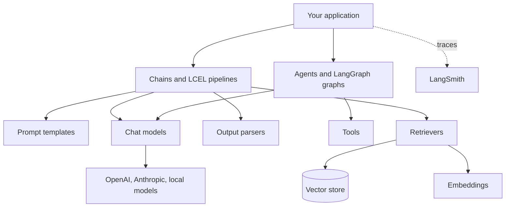

---

## 2. Chat Models & Messages

### ❓ How do you call an LLM with LangChain?
**Answer:**
```python
from langchain_openai import ChatOpenAI

llm = ChatOpenAI(model="gpt-4o-mini", temperature=0)   # reads OPENAI_API_KEY from env
response = llm.invoke("Explain Kafka in one sentence.")
print(response.content)          # AIMessage; .content holds the text
```
Key idea: every chat model implements the same **Runnable** interface (`invoke`, `stream`, `batch`, and async variants), so you can swap providers with minimal change.

---

### ❓ What are message types?
**Answer:**
| Message | Role | Use |
|---|---|---|
| `SystemMessage` | system | Instructions / persona |
| `HumanMessage` | user | User input |
| `AIMessage` | assistant | Model output (may include `tool_calls`) |
| `ToolMessage` | tool | Result of a tool execution, linked by `tool_call_id` |

```python
from langchain_core.messages import SystemMessage, HumanMessage, AIMessage

messages = [
    SystemMessage(content="You are a concise assistant."),
    HumanMessage(content="What is a B-tree?"),
]
ai = llm.invoke(messages)        # returns AIMessage
messages.append(ai)              # keep history for the next turn
```

---

### ❓ What are common model parameters?
**Answer:**
- `model` — model name.
- `temperature` — randomness (0 = more deterministic).
- `max_tokens` — cap on output length.
- `timeout`, `max_retries` — network reliability.
- `streaming=True` — enables token streaming.

---

## 3. Prompt Templates

### ❓ What is a prompt template and how do you use it?
**Answer:**
A prompt template is a reusable prompt with variables. It produces the list of messages (or a string) the model consumes.
```python
from langchain_core.prompts import ChatPromptTemplate

prompt = ChatPromptTemplate.from_messages([
    ("system", "You are a {role}. Answer in at most {max_words} words."),
    ("human", "{question}"),
])

messages = prompt.invoke({"role": "Java expert", "max_words": 30, "question": "What is the GIL?"})
```
Variants: `PromptTemplate.from_template("...")` for plain string prompts; `MessagesPlaceholder("history")` to inject a variable-length list of messages.

---

### ❓ What is `MessagesPlaceholder` for?
**Answer:**
It inserts a list of past messages (chat history) or intermediate agent steps (`agent_scratchpad`) at a specific position in the prompt.
```python
from langchain_core.prompts import MessagesPlaceholder

prompt = ChatPromptTemplate.from_messages([
    ("system", "You are a helpful assistant."),
    MessagesPlaceholder("history"),
    ("human", "{input}"),
])
```

---

## 4. LCEL & the Runnable Interface

### ❓ What is LCEL (LangChain Expression Language)?
**Answer:**
LCEL composes components with the `|` operator into a **pipeline**. Each piece is a `Runnable`; the output of one becomes the input of the next. Every LCEL chain automatically gets `invoke`, `batch`, `stream`, and `ainvoke` support.
```python
from langchain_core.output_parsers import StrOutputParser

chain = prompt | llm | StrOutputParser()
chain.invoke({"role": "Java expert", "max_words": 30, "question": "What is the GIL?"})
```

### 📊 Diagram — LCEL pipeline

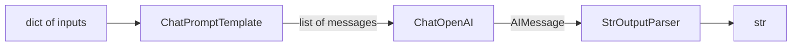

---

### ❓ What are the Runnable methods?
**Answer:**
| Method | Behavior |
|---|---|
| `invoke(input)` | One input → one output |
| `batch([inputs])` | Many inputs, parallelized where possible |
| `stream(input)` | Yields chunks as they arrive |
| `ainvoke`, `abatch`, `astream` | Async equivalents |
| `with_retry`, `with_fallbacks` | Wrap a runnable with resilience |
| `bind(**kwargs)` | Pre-bind arguments (e.g., `stop=[...]`) |

```python
for chunk in chain.stream({"role": "tutor", "max_words": 50, "question": "What is a mutex?"}):
    print(chunk, end="", flush=True)

chain.batch([{...}, {...}])   # parallel execution
```

---

### ❓ Explain `RunnableParallel`, `RunnablePassthrough`, and `RunnableLambda`.
**Answer:**
```python
from langchain_core.runnables import RunnableParallel, RunnablePassthrough, RunnableLambda

# Run branches in parallel and collect results into a dict
analysis = RunnableParallel(
    summary=summary_chain,
    keywords=keyword_chain,
    original=RunnablePassthrough(),          # forward input unchanged
)
analysis.invoke({"text": "..."})   # {'summary': ..., 'keywords': ..., 'original': {...}}

# Wrap a plain Python function as a Runnable
def word_count(text: str) -> int:
    return len(text.split())

count_chain = RunnableLambda(word_count)
```
- `RunnablePassthrough` — identity; `RunnablePassthrough.assign(new_key=...)` adds keys.
- `RunnableLambda` — turns any function into a pipeline step.
- `RunnableParallel` (or dict literal in a pipe) — fan-out + merge.

---

## 5. Output Parsers & Structured Output

### ❓ What are output parsers?
**Answer:**
They convert raw `AIMessage` content into a usable Python type.
| Parser | Output |
|---|---|
| `StrOutputParser` | plain `str` |
| `JsonOutputParser` | `dict` parsed from JSON |
| `PydanticOutputParser` | Pydantic model instance (formatting instructions injected in prompt) |
| `CommaSeparatedListOutputParser` | `list[str]` |

---

### ❓ How do you get reliably structured output?
**Answer:**
The preferred way is **`with_structured_output`**, which uses the provider's native structured-output / function-calling support:
```python
from typing import Literal
from pydantic import BaseModel, Field

class Ticket(BaseModel):
    title: str = Field(description="Short summary of the issue")
    priority: Literal["low", "medium", "high"]
    component: str

structured_llm = llm.with_structured_output(Ticket)
ticket = structured_llm.invoke("Login button crashes the app on Safari 17")
print(ticket.priority)     # typed access, validated by Pydantic
```
**Interview point:** Native structured output is more reliable than asking for JSON in the prompt and parsing text. Always validate with Pydantic; handle `ValidationError` with a retry or fallback.

---

## 6. Tools & Tool Calling

### ❓ What is tool calling (function calling)?
**Answer:**
The LLM does **not** execute code. It returns a structured request (`tool_calls`: name + arguments). Your code runs the tool and sends the result back as a `ToolMessage`; the model then produces the final answer.

### 📊 Diagram — Tool-calling loop

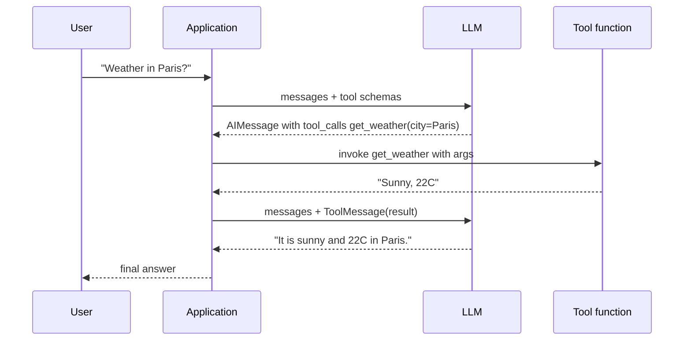

---

### ❓ How do you define a tool in LangChain?
**Answer:**
Use the `@tool` decorator. The **docstring** becomes the description the model sees; type hints define the argument schema.
```python
from langchain_core.tools import tool

@tool
def get_weather(city: str) -> str:
    """Get the current weather for a city."""
    return f"Sunny, 22C in {city}"

get_weather.invoke({"city": "Paris"})   # callable directly for testing
get_weather.name                        # 'get_weather'
```
For richer schemas use a Pydantic `args_schema` on the tool.

---

### ❓ How do you bind tools to a model and run the loop manually?
**Answer:**
```python
from langchain_core.messages import HumanMessage, ToolMessage

llm_with_tools = llm.bind_tools([get_weather])
messages = [HumanMessage(content="Weather in Paris?")]

ai = llm_with_tools.invoke(messages)
messages.append(ai)

for call in ai.tool_calls:                     # [{'name', 'args', 'id'}]
    result = get_weather.invoke(call["args"])
    messages.append(ToolMessage(content=result, tool_call_id=call["id"]))

final = llm_with_tools.invoke(messages)
print(final.content)
```
Agents automate this loop (see sections 9 and 10).

---

## 7. Memory / Chat History

### ❓ How do you give an LLM memory of a conversation?
**Answer:**
An LLM is stateless — "memory" means **you resend the relevant history** every turn. LangChain modern approach: `RunnableWithMessageHistory` wraps a chain and loads/stores history per session.
```python
from langchain_core.chat_history import InMemoryChatMessageHistory
from langchain_core.runnables.history import RunnableWithMessageHistory
from langchain_core.prompts import ChatPromptTemplate, MessagesPlaceholder

prompt = ChatPromptTemplate.from_messages([
    ("system", "You are a helpful assistant."),
    MessagesPlaceholder("history"),
    ("human", "{input}"),
])
chain = prompt | llm | StrOutputParser()

store: dict[str, InMemoryChatMessageHistory] = {}

def get_session_history(session_id: str) -> InMemoryChatMessageHistory:
    if session_id not in store:
        store[session_id] = InMemoryChatMessageHistory()
    return store[session_id]

with_history = RunnableWithMessageHistory(
    chain,
    get_session_history,
    input_messages_key="input",
    history_messages_key="history",
)

with_history.invoke({"input": "My name is Ann"}, config={"configurable": {"session_id": "s1"}})
with_history.invoke({"input": "What is my name?"}, config={"configurable": {"session_id": "s1"}})
```

---

### ❓ Memory types — what are they and what replaced ConversationBufferMemory?
**Answer:**
| Type | Behavior | Trade-off |
|---|---|---|
| **Buffer** | Keep all messages | Token cost grows linearly |
| **Window** | Keep last *k* messages | Forgets early context |
| **Summary** | LLM summarizes old turns | Cheaper; may lose detail |
| **Summary + buffer** | Summary of old + recent raw | Balanced |
| **Vector / entity memory** | Store facts and retrieve by similarity | More complex; needs a store |

`ConversationBufferMemory` and similar legacy classes are **deprecated** in LangChain 0.3. Use `RunnableWithMessageHistory` for simple chats, or **LangGraph checkpointers** (section 10) for persistent, multi-step agent state.

---

## 8. RAG — Retrieval-Augmented Generation

### ❓ What is RAG and why use it?
**Answer:**
RAG injects **relevant external knowledge** into the prompt at query time, so the model can answer from your data without fine-tuning. Benefits: fresher data, fewer hallucinations (answers cite sources), and per-user or private data stays out of model weights.

### 📊 Diagram — RAG pipeline (ingestion and query)

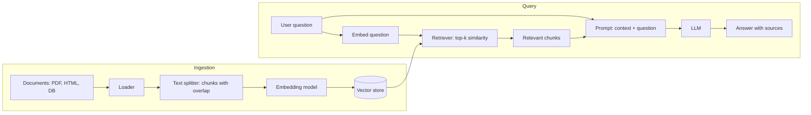

---

### ❓ Walk through the RAG components in code.
**Answer:**
```python
from langchain_community.document_loaders import PyPDFLoader
from langchain_text_splitters import RecursiveCharacterTextSplitter
from langchain_openai import OpenAIEmbeddings
from langchain_community.vectorstores import FAISS

# 1. Load
docs = PyPDFLoader("handbook.pdf").load()

# 2. Split (overlap keeps context across chunk boundaries)
splitter = RecursiveCharacterTextSplitter(chunk_size=800, chunk_overlap=120)
chunks = splitter.split_documents(docs)

# 3. Embed + store
embeddings = OpenAIEmbeddings(model="text-embedding-3-small")
vectorstore = FAISS.from_documents(chunks, embeddings)

# 4. Retrieve
retriever = vectorstore.as_retriever(search_kwargs={"k": 4})
retriever.invoke("What is the vacation policy?")
```

---

### ❓ How do you build the RAG chain with LCEL?
**Answer:**
```python
from langchain_core.runnables import RunnablePassthrough
from langchain_core.output_parsers import StrOutputParser
from langchain_core.prompts import ChatPromptTemplate

def format_docs(docs):
    return "\n\n".join(d.page_content for d in docs)

rag_prompt = ChatPromptTemplate.from_messages([
    ("system", "Answer ONLY from the context. If unknown, say you don't know.\n\nContext:\n{context}"),
    ("human", "{question}"),
])

rag_chain = (
    {"context": retriever | format_docs, "question": RunnablePassthrough()}
    | rag_prompt
    | llm
    | StrOutputParser()
)
rag_chain.invoke("What is the vacation policy?")
```
Interview points:
- **Chunk size**: too small loses context; too large dilutes relevance and costs tokens. Typical 300–1000 tokens with 10–20% overlap.
- **Top-k** and **re-ranking** (cross-encoder) improve precision.
- **Hybrid search** (BM25 + vectors) helps with exact terms like IDs.
- **Evaluation**: measure retrieval recall and answer faithfulness (LangSmith / RAGAS).

---

### ❓ What are common RAG failure modes?
**Answer:**
| Symptom | Likely cause | Fix |
|---|---|---|
| Irrelevant answers | Poor chunking or embeddings | Tune chunk size, try better embedding model |
| Answer missing facts that exist | Top-k too small, no overlap | Increase k, overlap, add hybrid search |
| Hallucinated answer | Context too noisy or prompt too loose | Stricter prompt, re-rank, cite sources |
| Slow queries | Large index, no ANN index | Use ANN index (HNSW) in the vector DB |
| Stale answers | No re-ingestion pipeline | Incremental indexing with timestamps |

---

## 9. Agents in LangChain

### ❓ What is an agent?
**Answer:**
An agent is an LLM in a **loop** that decides what to do next: call a tool, observe the result, and repeat until it can answer. The model chooses the control flow at runtime (contrast with a fixed chain whose steps are predetermined).

### 📊 Diagram — Agent loop (ReAct style)

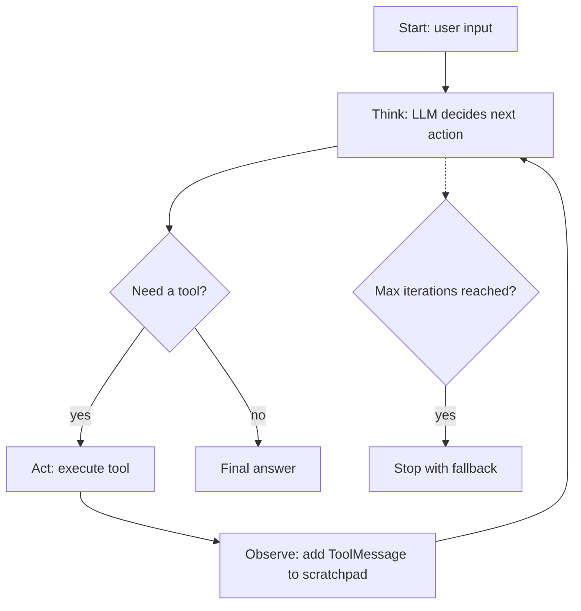

---

### ❓ How do you create an agent with `AgentExecutor` (classic LangChain)?
**Answer:**
```python
from langchain.agents import create_tool_calling_agent, AgentExecutor
from langchain_core.prompts import ChatPromptTemplate, MessagesPlaceholder

prompt = ChatPromptTemplate.from_messages([
    ("system", "You are a helpful assistant. Use tools when needed."),
    ("human", "{input}"),
    MessagesPlaceholder("agent_scratchpad"),     # where tool steps are injected
])

agent = create_tool_calling_agent(llm, [get_weather], prompt)
executor = AgentExecutor(agent=agent, tools=[get_weather], max_iterations=5, verbose=True)

executor.invoke({"input": "What's the weather in Paris and Rome?"})
```
`AgentExecutor` runs the loop, enforces `max_iterations`, and handles tool errors (`handle_parsing_errors=True`).

---

### ❓ What are the agent types you should know?
**Answer:**
| Type | How it decides | Notes |
|---|---|---|
| **Tool calling** (recommended) | Native function calling from the model | Most reliable with modern models |
| **ReAct** | Text format `Thought / Action / Observation` | Works with models lacking tool calling; more fragile |
| **Plan-and-execute** | Plan first, then execute steps | Good for long multi-step tasks |

---

## 10. LangGraph — Stateful Agents & Workflows

### ❓ What is LangGraph and why did it appear?
**Answer:**
LangGraph models an application as a **graph of nodes** that read and write a shared **state**, connected by edges (including conditional edges and loops). It gives explicit control over cycles, branching, persistence, human-in-the-loop, and multi-agent coordination. The classic `AgentExecutor` is hard to customize; LangGraph is the recommended way to build production agents in LangChain.

---

### ❓ How do you define a LangGraph with state, nodes, and edges?
**Answer:**
```python
from typing import Annotated, TypedDict
from langgraph.graph import StateGraph, START, END
from langgraph.graph.message import add_messages

class State(TypedDict):
    messages: Annotated[list, add_messages]     # reducer: appends instead of overwriting

def chatbot(state: State):
    reply = llm.invoke(state["messages"])
    return {"messages": [reply]}                # node returns a partial state update

builder = StateGraph(State)
builder.add_node("chatbot", chatbot)
builder.add_edge(START, "chatbot")
builder.add_edge("chatbot", END)

graph = builder.compile()
graph.invoke({"messages": [("user", "Hi, who are you?")]})
```
Key concepts: **State** (shared schema), **Reducer** (how updates merge, e.g., `add_messages`), **Nodes** (functions), **Edges** (control flow).

---

### 📊 Diagram — Tool-using agent as a LangGraph

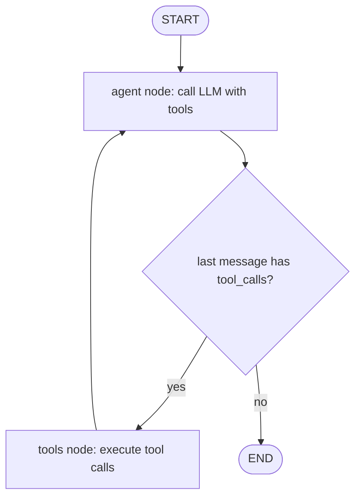

```python
from langgraph.prebuilt import ToolNode, tools_condition

llm_with_tools = llm.bind_tools([get_weather])

def agent(state: State):
    return {"messages": [llm_with_tools.invoke(state["messages"])]}

builder = StateGraph(State)
builder.add_node("agent", agent)
builder.add_node("tools", ToolNode([get_weather]))
builder.add_edge(START, "agent")
builder.add_conditional_edges("agent", tools_condition)   # routes to "tools" or END
builder.add_edge("tools", "agent")
graph = builder.compile()
```
Or simply: `from langgraph.prebuilt import create_react_agent; agent = create_react_agent(llm, [get_weather])`.

---

### ❓ How does persistence work in LangGraph? (Checkpointers)
**Answer:**
A **checkpointer** saves the state after each node, keyed by a `thread_id`. This enables:
- Multi-turn memory across requests
- Resuming after crashes
- Time travel / inspecting past states
- Human-in-the-loop pauses

```python
from langgraph.checkpoint.memory import MemorySaver

graph = builder.compile(checkpointer=MemorySaver())   # use Postgres/Redis checkpointers in prod
config = {"configurable": {"thread_id": "user-42"}}

graph.invoke({"messages": [("user", "My name is Ann")]}, config)
graph.invoke({"messages": [("user", "What's my name?")]}, config)   # remembers
```

---

### ❓ How do you add human-in-the-loop approval?
**Answer:**
Compile the graph with `interrupt_before` a sensitive node; execution pauses, and you resume after approval.
```python
graph = builder.compile(checkpointer=MemorySaver(), interrupt_before=["tools"])

config = {"configurable": {"thread_id": "t1"}}
graph.invoke({"messages": [("user", "Refund order 123")]}, config)   # pauses before tools

# after a human approves:
graph.invoke(None, config)     # resumes from the checkpoint
```

---

### ❓ What is a multi-agent pattern in LangGraph?
**Answer:**
- **Supervisor**: a router node decides which specialist agent runs next.
- **Network / swarm**: agents hand off control to each other.
- **Hierarchical**: supervisors of supervisors.

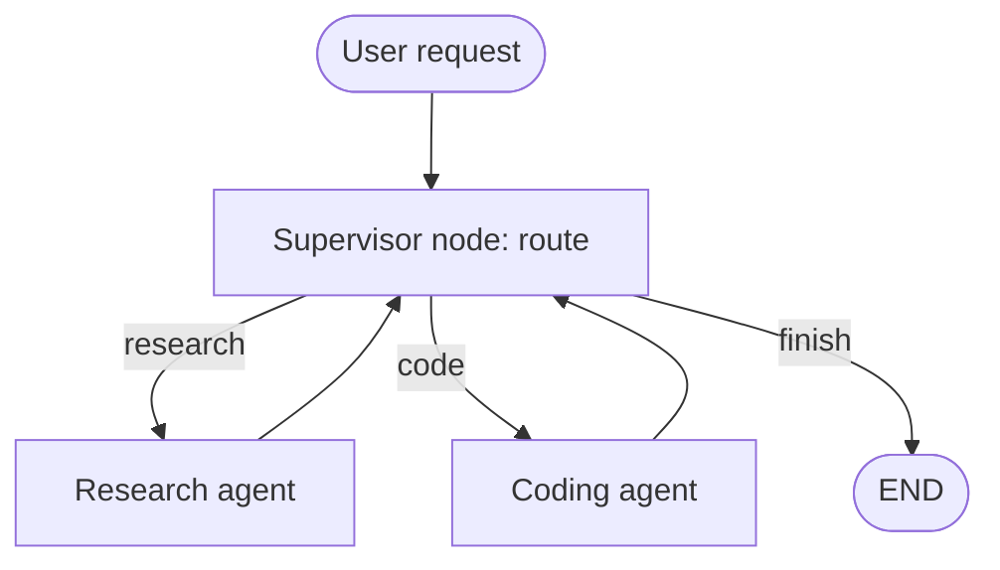

---

## 11. Callbacks, Tracing & Observability

### ❓ What are callbacks in LangChain?
**Answer:**
Callbacks are hooks invoked at lifecycle events (LLM start/end, tool start/end, chain start/end, errors). They power logging, metrics, streaming UIs, and tracing. Pass them via `config={"callbacks": [...]}` or set them on the model.

```python
from langchain_core.callbacks import BaseCallbackHandler

class TokenCounter(BaseCallbackHandler):
    def on_llm_end(self, response, **kwargs):
        usage = response.llm_output or {}
        print("token usage:", usage.get("token_usage"))

chain.invoke({"role": "tutor", "max_words": 20, "question": "..."},
             config={"callbacks": [TokenCounter()]})
```

---

### ❓ How do you trace and debug LLM apps in production?
**Answer:**
Use **LangSmith**. Enable with environment variables (newer names `LANGSMITH_*`; older `LANGCHAIN_*` also work):
```bash
export LANGSMITH_TRACING=true
export LANGSMITH_API_KEY=...
export LANGSMITH_PROJECT=my-rag-app
```
Every chain/agent run then appears as a trace tree: inputs, outputs, latency, token usage, tool calls, and errors. Traces are the fastest way to debug "why did the agent do that?" questions. Use LangSmith datasets and evaluators to regression-test prompts.

---

## 12. Reliability: Retries, Fallbacks, Caching, Cost

### ❓ How do you make LLM calls resilient?
**Answer:**
```python
from langchain_openai import ChatOpenAI
from langchain_anthropic import ChatAnthropic   # optional fallback provider

primary = ChatOpenAI(model="gpt-4o", timeout=30, max_retries=2)
backup = ChatAnthropic(model="claude-3-5-haiku-latest")

resilient = primary.with_fallbacks([backup])     # switch provider on failure
resilient_retry = primary.with_retry(stop_after_attempt=3)
```

---

### ❓ How do you cache LLM responses?
**Answer:**
```python
from langchain_core.globals import set_llm_cache
from langchain_core.caches import InMemoryCache

set_llm_cache(InMemoryCache())   # identical prompts return cached responses
```
For production use a persistent cache (Redis / SQLite cache from `langchain-community`). Caching saves cost and latency for repeated prompts; it doesn't help with unique user queries.

---

### ❓ How do you control cost and latency?
**Answer:**
- Use **smaller models** for simple steps (routing, classification) and larger ones for reasoning.
- **Limit context**: top-k retrieval, summary memory, truncate tool outputs.
- **Stream** responses for better perceived latency.
- **Batch** independent calls with `batch()` / `abatch()`.
- **Cache** deterministic prompts.
- Track token usage per run (callbacks / LangSmith).
- Set `max_tokens` and an agent `max_iterations` / recursion limit to bound runaway loops.

---

## Part B — OpenAI Agents SDK

## 13. What is the OpenAI Agents SDK? Core Primitives

### ❓ What is the OpenAI Agents SDK?
**Answer:**
The `openai-agents` Python package is OpenAI's lightweight framework for building **agentic applications** on top of the OpenAI Responses API. It is intentionally small — a few primitives plus a built-in run loop — and it's Python-first and provider-agnostic in design (other models can be plugged in through adapters).

Install: `pip install openai-agents` and set `OPENAI_API_KEY`.

---

### ❓ What are the core primitives?
**Answer:**
| Primitive | What it is |
|---|---|
| **Agent** | An LLM with `instructions`, `model`, `tools`, `handoffs`, guardrails, and optional `output_type` |
| **Runner** | Executes the agent loop (`run`, `run_sync`, `run_streamed`) |
| **Tools** | Function tools (Python functions), hosted tools (WebSearch, FileSearch, CodeInterpreter), agents-as-tools |
| **Handoffs** | Transfer control of the conversation to another agent |
| **Guardrails** | Input / output validation that can halt a run (tripwire) |
| **Sessions** | Automatic conversation history management |
| **Tracing** | Built-in traces of LLM calls, tool calls, handoffs, guardrails |
| **Context** | Local dependency object passed to tools and hooks (not sent to the LLM) |

### 📊 Diagram — Agents SDK building blocks

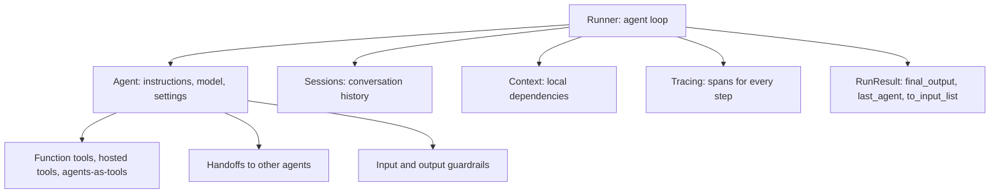

---

## 14. Agents & the Runner

### ❓ How do you create and run an agent?
**Answer:**
```python
from agents import Agent, Runner

agent = Agent(
    name="Math Tutor",
    instructions="You explain math concepts step by step, briefly.",
    model="gpt-4o-mini",
)

result = Runner.run_sync(agent, "Explain the chain rule in two sentences.")  # sync
print(result.final_output)

# async version
import asyncio
async def main():
    result = await Runner.run(agent, "What is a derivative?")
    print(result.final_output)
asyncio.run(main())
```

| Runner method | Behavior |
|---|---|
| `Runner.run_sync(agent, input)` | Blocking convenience wrapper |
| `await Runner.run(agent, input)` | Async run, returns `RunResult` |
| `Runner.run_streamed(agent, input)` | Returns a streaming result you iterate over |

---

### ❓ What happens inside `Runner.run`?
**Answer:**
1. Calls the model with instructions, history, and tool schemas.
2. If the model returns **tool calls**, runs the tools and appends results → loop again.
3. If the model triggers a **handoff**, switches the active agent → loop again.
4. If the model returns a **final output** (text or `output_type`), returns a `RunResult`.
5. Guardrails run at input (first agent) and output (final agent); a tripwire raises an exception.
6. If `max_turns` is exceeded, raises `MaxTurnsExceeded`.

### 📊 Diagram — Agents SDK run loop

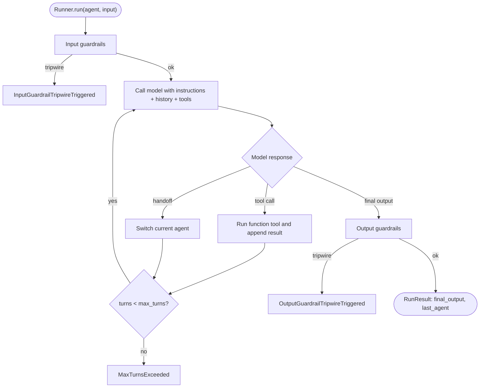

---

### ❓ What does `RunResult` contain?
**Answer:**
- `final_output` — the final answer (string or the `output_type` instance).
- `last_agent` — the agent that produced the final output (important after handoffs).
- `new_items` / `raw_responses` — detailed steps for debugging.
- `to_input_list()` — the full conversation as input for the next turn (manual memory).

```python
result = await Runner.run(agent, "Hi")
history = result.to_input_list()                                   # carry context forward
result2 = await Runner.run(agent, history + [{"role": "user", "content": "Continue"}])
```

---

### ❓ How are `instructions` specified? Can they be dynamic?
**Answer:**
Static strings work, and `instructions` can also be a function that receives the run context and returns a string, which is useful for per-user personalization.
```python
def dynamic_instructions(wrapper, agent) -> str:
    return f"You help user {wrapper.context.user_id}. Be concise."

agent = Agent(name="Support", instructions=dynamic_instructions, model="gpt-4o-mini")
```

---

### ❓ How do you tune model settings?
**Answer:**
```python
from agents import Agent, ModelSettings

agent = Agent(
    name="Writer",
    instructions="Write marketing copy.",
    model="gpt-4o",
    model_settings=ModelSettings(temperature=0.8, max_tokens=300),
)
```

---

## 15. Function Tools & Hosted Tools

### ❓ How do you define a function tool?
**Answer:**
Decorate a Python function with `@function_tool`. The SDK builds the JSON schema from type hints and uses the docstring as the description.
```python
from agents import Agent, Runner, function_tool

@function_tool
def get_order_status(order_id: str) -> str:
    """Look up the shipping status of an order by its ID."""
    return f"Order {order_id} shipped yesterday."

support = Agent(
    name="Support",
    instructions="Use tools to answer order questions.",
    tools=[get_order_status],
)
print(Runner.run_sync(support, "Where is order A123?").final_output)
```

**Interview points:**
- Tool errors: an exception inside a tool is reported back to the model as an error result (configurable via a custom error function), so the agent can recover.
- Keep tool functions **small, deterministic, and side-effect-aware** — mark or confirm destructive actions.
- Tools can be `async def` too.

---

### ❓ What are hosted tools?
**Answer:**
Tools executed by OpenAI's infrastructure, not your process:
- `WebSearchTool` — live web search.
- `FileSearchTool` — search over vector stores you've created in OpenAI.
- `CodeInterpreterTool` — sandboxed Python execution.
- Computer / image tools (availability depends on model and SDK version).

```python
from agents import Agent, WebSearchTool

researcher = Agent(
    name="Researcher",
    instructions="Search the web and cite sources.",
    tools=[WebSearchTool()],
)
```

---

## 16. Handoffs (Multi-Agent Routing)

### ❓ What is a handoff?
**Answer:**
A handoff transfers the **whole conversation** from one agent to another; the receiving agent becomes the active one and responds to the user. The original agent doesn't keep control afterward (unless handed back). Use handoffs for **routing / delegation to specialists**.

```python
from agents import Agent, Runner

billing = Agent(name="Billing", instructions="Resolve billing and invoice questions.")
tech = Agent(name="Technical", instructions="Troubleshoot technical issues.")

triage = Agent(
    name="Triage",
    instructions="Route the user to Billing or Technical. Do not answer yourself.",
    handoffs=[billing, tech],
)

result = Runner.run_sync(triage, "I was charged twice this month.")
print(result.last_agent.name)     # "Billing"
print(result.final_output)
```

### 📊 Diagram — Triage with handoffs

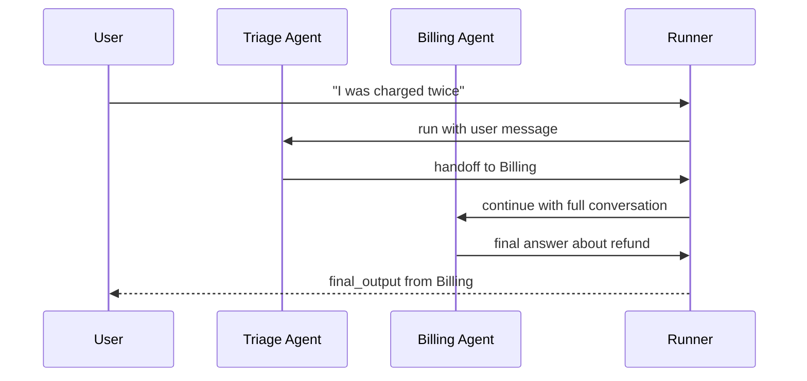

---

### ❓ How do you customize a handoff?
**Answer:**
Use `handoff()` to add a name/description, an input type, or an `on_handoff` callback (e.g., to log the handoff or pre-fetch data).
```python
from agents import handoff
from pydantic import BaseModel

class EscalationInfo(BaseModel):
    reason: str

def on_escalate(ctx, info: EscalationInfo):
    print("Escalating:", info.reason)

escalate = handoff(
    agent=tech,
    tool_name_override="escalate_to_tech",
    tool_description_override="Escalate when the issue needs engineering.",
    on_handoff=on_escalate,
    input_type=EscalationInfo,
)
triage = Agent(name="Triage", instructions="...", handoffs=[escalate, billing])
```

---

## 17. Agents as Tools

### ❓ How is "agents as tools" different from handoffs?
**Answer:**
| | Handoff | Agent as tool |
|---|---|---|
| Control | Transfers to the sub-agent | Caller **keeps control** |
| Output | Sub-agent answers the user | Sub-agent returns text to the caller as a tool result |
| Use case | Routing / specialists take over | Orchestrator composes results from helpers |

```python
from agents import Agent, Runner

translator = Agent(name="Translator", instructions="Translate the text into Spanish.")
summarizer = Agent(name="Summarizer", instructions="Summarize in one sentence.")

orchestrator = Agent(
    name="Orchestrator",
    instructions="Summarize the user's text, then translate the summary into Spanish.",
    tools=[
        summarizer.as_tool(tool_name="summarize", tool_description="Summarize text"),
        translator.as_tool(tool_name="translate", tool_description="Translate to Spanish"),
    ],
)
Runner.run_sync(orchestrator, "Long article text ...")
```

### 📊 Diagram — Handoff vs agent-as-tool

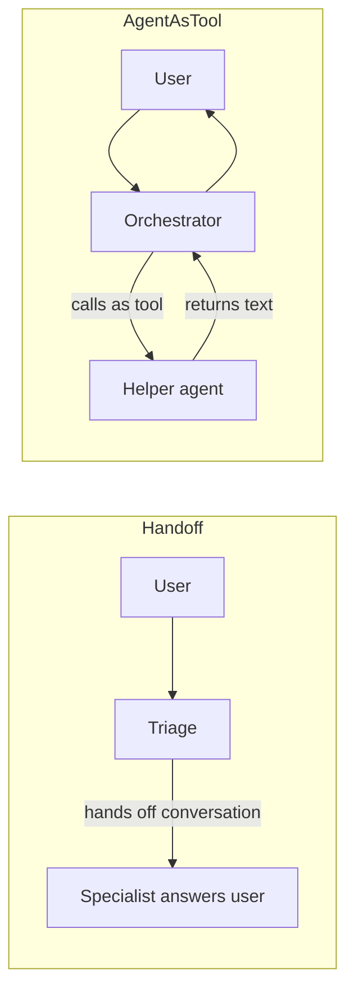

---

## 18. Guardrails

### ❓ What are guardrails and how do they work?
**Answer:**
Guardrails are checks that run **in parallel with or around** the agent to validate inputs or outputs. A guardrail returns `GuardrailFunctionOutput(tripwire_triggered=...)`. If the tripwire fires, the run is stopped with an exception so you can return a safe message.

- **Input guardrails** — run on the first agent's input (e.g., off-topic, PII, prompt injection).
- **Output guardrails** — run on the final output (e.g., policy violations, leaks).
- **Tool guardrails** — validate tool inputs/outputs (available in newer SDK versions).

```python
from pydantic import BaseModel
from agents import (
    Agent, Runner, GuardrailFunctionOutput, input_guardrail,
    InputGuardrailTripwireTriggered,
)

class HomeworkCheck(BaseModel):
    is_homework: bool
    reasoning: str

checker = Agent(
    name="Homework checker",
    instructions="Decide if the user is asking to do their homework.",
    output_type=HomeworkCheck,
)

@input_guardrail
async def homework_guardrail(ctx, agent, user_input):
    check = await Runner.run(checker, user_input)
    return GuardrailFunctionOutput(
        output_info=check.final_output,
        tripwire_triggered=check.final_output.is_homework,
    )

tutor = Agent(
    name="Tutor",
    instructions="Teach concepts; do not give homework answers.",
    input_guardrails=[homework_guardrail],
)

try:
    Runner.run_sync(tutor, "Solve my calculus homework: ...")
except InputGuardrailTripwireTriggered:
    print("Blocked: please ask a conceptual question instead.")
```

### 📊 Diagram — Guardrail flow

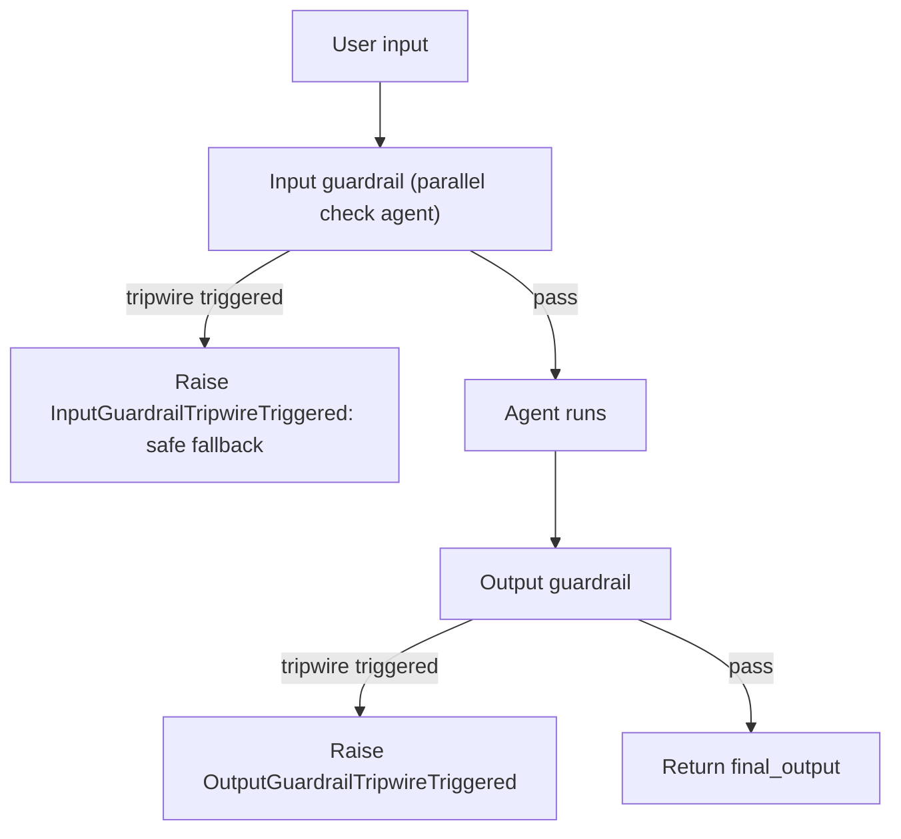

**Interview points:**
- Guardrails are **not** a substitute for authorization; enforce access control in tools/APIs.
- Input guardrails can run concurrently with the agent to cut latency (they only block the final result if tripped).
- Prompt injection defense = guardrails + least-privilege tools + never trusting tool/retrieved text as instructions.

---

## 19. Structured Output

### ❓ How do you get typed output from an agent?
**Answer:**
Set `output_type` to a Pydantic model (or a dataclass / TypedDict / primitive). The SDK enforces the schema and `final_output` is an instance of that type.
```python
from typing import Literal
from pydantic import BaseModel
from agents import Agent, Runner

class Ticket(BaseModel):
    title: str
    priority: Literal["low", "medium", "high"]

triage = Agent(
    name="Ticket extractor",
    instructions="Extract a support ticket from the user message.",
    output_type=Ticket,
)

ticket = Runner.run_sync(triage, "Checkout page 500s for all EU users").final_output
print(ticket.priority)   # typed access
```
**Interview point:** `output_type` makes the final answer a validated object instead of free text. Keep such agents focused on one job (extraction, classification) and let a parent agent or application code consume the typed result.

---

## 20. Context / Dependency Injection

### ❓ How do you pass per-run dependencies (user id, DB connection) to tools?
**Answer:**
Use a **context object**. It is available to tools and hooks through `RunContextWrapper`, but it is **never sent to the LLM**. This is the safe way to carry user identity or credentials.
```python
from dataclasses import dataclass
from agents import Agent, Runner, RunContextWrapper, function_tool

@dataclass
class UserContext:
    user_id: str
    is_premium: bool

@function_tool
def my_orders(wrapper: RunContextWrapper[UserContext]) -> str:
    """List the current user's recent orders."""
    return f"Orders for {wrapper.context.user_id}: [A1, B2]"

agent = Agent[UserContext](
    name="Shop assistant",
    instructions="Help the user with their orders.",
    tools=[my_orders],
)

result = Runner.run_sync(
    agent,
    "Show my orders",
    context=UserContext(user_id="u-17", is_premium=True),
)
```
**Interview point:** The LLM only sees tool **results**, so never trust the model to supply the user id — take it from the context (this prevents IDOR-style prompt manipulation).

---

## 21. Conversation Memory (Sessions)

### ❓ How do you keep multi-turn memory with the Agents SDK?
**Answer:**
Two approaches:

**1. Manual** — carry `to_input_list()` forward:
```python
history = []
for user_msg in ["My name is Ann", "What is my name?"]:
    history.append({"role": "user", "content": user_msg})
    result = Runner.run_sync(agent, history)
    history = result.to_input_list()
print(result.final_output)     # remembers "Ann"
```

**2. Sessions** — the SDK stores and reloads history for you (e.g., SQLite, in newer SDK versions):
```python
from agents import SQLiteSession

session = SQLiteSession("conversation-42")
Runner.run_sync(agent, "My name is Ann", session=session)
Runner.run_sync(agent, "What is my name?", session=session)
```
Sessions give you persistence across process restarts; for scale, implement a custom session backed by Redis/Postgres.

---

## 22. Streaming, Tracing & Limits

### ❓ How do you stream output from an agent?
**Answer:**
```python
import asyncio
from openai.types.responses import ResponseTextDeltaEvent
from agents import Agent, Runner

agent = Agent(name="Poet", instructions="Write short poems.")

async def main():
    result = Runner.run_streamed(agent, "Write a haiku about queues")
    async for event in result.stream_events():
        if event.type == "raw_response_event" and isinstance(event.data, ResponseTextDeltaEvent):
            print(event.data.delta, end="", flush=True)
    print()
    print("Final:", result.final_output)

asyncio.run(main())
```

---

### ❓ How does tracing work in the Agents SDK?
**Answer:**
Tracing is **on by default**: every run produces spans for agent execution, LLM generations, tool calls, handoffs, and guardrails, viewable in the OpenAI platform traces dashboard. You can group related runs into one trace and add custom spans:
```python
from agents import trace

async def pipeline(text: str):
    with trace("Support pipeline"):
        triage = await Runner.run(triage_agent, text)
        return triage.final_output
```
Disable for sensitive data or tests with the `OPENAI_AGENTS_DISABLE_TRACING=1` environment variable (or `set_tracing_disabled(True)`).

---

### ❓ What limits and safety knobs does the SDK provide?
**Answer:**
- `max_turns` on `Runner.run(...)` — caps the loop (default 10); raises `MaxTurnsExceeded`.
- Guardrails — block unsafe inputs or outputs.
- `tool_use_behavior` on an agent — e.g., stop as soon as a tool returns (useful for "tool-as-final-answer").
- `ModelSettings` — temperature, max tokens.
- Least-privilege tool design — read-only tools by default, confirmation for writes.

```python
result = Runner.run_sync(agent, "task", max_turns=6)
```

---

## Part C — Comparison, Scenarios & Revision

## 23. LangChain vs LangGraph vs OpenAI Agents SDK

### ❓ When would you choose LangChain, LangGraph, or the OpenAI Agents SDK?
**Answer:**
| Dimension | LangChain (LCEL) | LangGraph | OpenAI Agents SDK |
|---|---|---|---|
| **Core idea** | Composable pipelines of Runnables | Explicit state machine / graph | Lightweight agent loop with primitives |
| **Best for** | RAG pipelines, prompt chains, integrations | Complex, stateful, cyclic agents; human-in-the-loop | Quick, clean agents, handoffs, guardrails on OpenAI models |
| **Control flow** | Mostly linear / DAG | Explicit nodes, edges, loops | Model-driven loop with handoffs and tools |
| **Memory/persistence** | `RunnableWithMessageHistory` | Checkpointers (Postgres, Redis) | Sessions / `to_input_list()` |
| **Provider lock-in** | Provider-agnostic | Provider-agnostic | Optimized for OpenAI models |
| **Observability** | LangSmith | LangSmith | Built-in tracing (OpenAI platform) |
| **Learning curve** | Medium (lots of abstractions) | Higher | Low |

### 📊 Diagram — Choosing the right tool

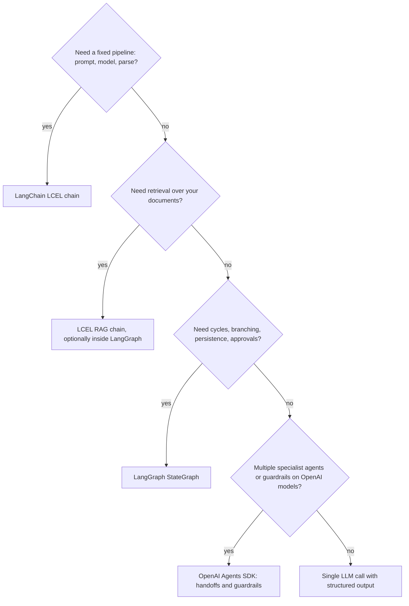

**Interview answer template:** "For a document Q&A feature I'd use an LCEL RAG chain for simplicity. If it grows into a multi-step workflow with approvals and retries, I'd move the orchestration into LangGraph. If the domain is mostly routing between specialist agents on OpenAI models, the Agents SDK's handoffs and guardrails give me that with less code."

---

## 24. Design Scenarios & Patterns

### ❓ Design a customer-support bot over company docs. What components do you use?
**Answer:**
- **Ingestion**: scheduled loaders → splitter → embeddings → vector DB (with metadata: product, version, date).
- **Retrieval**: hybrid search + top-k + re-ranking, filtered by user's tenant/permissions.
- **Generation**: LLM with a grounded system prompt, citations, and "I don't know" behavior.
- **Memory**: per-session history (windowed/summarized).
- **Escalation**: handoff/tool to create a ticket when confidence is low.
- **Guardrails**: PII redaction on input/output, topic restrictions.
- **Observability**: traces, feedback loop, offline eval set.

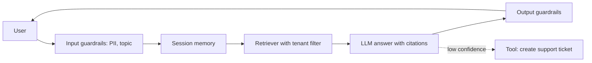

---

### ❓ How do you evaluate an LLM application?
**Answer:**
- **Offline eval sets**: curated question/answer pairs; track accuracy, faithfulness, groundedness.
- **RAG-specific metrics**: context precision/recall (retrieval) and answer relevance/faithfulness (generation). Frameworks: RAGAS, LangSmith evaluators.
- **LLM-as-judge**: a model grades outputs against a rubric (watch for bias; calibrate with human labels).
- **Regression tests** on every prompt/model change.
- **Online metrics**: thumbs up/down, deflection rate, latency, cost per answer.

---

### ❓ What are the main risks of LLM agents and how do you mitigate them?
**Answer:**
| Risk | Mitigation |
|---|---|
| Prompt injection via retrieved docs or user input | Treat retrieved text as data, not instructions; guardrails; least-privilege tools |
| Unauthorized actions | Confirmation step (human-in-the-loop) for writes; scoped credentials |
| Infinite loops / cost blowup | `max_turns`, `max_iterations`, recursion limits, token budgets |
| Hallucinated facts | RAG grounding, citations, "say you don't know" instructions |
| Data leakage across tenants | Filter retrieval by tenant; never let model choose the tenant id |
| Non-determinism | Temperature 0 where possible, structured output, evals |
| Tool errors | Return errors as tool results; retries with backoff; fallbacks |

---

### ❓ What is the difference between a workflow and an agent?
**Answer:**
- **Workflow**: the developer defines the steps and branches; LLMs fill in individual steps. Predictable, testable, cheaper.
- **Agent**: the LLM decides the next step dynamically using tools. Flexible but less predictable.

Rule of thumb: start with a **workflow** (or a single LLM call with RAG); add agency only where the path genuinely can't be predetermined.

---

### ❓ How do you handle long-running or async agent work in production?
**Answer:**
- Run agents as background jobs (queue + workers) and return a job id.
- Stream intermediate events to the client (SSE / WebSocket).
- Persist state with LangGraph checkpointers so jobs survive restarts.
- Use idempotency keys for tool calls that have side effects.

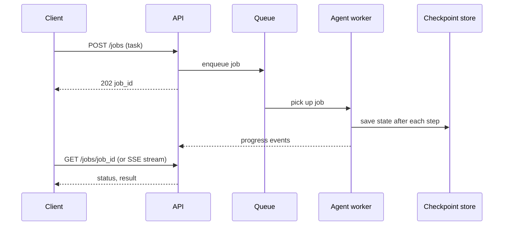

---

## 25. Hands-on Coding Scenarios

### ❓ Scenario 1: Build a minimal RAG chain that answers only from provided text.
**Answer:**
```python
from langchain_core.documents import Document
from langchain_core.prompts import ChatPromptTemplate
from langchain_core.runnables import RunnablePassthrough
from langchain_core.output_parsers import StrOutputParser
from langchain_community.vectorstores import FAISS
from langchain_openai import OpenAIEmbeddings, ChatOpenAI

docs = [
    Document(page_content="Refunds are processed within 5 business days.", metadata={"src": "policy"}),
    Document(page_content="Premium members get free shipping.", metadata={"src": "faq"}),
]
retriever = FAISS.from_documents(docs, OpenAIEmbeddings()).as_retriever(search_kwargs={"k": 2})

prompt = ChatPromptTemplate.from_messages([
    ("system", "Answer only from the context. If the answer is not there, say so.\n\n{context}"),
    ("human", "{question}"),
])

def fmt(docs):
    return "\n".join(d.page_content for d in docs)

chain = (
    {"context": retriever | fmt, "question": RunnablePassthrough()}
    | prompt
    | ChatOpenAI(model="gpt-4o-mini", temperature=0)
    | StrOutputParser()
)
print(chain.invoke("How long do refunds take?"))
```

---

### ❓ Scenario 2: Create a tool-using agent that looks up data and returns a typed answer.
**Answer:**
```python
from pydantic import BaseModel
from agents import Agent, Runner, function_tool

INVENTORY = {"SKU-1": 12, "SKU-2": 0}

@function_tool
def check_stock(sku: str) -> int:
    """Return the number of units in stock for a SKU."""
    return INVENTORY.get(sku, 0)

class StockAnswer(BaseModel):
    sku: str
    in_stock: bool
    units: int

agent = Agent(
    name="Stock assistant",
    instructions="Use check_stock to answer stock questions.",
    tools=[check_stock],
    output_type=StockAnswer,
)
answer = Runner.run_sync(agent, "Is SKU-2 available?").final_output
print(answer.in_stock)   # False
```

---

### ❓ Scenario 3: Triage agent that hands off to billing or tech, with a guardrail that blocks abuse.
**Answer:**
```python
from agents import Agent, Runner

billing = Agent(name="Billing", instructions="Handle invoices and refunds.")
tech = Agent(name="Tech", instructions="Handle technical problems step by step.")

triage = Agent(
    name="Triage",
    instructions="Route each request to Billing or Tech. Never answer directly.",
    handoffs=[billing, tech],
)

result = Runner.run_sync(triage, "The app crashes on login")
print(result.last_agent.name, "->", result.final_output)
```
Add an input guardrail (see section 18) to block abusive content before triage runs.

---

### ❓ Scenario 4: LangGraph agent with memory per user and a human approval before a write action.
**Answer:**
```python
from typing import Annotated, TypedDict
from langchain_core.tools import tool
from langchain_openai import ChatOpenAI
from langgraph.graph import StateGraph, START, END
from langgraph.graph.message import add_messages
from langgraph.checkpoint.memory import MemorySaver
from langgraph.prebuilt import ToolNode, tools_condition

llm = ChatOpenAI(model="gpt-4o-mini", temperature=0)

@tool
def refund_order(order_id: str) -> str:
    """Refund an order. Irreversible."""
    return f"Refunded {order_id}"

class State(TypedDict):
    messages: Annotated[list, add_messages]

llm_tools = llm.bind_tools([refund_order])

def agent(state: State):
    return {"messages": [llm_tools.invoke(state["messages"])]}

builder = StateGraph(State)
builder.add_node("agent", agent)
builder.add_node("tools", ToolNode([refund_order]))
builder.add_edge(START, "agent")
builder.add_conditional_edges("agent", tools_condition)
builder.add_edge("tools", "agent")

graph = builder.compile(checkpointer=MemorySaver(), interrupt_before=["tools"])
config = {"configurable": {"thread_id": "user-7"}}

graph.invoke({"messages": [("user", "Refund order 991")]}, config)   # pauses before the write
graph.invoke(None, config)                                            # resume after approval
```

---

## 26. Quick Revision Checklist

| Area | Key points |
|---|---|
| **Packages** | `langchain-core` (base), `langchain-openai`, `langchain-community`, `langgraph`, `langsmith` |
| **Messages** | System, Human, AI (`tool_calls`), Tool (`tool_call_id`) |
| **Prompts** | `ChatPromptTemplate`; `MessagesPlaceholder` for history / scratchpad |
| **LCEL** | `prompt \| llm \| parser`; `invoke`, `batch`, `stream`, async variants |
| **Runnables** | `RunnableParallel` (fan-out), `RunnablePassthrough`, `RunnableLambda` |
| **Structured output** | `llm.with_structured_output(PydanticModel)` |
| **Tools** | `@tool` (docstring = description); `bind_tools`; loop on `tool_calls` |
| **Memory** | LLM is stateless; `RunnableWithMessageHistory`; buffer / window / summary; LangGraph checkpointers |
| **RAG** | Load → split (overlap) → embed → vector store → retrieve top-k → grounded prompt |
| **RAG tuning** | Chunk size, top-k, re-ranking, hybrid search, evals (faithfulness, recall) |
| **Agents** | LLM loop: think → act (tool) → observe → repeat; bound with `max_iterations` |
| **LangGraph** | State + reducer (`add_messages`), nodes, edges, conditional edges, checkpointer, `interrupt_before` |
| **Observability** | Callbacks; LangSmith tracing via `LANGSMITH_*` env vars |
| **Reliability** | `with_retry`, `with_fallbacks`, LLM cache, `max_tokens`, timeouts |
| **Agents SDK primitives** | Agent, Runner, tools, handoffs, guardrails, sessions, tracing, context |
| **Runner** | `run` (async), `run_sync`, `run_streamed`; `RunResult.final_output`, `last_agent`, `to_input_list()` |
| **Function tools** | `@function_tool`; schema from type hints + docstring |
| **Handoffs** | Transfer the conversation; use `handoff()` to customize |
| **Agents as tools** | `agent.as_tool()`; caller keeps control |
| **Guardrails** | `@input_guardrail` / `@output_guardrail` → `GuardrailFunctionOutput(tripwire_triggered=...)` |
| **Structured output** | `output_type=PydanticModel` → typed `final_output` |
| **Context** | `Agent[Ctx]` + `RunContextWrapper[Ctx]`; never sent to LLM; take user identity from here |
| **Sessions / memory** | `to_input_list()` manually or `SQLiteSession` in newer SDKs |
| **Tracing** | On by default; `trace()` groups runs; `OPENAI_AGENTS_DISABLE_TRACING` to turn off |
| **Limits** | `max_turns` → `MaxTurnsExceeded`; `ModelSettings`; least-privilege tools |
| **Choosing** | LCEL for pipelines/RAG; LangGraph for stateful cyclic workflows; Agents SDK for handoffs/guardrails on OpenAI |
| **Design rule** | Start with a workflow; add agency only where needed; always evaluate and trace |
